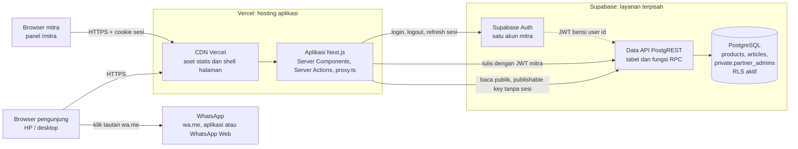
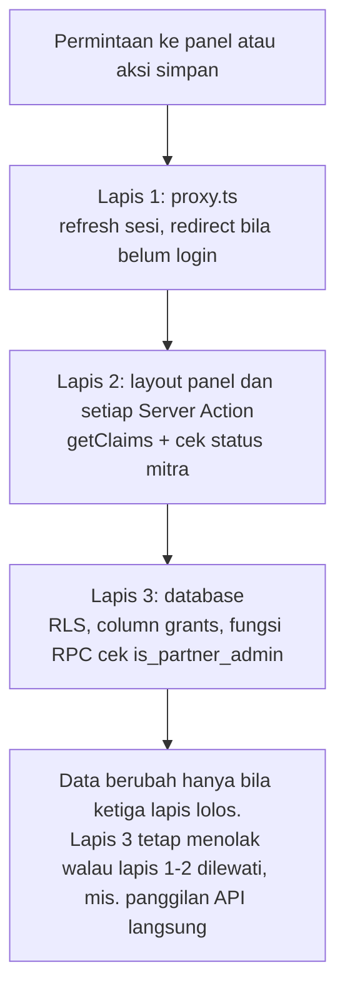
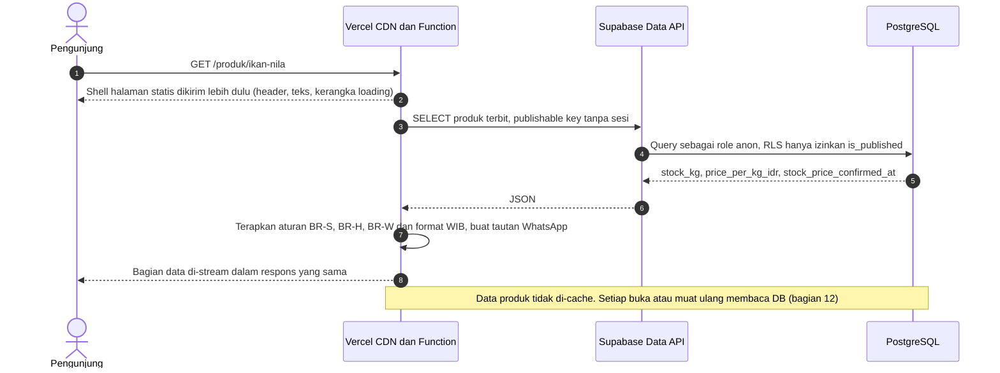
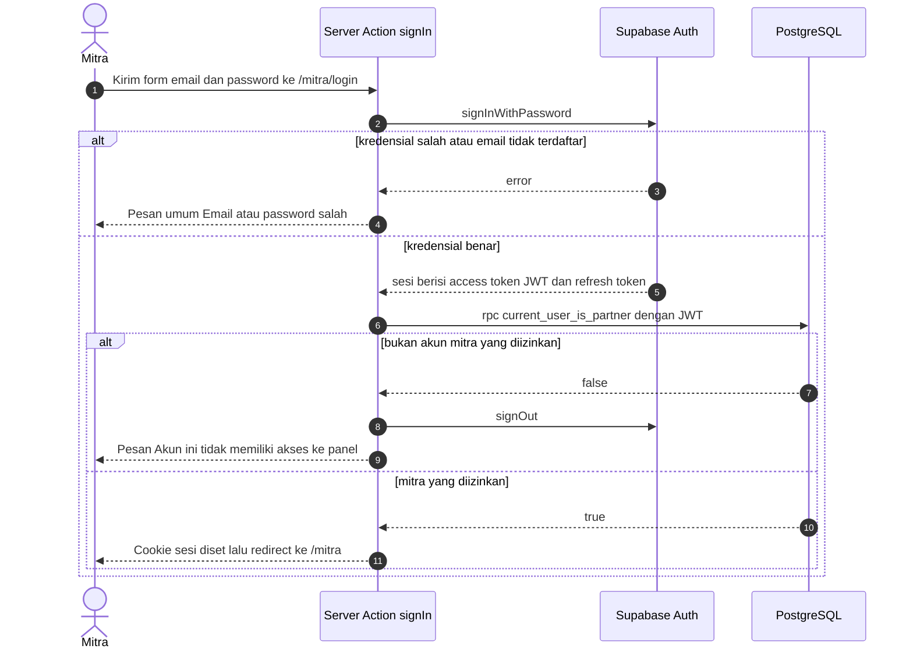
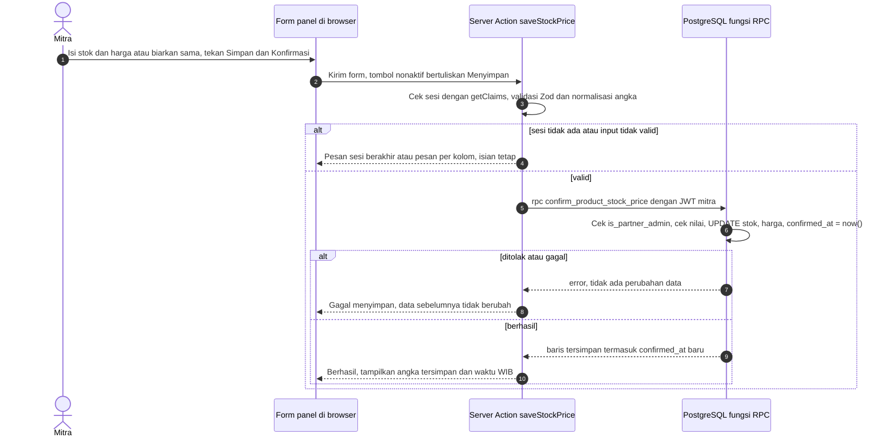
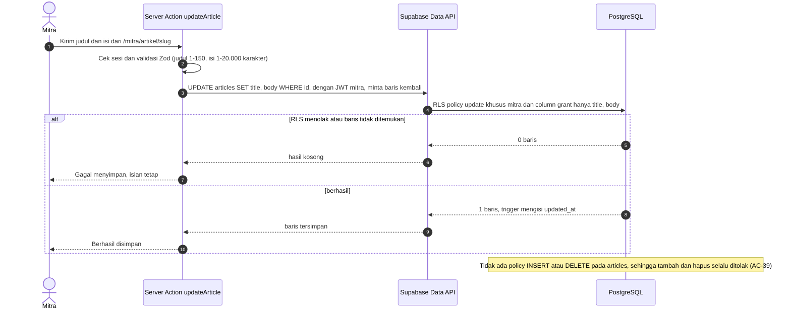
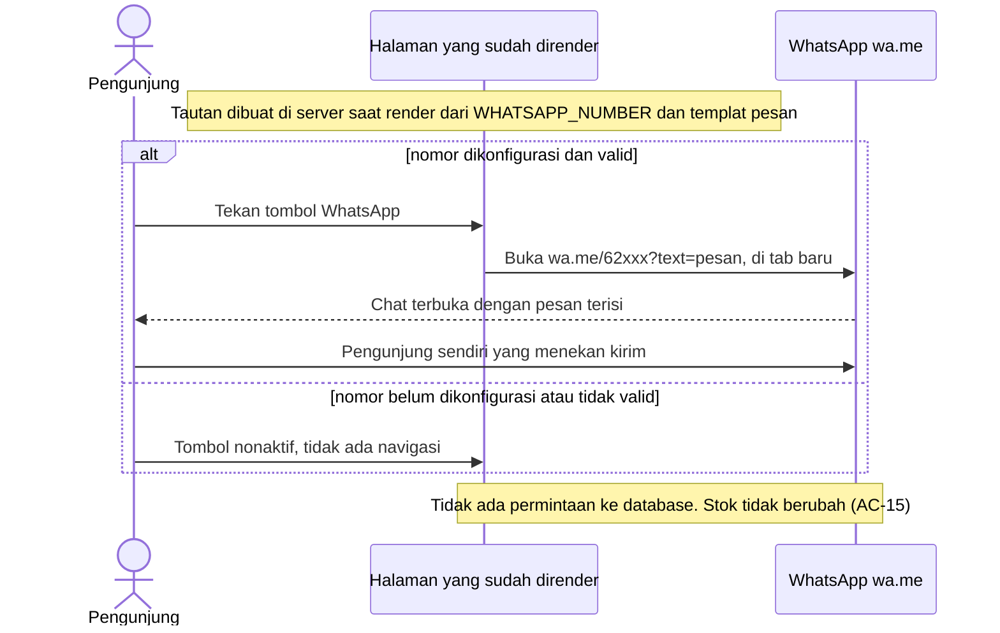
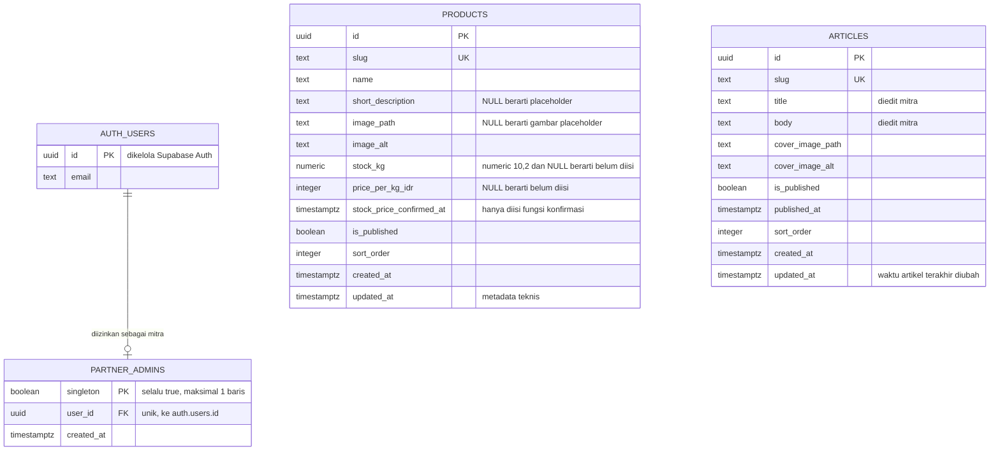

# ARCHITECTURE — Website Informasi & Promosi Usaha Ikan Nila

| Item | Keterangan |
|---|---|
| Versi dokumen | 0.1 (draf untuk ditinjau) |
| Tanggal | 17 November 2026 |
| Status | Usulan, menunggu persetujuan. **Belum ada kode, dependency, database, atau deployment yang dibuat.** |
| Dokumen terkait | [`PRD.md`](./PRD.md): kebutuhan produk. ID `A-xx` (asumsi), `Q-xx` (pertanyaan), `AC-xx` (acceptance criteria), dan `BR-xx` (aturan bisnis) merujuk ke PRD. |

Label status yang dipakai sama dengan PRD: **[Dikonfirmasi]**, **[Asumsi A-xx]**, **[Pertanyaan Q-xx]**, **[Saran]**.
Hampir semua keputusan teknis dalam dokumen ini berstatus **[Saran]** sampai disetujui.

Potongan SQL/kode di dokumen ini adalah **sketsa konseptual** untuk menjelaskan desain. Potongan itu
bukan migrasi atau kode final.

---

## 1. Rekomendasi stack dan alasan pemilihan

### 1.1 Stack yang direkomendasikan **[Saran]**

| Lapisan | Pilihan | Alasan |
|---|---|---|
| Framework (frontend + backend) | **Next.js 16.x (App Router) + TypeScript (strict)** | Satu basis kode untuk halaman publik, panel, dan logika server (Server Components & Server Actions). Halaman bisa dirender di server sehingga data stok terbaru tersaji tanpa API terpisah. Didukung native oleh Vercel. Versi dikunci saat scaffold. Per sumber sekunder, Next.js 16.4 (Oktober 2026) menjadikan *Cache Components* bawaan untuk aplikasi baru, dan dokumen ini dirancang untuk mode tersebut (§12). |
| Runtime | **Node.js** (bawaan Vercel, Fluid Compute) | Edge runtime tidak diperlukan dan sudah tidak direkomendasikan. |
| Database | **PostgreSQL via Supabase** (region Singapura, A-19) | Postgres mendukung `numeric` untuk stok desimal, `timestamptz` untuk waktu, `CHECK` constraint, fungsi, dan RLS. Data proyek ini sangat kecil (1 produk, 2 artikel). Dashboard Supabase berguna untuk administrasi darurat oleh pengembang. |
| Autentikasi | **Supabase Auth** (email + password, A-08) via `@supabase/ssr` | Satu penyedia untuk database + autentikasi. JWT pengguna dipakai langsung oleh RLS sehingga hak akses ditegakkan di database. Registrasi publik bisa dimatikan. |
| Otorisasi | **RLS + tabel allowlist satu baris + fungsi RPC** | Perlindungan di level database, bukan hanya di UI (§9). |
| Styling | **Tailwind CSS v4** | Ringan, tanpa runtime CSS, mudah dirawat untuk proyek kecil. Komponen UI dibuat sendiri dalam jumlah kecil. Pustaka komponen (mis. shadcn/ui) opsional, hanya bila mempercepat pembuatan form. |
| Validasi | **Zod** | Satu skema validasi di server untuk stok, harga, dan artikel. |
| Render artikel | **react-markdown** tanpa HTML mentah | Format dasar yang aman. HTML/skrip dari input tidak dijalankan (AC-40). |
| Gambar | **File statis di repo + `next/image`** | Cukup untuk MVP karena mitra tidak mengunggah foto (A-12). Supabase Storage baru dibutuhkan bila mitra perlu mengunggah foto (§14). |
| Pengujian | **Vitest** (unit), **pgTAP via `supabase test db`** (RLS/fungsi DB), **Playwright** (E2E, HP & desktop), **axe-core** (aksesibilitas) | Menguji aturan bisnis di setiap lapisan (§17). |
| Tooling DB | **Supabase CLI** + migrasi SQL di repo | Skema dapat direproduksi dan ditinjau lewat Git. |
| Hosting aplikasi | **Vercel** **[Dikonfirmasi]** | Target deployment yang disepakati. |

### 1.2 Mengapa usulan awal (Next.js + Supabase + Vercel + Tailwind) dipertahankan

1. **Sederhana untuk skala ini.** Tidak perlu server API terpisah, antrean, cache eksternal, atau CMS.
   Panel hanya berisi dua formulir.
2. **Hak akses aman tanpa secret key di aplikasi.** Semua penulisan dilakukan dengan sesi mitra (JWT) dan
   diperiksa RLS. Aplikasi di Vercel **tidak memerlukan** Supabase secret/service-role key sama sekali.
3. **Data terbaru mudah dijamin.** Server Components membaca database saat halaman diminta (§12).
4. **Kompatibel penuh dengan Vercel** dan biaya operasional rendah (lihat 1.4).

### 1.3 Perbandingan dengan teknologi Jokincay dan alternatif lain

| Aspek | Laravel 13 + Filament v3 + MySQL (stack Jokincay) | Next.js + Neon Postgres + Auth.js/Better Auth | **Next.js + Supabase (usulan)** |
|---|---|---|---|
| Kesederhanaan | Panel admin CRUD sangat cepat dibuat dengan Filament. Namun framework penuh dengan banyak fitur yang tidak terpakai. | Perlu merangkai sendiri tabel user, hash password, sesi, dan hak akses. | Auth + DB + RLS dalam satu layanan. Panel kustom kecil (2 form). |
| Pengalaman tim | Cocok bila tim menguasai PHP/Laravel **[Pertanyaan Q-20]** | Perlu TypeScript + pengetahuan keamanan auth | Perlu TypeScript + dasar SQL/RLS |
| Biaya | Butuh hosting PHP (VPS/shared hosting) di luar Vercel | Vercel + Neon (ada paket gratis) | Vercel + Supabase (ada paket gratis, dengan batasan, lihat 1.4) |
| Kompatibilitas Vercel | **Rendah.** PHP bukan runtime resmi Vercel (hanya runtime komunitas). Filesystem serverless tidak persisten, sehingga SQLite, sesi file, dan upload lokal tidak cocok. | Tinggi | Tinggi |
| Pemeliharaan | Pembaruan Composer + PHP. Server perlu dirawat bila VPS. | Pembaruan library auth ditanggung sendiri | Layanan terkelola. Pembaruan dependency JS. |
| Hak akses di level DB | Di aplikasi (policy/middleware Laravel) | Di aplikasi | **Di database (RLS)** + aplikasi |

**Kesimpulan:** Bila target tetap Vercel, stack Jokincay tidak disarankan. Laravel + Filament baru masuk
akal bila tim jauh lebih menguasai PHP **dan** bersedia memakai hosting selain Vercel (Q-20). Alternatif
"satu password admin di environment variable" sempat dipertimbangkan dan ditolak. Pendekatan itu
mengharuskan aplikasi memegang secret key database dan membuat mekanisme sesi sendiri, sehingga lebih
berisiko daripada Supabase Auth + RLS.

### 1.4 Catatan biaya dan paket (dicek November 2026, **wajib dicek ulang** di halaman harga resmi)

- **Vercel:** ketentuan *fair use* menyatakan paket **Hobby hanya untuk penggunaan pribadi non-komersial**.
  Website usaha termasuk penggunaan komersial, sehingga produksi memerlukan paket **Pro** (sumber
  sekunder menyebut sekitar US$20/pengguna/bulan). Lihat Q-10.
- **Supabase:** paket gratis cukup secara kapasitas, tetapi **proyek paket gratis dijeda otomatis bila
  aktivitasnya rendah selama 7 hari** (ada email peringatan, dan proyek bisa dipulihkan). Untuk website
  usaha dengan lalu lintas kecil, risikonya nyata (R5 di PRD). Pilihannya paket Pro (sekitar US$25/bulan
  menurut halaman harga), atau menerima risiko secara sadar dengan pemantauan.
- **Domain khusus** (opsional): biaya registrar tahunan. Domain bawaan `*.vercel.app` gratis.

---

## 2. Ringkasan hasil pemeriksaan repo Jokincay

### 2.1 Cakupan pemeriksaan

- Repo `https://github.com/Jayflux/Jokincay` **dapat diakses** (publik). Pemeriksaan dilakukan 17 November 2026
  dengan *shallow clone* commit `58bd4eb` (cabang `main`, satu commit: "docs: update README with project
  overview and setup guide", repo dibuat 27 September 2026).
- Pemeriksaan dilakukan dengan **membaca kode** (README, `composer.json`, `package.json`, `.env.example`,
  migrasi, model, enum, service, controller, route, Filament resource, seeder, test). Aplikasi dan test-nya
  **tidak dijalankan**, dan instruksi otomatis di file `CLAUDE.md`/`AGENTS.md` repo tersebut tidak diikuti.

### 2.2 Apa sebenarnya Jokincay

Menurut README dan kode, Jokincay adalah **dashboard & manajemen operasional layanan joki tugas**.
Pelanggan membuat pesanan tanpa akun, melacak status lewat nomor WhatsApp, dan mengunggah bukti transfer.
Admin menetapkan harga, memperbarui status/progres, memverifikasi pembayaran, dan mengekspor laporan.

### 2.3 Teknologi yang digunakan

| Komponen | Temuan |
|---|---|
| Bahasa/framework | PHP `^8.3`, `laravel/framework ^13.17` (README menyebut "Laravel 12", **tidak konsisten** dengan `composer.json`) |
| Panel admin | Filament v3 (`/admin`, login bawaan Filament) |
| Frontend | Blade + Tailwind CSS v4 + Vite 8 |
| Database | SQLite (default pengembangan), MySQL disebut untuk produksi |
| Autentikasi | Sesi Laravel melalui login Filament. Tabel `users` dengan kolom `role` (default `'admin'`). |
| Penyimpanan file | Disk lokal privat (lampiran tugas & bukti transfer) |
| Lain-lain | Rate limiter per IP untuk endpoint publik, PHPUnit (feature & unit test) |

Model data: `users`, `customers (name, whatsapp unik)`, `orders (order_number, customer_id, task_type,
description, attachment, price decimal(15,2) NULL, deadline, status, progress, notes, completed_at)`,
`payments (order_id, amount decimal(15,2), proof_path, status, uploaded_at, verified_at, verified_by,
rejection_reason)`.

### 2.4 Bagaimana mekanisme stok bekerja

**Tidak ada mekanisme stok.** Pencarian istilah `stok`, `stock`, `inventory`, `qty`, `quantity`, `kg`,
dan `berat` tidak menemukan logika domain apa pun. Tidak ada tabel produk/stok. Repo ini **bukan**
referensi monitoring stok. Hanya pola-pola terkait yang bisa dipelajari:

| Pola di Jokincay | Relevansi untuk website ikan nila |
|---|---|
| Admin memperbarui nilai manual lewat panel (harga, status, progres pesanan) | Mirip mitra memperbarui stok/harga manual. |
| `price` bisa NULL dan ditampilkan sebagai "belum ditentukan/negosiasi", terpisah dari angka | Mirip pembedaan "Belum tersedia" (NULL) vs angka. **Catatan:** kode pembayaran memperlakukan NULL dan 0 sama (`!$order->price \|\| $order->price <= 0`). Kita **harus** membedakannya. |
| Halaman pelacakan publik membaca data tersimpan terbaru saat diminta | Mirip halaman produk yang membaca data saat dibuka. |
| `WhatsAppService` membuat tautan `https://wa.me/{nomor}?text={urlencode(pesan)}`. `WhatsAppNormalizer` mengubah `08…`/`+62…`/`8…` menjadi `62…`. | Konsep yang sama dipakai untuk tombol WhatsApp (diimplementasikan ulang). |
| Format rupiah `number_format(x, 0, ',', '.')` | Kita memakai `Intl.NumberFormat('id-ID')`. |

### 2.5 Catatan yang **tidak** boleh ditiru

| Temuan | Risiko | Pendekatan kita |
|---|---|---|
| `User::canAccessPanel()` selalu `true`, dan kolom `role` default `'admin'` tanpa dipakai untuk otorisasi | Setiap akun di tabel `users` otomatis punya akses admin penuh | Allowlist eksplisit satu akun + RLS di database (§9). |
| Seeder membuat admin dengan password bawaan yang diketahui umum dan dicantumkan di README | Kredensial lemah/diketahui | Tidak ada kredensial di seed/repo. Akun dibuat manual (§9.6). |
| Nomor WhatsApp admin memiliki **nilai cadangan yang ditanam di kode/konfigurasi** bila env kosong | Pengunjung diarahkan ke nomor yang bukan milik usaha | Tanpa cadangan. Bila nomor tidak ada, tombol dinonaktifkan (§13). |
| Input harga di Filament `numeric()` tanpa batas minimum | Nilai negatif bisa tersimpan | Validasi server + `CHECK (>= 0)` di DB. |
| `config/app.php` memakai zona waktu `UTC`, sementara laporan mencetak `now()` dengan label "WIB" tanpa konversi yang terlihat | Jam yang diberi label WIB kemungkinan sebenarnya UTC (selisih 7 jam) | Konversi eksplisit ke `Asia/Jakarta` saat menampilkan waktu (§11). |
| Efek samping lewat *model events* (pembayaran otomatis tersinkron saat harga berubah) | Perubahan tersembunyi sulit dilacak | Aksi eksplisit (fungsi `confirm_product_stock_price`). |

### 2.6 Bagian yang dapat dijadikan referensi

- **Konsep**: tautan WhatsApp `wa.me` + pesan terisi, normalisasi nomor Indonesia, pemisahan nilai kosong
  vs terisi, rate limiting endpoint publik, kategori pengujian (alur pembuatan data, normalisasi nomor,
  akses terlarang).
- **Yang perlu disederhanakan** untuk ikan nila: tidak ada pesanan, pembayaran, unggah file, pelacakan,
  laporan, dashboard statistik, atau data pelanggan. Yang tersisa hanya **produk (stok/harga/waktu),
  artikel, dan satu akun mitra**.

### 2.7 Lisensi dan penggunaan ulang kode

- GitHub API melaporkan **tidak ada lisensi** (`license: null`), dan **tidak ada file `LICENSE`** di repo.
- README menulis "lisensi terbuka MIT" dengan tautan ke `LICENSE` yang **tidak ada**. `composer.json`
  berisi `"license": "MIT"`, tetapi file itu masih membawa identitas *skeleton* Laravel (`"name":
  "laravel/laravel"`, deskripsi "The skeleton application for the Laravel framework"). Jadi nilai MIT
  tersebut kemungkinan warisan template, bukan pernyataan lisensi pemilik repo.
- **Kesimpulan:** status lisensi **tidak jelas**, sehingga **kode tidak disalin**. Secara teknis kode itu
  juga tidak cocok karena PHP/Blade, sedangkan proyek ini TypeScript/React. Yang dipakai hanya konsep umum
  yang ditulis ulang secara independen. Bila suatu saat ingin memakai bagian kode tertentu, minta pemilik
  repo menambahkan file `LICENSE` secara eksplisit terlebih dahulu.

---

## 3. Diagram arsitektur

### 3.1 Konteks sistem



### 3.2 Lapisan keamanan berlapis



---

## 4. Hubungan antarkomponen

| Komponen | Peran | Berhubungan dengan |
|---|---|---|
| **Browser pengunjung** | Membuka halaman publik. Tidak login dan tidak menyimpan cookie sesi. | Vercel (HTML/aset), WhatsApp (klik tautan). **Tidak** berhubungan langsung dengan Supabase. Semua data dirender di server. |
| **Browser mitra** | Membuka panel, mengirim formulir. Menyimpan cookie sesi Supabase (dikelola `@supabase/ssr`). | Vercel saja. Login dan penyimpanan dilakukan melalui Server Actions. |
| **Aplikasi Next.js di Vercel** | Merender halaman, menjalankan Server Actions, menyegarkan sesi (`proxy.ts`), membuat tautan WhatsApp. | Supabase Auth (login/sesi), Supabase Data API (baca/tulis), CDN Vercel. |
| **Supabase Auth** | Memverifikasi email+password dan menerbitkan JWT (access token) + refresh token. Registrasi publik dimatikan. | Aplikasi, Data API (JWT dibaca oleh RLS lewat `auth.uid()`). |
| **Database (Postgres)** | Menyimpan produk, artikel, dan allowlist mitra. Menegakkan RLS, constraint, dan fungsi konfirmasi. | Data API. Pengembang (migrasi via Supabase CLI). |
| **WhatsApp** | Layanan eksternal. Website hanya membuat **tautan** `wa.me`. | Browser pengunjung. **Tidak ada** integrasi API, webhook, atau penyimpanan pesan. |

Hal penting yang perlu dipahami klien:

- **Hosting aplikasi ≠ database.** Vercel menjalankan aplikasi dan CDN. Supabase menyimpan data dan akun.
  Keduanya layanan terpisah dengan akun, paket, tagihan, dan region masing-masing. Deployment di Vercel
  tidak otomatis membuat database.
- **WhatsApp tidak terhubung ke stok.** Klik dan chat tidak tercatat di sistem (BR-S5).

---

## 5. Alur data

### 5.1 Pembacaan stok dan harga oleh pengunjung



Bila langkah 3–6 gagal (DB tidak tersedia/timeout), komponen data menampilkan pesan gangguan (AC-12).
Tombol WhatsApp tetap dirender karena konfigurasinya berasal dari environment variable, bukan dari database.

### 5.2 Login mitra



Setelah login, `proxy.ts` (hanya untuk `/mitra/*`) menyegarkan token yang kedaluwarsa di setiap permintaan
panel. Layout panel memanggil `supabase.auth.getClaims()` (memverifikasi tanda tangan JWT) dan memeriksa
status mitra sebelum merender apa pun.

### 5.3 Update atau konfirmasi ulang stok dan harga



- **Konfirmasi ulang** memakai jalur yang **sama persis**. Angka yang dikirim sama dengan yang tersimpan,
  dan fungsi tetap mengisi `stock_price_confirmed_at = now()` (AC-31). Server Action membandingkan nilai
  lama dan baru hanya untuk memilih teks pesan ("Data dikonfirmasi ulang…" vs "Data diperbarui…").
- Seluruh perubahan terjadi dalam **satu perintah UPDATE** di dalam fungsi, jadi bersifat atomik (NFR-20).

### 5.4 Perubahan artikel



Catatan implementasi: UPDATE yang ditolak RLS di PostgREST **tidak** menghasilkan error. Hasilnya 0
baris. Server Action **wajib** memeriksa jumlah baris yang kembali dan memperlakukan 0 baris sebagai gagal.

### 5.5 Tombol pesan WhatsApp



---

## 6. Struktur halaman dan route

| Route | Jenis | Akses | Strategi render | Isi utama |
|---|---|---|---|---|
| `/` | Publik | Semua | Shell statis + bagian produk dinamis (Suspense) | Hero, ringkasan produk (stok/harga/waktu), cuplikan profil, 2 artikel, CTA WhatsApp |
| `/produk` | Publik | Semua | Shell statis + daftar produk dinamis | Kartu produk aktif (MVP: 1) |
| `/produk/[slug]` | Publik | Semua | Shell statis + data produk dinamis | Detail produk. Slug MVP: `ikan-nila`. Slug tak dikenal → 404 |
| `/profil` | Publik | Semua | Statis | Profil usaha dari `src/config/site.ts` |
| `/artikel` | Publik | Semua | Dinamis (MVP) | Daftar artikel terbit |
| `/artikel/[slug]` | Publik | Semua | Dinamis (MVP) | Isi artikel. Slug tak dikenal → 404 |
| `/kontak` | Publik | Semua | Statis | WhatsApp, alamat, jam operasional |
| `/mitra/login` | Panel | Tamu | Dinamis | Form login. Bila sudah login sebagai mitra, redirect ke `/mitra` |
| `/mitra` | Panel | Mitra | Dinamis, `no-store` | Data tersimpan + form stok & harga |
| `/mitra/artikel` | Panel | Mitra | Dinamis, `no-store` | Daftar 2 artikel (tanpa tombol tambah/hapus) |
| `/mitra/artikel/[slug]` | Panel | Mitra | Dinamis, `no-store` | Form edit judul & isi + pratinjau |
| `/robots.txt` | Sistem | — | Dinamis per env | `Disallow: /mitra`. `noindex` global sebelum peluncuran |
| `/sitemap.xml` | Sistem | — | Dinamis | Hanya halaman publik |

- **Logout** berupa Server Action (POST) dari tombol di header panel, **bukan** tautan GET.
- Path `/mitra` dipilih agar mudah dipahami. Merahasiakan path bukan bentuk keamanan, karena keamanan
  ditegakkan di lapis 2–3 (§3.2).

---

## 7. Struktur folder proyek (usulan)

```text
ikannila/
├── PRD.md
├── ARCHITECTURE.md
├── README.md                         # (fase implementasi) cara setup & menjalankan
├── .env.example                      # daftar env var tanpa nilai rahasia
├── .gitignore                        # wajib mengabaikan .env*.local
├── next.config.ts                    # cacheComponents, security headers
├── vercel.ts                         # opsional: region function (mis. sin1)
├── package.json
├── tsconfig.json
├── eslint.config.mjs
├── vitest.config.ts
├── playwright.config.ts
├── public/
│   └── images/
│       ├── placeholders/             # SVG netral "Foto belum tersedia"
│       └── products/                 # foto asli dari klien (menyusul)
├── supabase/
│   ├── config.toml                   # pengaturan lokal; enable_signup = false
│   ├── migrations/
│   │   ├── <ts>_schema.sql           # tabel, constraint, trigger updated_at
│   │   ├── <ts>_security.sql         # schema private, allowlist, RLS, grants
│   │   ├── <ts>_functions.sql        # confirm_product_stock_price, current_user_is_partner
│   │   └── <ts>_initial_content.sql  # produk "Ikan Nila" + 2 artikel placeholder (idempoten)
│   ├── seed.sql                      # data uji lokal saja; TANPA akun/password
│   └── tests/                        # pgTAP: RLS, grants, fungsi
├── src/
│   ├── proxy.ts                      # refresh sesi Supabase; matcher hanya /mitra/:path*
│   ├── app/
│   │   ├── layout.tsx                # <html lang="id">, font, metadata dasar
│   │   ├── not-found.tsx
│   │   ├── global-error.tsx
│   │   ├── robots.ts
│   │   ├── sitemap.ts
│   │   ├── (publik)/
│   │   │   ├── layout.tsx            # header, footer, tombol WhatsApp
│   │   │   ├── page.tsx              # beranda
│   │   │   ├── produk/page.tsx
│   │   │   ├── produk/[slug]/page.tsx
│   │   │   ├── profil/page.tsx
│   │   │   ├── artikel/page.tsx
│   │   │   ├── artikel/[slug]/page.tsx
│   │   │   ├── kontak/page.tsx
│   │   │   └── error.tsx
│   │   └── mitra/
│   │       ├── login/page.tsx
│   │       └── (terlindungi)/
│   │           ├── layout.tsx        # requirePartner(), header panel, tombol logout
│   │           ├── page.tsx          # stok & harga
│   │           ├── artikel/page.tsx
│   │           └── artikel/[slug]/page.tsx
│   ├── components/
│   │   ├── ui/                       # Button, Input, Alert, Badge, Skeleton
│   │   ├── publik/                   # ProductCard, StockStatus, PriceText, UpdatedAt,
│   │   │                             # WhatsAppButton, Placeholder
│   │   └── panel/                    # StockPriceForm, ArticleForm, MarkdownPreview
│   ├── config/
│   │   ├── site.ts                   # info usaha; null = belum tersedia
│   │   └── whatsapp-messages.ts      # templat pesan terisi
│   ├── lib/
│   │   ├── env.ts                    # membaca & memvalidasi env var
│   │   ├── supabase/
│   │   │   ├── public-client.ts      # klien tanpa cookie untuk baca publik
│   │   │   ├── server-client.ts      # klien ber-cookie untuk panel & Server Actions
│   │   │   └── proxy-session.ts      # updateSession() untuk proxy.ts
│   │   ├── auth/require-partner.ts   # getClaims + cek mitra; dipakai layout & actions
│   │   ├── data/products.ts          # query baca produk
│   │   ├── data/articles.ts          # query baca artikel
│   │   ├── actions/auth.ts           # signIn, signOut
│   │   ├── actions/stock-price.ts    # saveStockPrice
│   │   ├── actions/articles.ts       # updateArticle
│   │   ├── domain/product-status.ts  # aturan Belum tersedia / Stok habis / angka
│   │   ├── validation/               # skema Zod + parser angka format Indonesia
│   │   ├── format/                   # datetime (WIB), rupiah, kg
│   │   └── whatsapp.ts               # normalisasi nomor & pembuat tautan
│   └── types/database.ts             # hasil `supabase gen types typescript`
└── tests/
    ├── unit/                         # Vitest
    └── e2e/                          # Playwright (HP & desktop)
```

Prinsip: **aturan bisnis** (status stok, format WIB, parser angka, tautan WhatsApp) ditulis sebagai fungsi
murni di `src/lib/domain`, `src/lib/format`, `src/lib/validation`, dan `src/lib/whatsapp.ts` agar mudah diuji
unit tanpa database.

---

## 8. Rancangan skema database awal

### 8.1 Diagram entitas



### 8.2 Tabel `public.products`

| Field | Tipe | Wajib (NOT NULL) | Nilai awal / NULL | Tujuan & aturan |
|---|---|---|---|---|
| `id` | `uuid` | Ya | `gen_random_uuid()` | Primary key. |
| `slug` | `text` | Ya | Diisi pengembang (`ikan-nila`) | URL stabil. `UNIQUE`. `CHECK` format `^[a-z0-9]+(-[a-z0-9]+)*$`. |
| `name` | `text` | Ya | Diisi pengembang ("Ikan Nila", A-01) | Nama tampilan. `CHECK` 1–100 karakter. Tidak diedit mitra di MVP. |
| `short_description` | `text` | Tidak | `NULL` | Deskripsi singkat. NULL → placeholder "[Deskripsi produk belum tersedia]". |
| `image_path` | `text` | Tidak | `NULL` | Path gambar statis di `/public/images/products/…`. NULL → gambar placeholder. |
| `image_alt` | `text` | Tidak | `NULL` | Teks alternatif gambar. |
| `stock_kg` | `numeric(10,2)` | Tidak | `NULL` = **belum pernah diisi** | Stok dalam kg. `CHECK (stock_kg >= 0)`. `0` = "Stok habis". Presisi 2 desimal (A-03, dapat disesuaikan). Rentang hingga 99.999.999,99, jauh di atas batas wajar aplikasi (A-07). |
| `price_per_kg_idr` | `integer` | Tidak | `NULL` = **belum pernah diisi** | Harga rupiah bulat per kg (A-02). `CHECK (price_per_kg_idr >= 0)`. Batas `integer` (± 2,1 miliar) jauh di atas kebutuhan. |
| `stock_price_confirmed_at` | `timestamptz` | Tidak | `NULL` = **belum pernah dikonfirmasi** | Waktu terakhir stok & harga disimpan/dikonfirmasi. **Hanya** diisi oleh fungsi `confirm_product_stock_price` dengan `now()` (§11). |
| `is_published` | `boolean` | Ya | `false` (data awal: `true`) | Tampil di publik atau tidak. Dikelola pengembang. |
| `sort_order` | `integer` | Ya | `0` | Urutan tampil bila produk > 1. |
| `created_at` | `timestamptz` | Ya | `now()` | Metadata teknis. |
| `updated_at` | `timestamptz` | Ya | `now()`, diperbarui trigger setiap UPDATE | Metadata teknis perubahan baris apa pun. **Tidak** ditampilkan sebagai "stok diperbarui". |

Constraint tambahan:

- **Integritas waktu:** `CHECK (stock_price_confirmed_at IS NOT NULL OR (stock_kg IS NULL AND price_per_kg_idr IS NULL))`.
  Artinya tidak boleh ada angka stok/harga tanpa waktu konfirmasi, sehingga tidak ada data yang tampil
  tanpa keterangan waktu.

**Mengapa `numeric(10,2)` untuk stok:** tipe `numeric` menyimpan desimal **tepat** (tanpa galat biner seperti
`float`/`real`), sehingga `12,5` tersimpan persis `12.50`. **Perhatian:** Postgres membulatkan diam-diam
nilai berpresisi lebih tinggi ke skala kolom (mis. `1.255` → `1.26`). Karena itu validasi aplikasi **dan**
fungsi RPC wajib **menolak** input lebih dari 2 desimal, bukan membiarkannya dibulatkan (§10).

### 8.3 Tabel `public.articles`

| Field | Tipe | Wajib | Nilai awal / NULL | Tujuan & aturan |
|---|---|---|---|---|
| `id` | `uuid` | Ya | `gen_random_uuid()` | Primary key. |
| `slug` | `text` | Ya | Diisi pengembang | URL stabil, `UNIQUE`. Tidak berubah saat judul diedit (A-11). Slug final ditetapkan pengembang sebelum peluncuran setelah judul asli diketahui. |
| `title` | `text` | Ya | Placeholder bertanda jelas | Judul. `CHECK (char_length(btrim(title)) BETWEEN 1 AND 150)`. **Dapat diedit mitra.** |
| `body` | `text` | Ya | Placeholder bertanda jelas | Isi Markdown terbatas (A-10). `CHECK (char_length(btrim(body)) BETWEEN 1 AND 20000)`. **Dapat diedit mitra.** |
| `cover_image_path` | `text` | Tidak | `NULL` | Gambar sampul statis, dikelola pengembang. |
| `cover_image_alt` | `text` | Tidak | `NULL` | Teks alternatif sampul. |
| `is_published` | `boolean` | Ya | `false` (data awal: `true`) | Dikelola pengembang. |
| `published_at` | `timestamptz` | Tidak | `NULL` | Tanggal terbit yang ditampilkan. Diisi saat peluncuran. |
| `sort_order` | `integer` | Ya | `0` | Urutan tampil. |
| `created_at` | `timestamptz` | Ya | `now()` | Metadata teknis. |
| `updated_at` | `timestamptz` | Ya | `now()`, trigger | Waktu artikel terakhir diubah. Terpisah total dari waktu konfirmasi stok. Boleh ditampilkan sebagai "Terakhir diperbarui" di detail artikel **[Saran]**. |

Cuplikan (excerpt) di daftar artikel dihasilkan otomatis dari `body` (± 160 karakter pertama, tanpa
format) sehingga mitra hanya perlu mengurus judul dan isi.

### 8.4 Tabel `private.partner_admins` (otorisasi mitra)

| Field | Tipe | Wajib | Nilai awal | Tujuan |
|---|---|---|---|---|
| `singleton` | `boolean` | Ya | `true`, `PRIMARY KEY`, `CHECK (singleton)` | Menjamin **paling banyak satu baris**, jadi hanya satu akun yang bisa diizinkan. |
| `user_id` | `uuid` | Ya | Diisi manual oleh pengembang | `UNIQUE`, `REFERENCES auth.users(id) ON DELETE CASCADE`. Akun mitra yang diizinkan. |
| `created_at` | `timestamptz` | Ya | `now()` | Metadata. |

- Tabel ditempatkan di schema **`private`** yang **tidak diekspos** lewat Data API, dan RLS tetap diaktifkan
  tanpa policy apa pun. Pengunjung maupun mitra tidak dapat membaca atau mengubahnya lewat API.
- Mengganti mitra = mengganti `user_id` pada satu baris itu (oleh pengembang, via SQL editor).
- Tidak ada tabel profil tambahan. Email/password dikelola Supabase Auth (`auth.users`).

### 8.5 Data awal (migrasi `initial_content`, idempoten)

- 1 produk: `slug = 'ikan-nila'`, `name = 'Ikan Nila'`, `is_published = true`, stok/harga/waktu konfirmasi
  **NULL** (tampil "Belum tersedia" dan "Belum pernah diperbarui" sampai mitra mengisi).
- 2 artikel: judul dan isi placeholder yang ditandai jelas, mis. judul `"[PLACEHOLDER] Artikel 1, menunggu
  bahan dari klien"`, `is_published = true`.
- **Tidak ada** akun pengguna, password, atau `partner_admins` di migrasi/seed. Akun dibuat manual per
  lingkungan (§9.6).

### 8.6 Perluasan ke beberapa pilihan produk (Q-01)

Desain ini sudah mengantisipasi varian tanpa perombakan:

1. **Opsi yang disarankan:** setiap pilihan yang dijual (mis. per ukuran/kondisi) menjadi **satu baris
   `products`** dengan stok, harga, dan waktu konfirmasinya sendiri. Fungsi RPC sudah bekerja per
   `product_id`, katalog sudah merender daftar, dan panel tinggal menampilkan satu formulir per produk.
   Bila perlu label pengelompokan, tambahkan kolom opsional (mis. `variant_label`) lewat migrasi.
2. **Bila pilihan berbagi deskripsi/foto:** tambahkan tabel induk `product_groups` dan kolom
   `products.group_id` (nullable) lewat migrasi. Data lama tetap valid.

Logika waktu konfirmasi, RLS, dan tampilan status tidak berubah pada kedua opsi.

---

## 9. Rancangan hak akses

### 9.1 Matriks hak akses

| Aksi | Pengunjung (`anon`) | Akun login non-mitra (`authenticated`, tidak di allowlist) | Mitra (`authenticated` + allowlist) | Pengembang |
|---|---|---|---|---|
| Baca produk terbit | ✅ | ✅ | ✅ | ✅ |
| Baca produk tidak terbit | ❌ | ❌ | ✅ | ✅ |
| Ubah stok/harga (via RPC) | ❌ | ❌ (fungsi menolak) | ✅ | ✅ (SQL editor) |
| Ubah kolom produk lain (nama, foto, dll.) | ❌ | ❌ | ❌ (bukan cakupan MVP) | ✅ (migrasi/SQL) |
| Baca artikel terbit | ✅ | ✅ | ✅ | ✅ |
| Ubah judul/isi artikel | ❌ | ❌ | ✅ | ✅ |
| Ubah kolom artikel lain (slug, terbit, sampul) | ❌ | ❌ | ❌ | ✅ |
| Tambah/hapus artikel | ❌ | ❌ | ❌ (di luar MVP) | ✅ |
| Baca/ubah `partner_admins` | ❌ | ❌ | ❌ | ✅ |
| Mendaftar akun baru | ❌ (signup dimatikan) | — | — | ✅ (dashboard) |

"Pengembang" di sini berarti akses melalui dashboard Supabase/SQL editor/CLI dengan kredensial
pengembang, **bukan** melalui aplikasi.

### 9.2 Prinsip

1. **Aplikasi tidak memegang secret key.** Baca publik memakai *publishable key* (kunci publik yang aman bila
   RLS benar). Penulisan memakai **JWT sesi mitra**. Karena itu kebocoran kode frontend tidak membuka akses
   tulis.
2. **Perlindungan di database, bukan hanya UI.** Menyembunyikan tombol/halaman hanya untuk kenyamanan.
   Penolakan sesungguhnya dilakukan oleh RLS, column grants, dan pemeriksaan di fungsi.
3. **Deny by default.** RLS aktif di semua tabel. Hak `INSERT/UPDATE/DELETE` yang tidak perlu dicabut
   eksplisit. Supabase secara bawaan memberi hak tabel di schema `public` kepada role `anon`/`authenticated`
   dan mengandalkan RLS, sehingga keduanya harus diterapkan. Perilaku default ini dicek ulang saat
   implementasi.

### 9.3 Memastikan hanya satu akun yang diizinkan

- **Allowlist eksplisit** di `private.partner_admins`, dibatasi maksimal satu baris oleh constraint
  `singleton`. Login yang berhasil saja **tidak cukup**: akun harus terdaftar di allowlist.
- Fungsi pemeriksa (sketsa):

```sql
-- SKETSA KONSEPTUAL
create schema if not exists private;

create or replace function private.is_partner_admin()
returns boolean
language sql stable security definer set search_path = ''
as $$
  select exists (
    select 1 from private.partner_admins
    where user_id = (select auth.uid())
  );
$$;

-- Wrapper publik agar aplikasi bisa bertanya "apakah SAYA mitra?" (hanya tentang pemanggil)
create or replace function public.current_user_is_partner()
returns boolean
language sql stable security definer set search_path = ''
as $$ select private.is_partner_admin(); $$;
```

- Hak eksekusi: `revoke execute ... from public, anon`, lalu `grant execute ... to authenticated`.
  Postgres secara bawaan memberi `EXECUTE` fungsi baru kepada `PUBLIC`, sehingga pencabutan ini wajib.

### 9.4 Kebijakan RLS dan grants (konseptual)

```sql
-- SKETSA KONSEPTUAL
alter table public.products enable row level security;
alter table public.articles enable row level security;
alter table private.partner_admins enable row level security;  -- tanpa policy = tertutup

-- Cabut hak tulis langsung (deny by default)
revoke insert, update, delete, truncate on public.products from anon, authenticated;
revoke insert, update, delete, truncate on public.articles from anon, authenticated;
-- Mitra hanya boleh mengubah DUA kolom artikel
grant update (title, body) on public.articles to authenticated;

-- Produk
create policy "publik baca produk terbit" on public.products
  for select to anon, authenticated using (is_published);
create policy "mitra baca semua produk" on public.products
  for select to authenticated using ((select private.is_partner_admin()));
-- Tidak ada policy INSERT/UPDATE/DELETE: stok & harga HANYA lewat fungsi RPC.

-- Artikel
create policy "publik baca artikel terbit" on public.articles
  for select to anon, authenticated using (is_published);
create policy "mitra baca semua artikel" on public.articles
  for select to authenticated using ((select private.is_partner_admin()));
create policy "mitra ubah artikel" on public.articles
  for update to authenticated
  using ((select private.is_partner_admin()))
  with check ((select private.is_partner_admin()));
-- Tidak ada policy INSERT/DELETE: tambah/hapus artikel ditolak (AC-39).
```

Peran RLS secara konseptual: setiap query via Data API berjalan sebagai role `anon` (tanpa login) atau
`authenticated` (dengan JWT). Postgres hanya menampilkan/mengubah baris yang lolos policy. Jika tidak ada
policy untuk suatu operasi, operasi itu ditolak.

### 9.5 Fungsi konfirmasi stok & harga (inti aturan waktu)

```sql
-- SKETSA KONSEPTUAL
create or replace function public.confirm_product_stock_price(
  p_product_id uuid,
  p_stock_kg numeric,
  p_price_per_kg_idr integer
) returns public.products
language plpgsql security definer set search_path = ''
as $$
declare v_row public.products;
begin
  if not private.is_partner_admin() then
    raise exception 'forbidden' using errcode = '42501';
  end if;
  if p_stock_kg is null or p_price_per_kg_idr is null then
    raise exception 'stok dan harga wajib diisi' using errcode = '22023';
  end if;
  if p_stock_kg <> round(p_stock_kg, 2) then          -- tolak > 2 desimal, jangan dibulatkan
    raise exception 'stok maksimal 2 desimal' using errcode = '22023';
  end if;
  update public.products
     set stock_kg = p_stock_kg,
         price_per_kg_idr = p_price_per_kg_idr,
         stock_price_confirmed_at = now()             -- jam database, bukan jam perangkat
   where id = p_product_id
  returning * into v_row;                             -- CHECK >= 0 tetap berlaku
  if not found then
    raise exception 'produk tidak ditemukan' using errcode = 'P0002';
  end if;
  return v_row;
end;
$$;
```

Karena hak `UPDATE` langsung pada `products` dicabut, **satu-satunya** cara mengubah stok, harga, atau waktu
konfirmasi dari aplikasi adalah lewat fungsi ini. Itu yang menjamin waktu konfirmasi tidak berubah oleh
hal lain (§11).

### 9.6 Pembuatan akun mitra awal (tanpa registrasi publik)

1. Di Supabase Dashboard → Authentication → pengaturan Sign In / Providers, **matikan "Allow new users to
   sign up"**. Di `supabase/config.toml` lokal: `enable_signup = false`. Lokasi menu dicek ulang saat
   setup.
2. Atur kebijakan password (panjang minimal, mis. 12 karakter) di pengaturan Auth.
3. Pengembang membuat pengguna lewat **Dashboard → Authentication → Users → Add user → Create new user**
   (email mitra + password acak kuat, dikonfirmasi otomatis). Tidak lewat kode, migrasi, atau seed.
4. Pengembang menambahkan `user_id` akun tersebut ke `private.partner_admins` lewat SQL editor (sekali
   per lingkungan).
5. Password sementara diserahkan lewat saluran aman (langsung/telepon, bukan grup chat). Catatan:
   fitur ganti password mandiri berada di pengembangan berikutnya (PRD §6.1, Q-11).
6. **Reset password di MVP** dilakukan pengembang dari dashboard (A-09). Layanan email bawaan Supabase
   hanya mengirim ke anggota tim proyek dan bersifat *best-effort* untuk non-produksi. Email reset ke
   mitra baru bisa dipakai setelah **custom SMTP** dikonfigurasi (pengembangan berikutnya).
7. **Mencabut akses:** hapus baris `partner_admins` dan/atau nonaktifkan/hapus pengguna di dashboard.
   Sesi yang masih ada langsung kehilangan hak tulis karena RLS memeriksa allowlist di setiap query.

Lapisan pengaman tambahan: walau signup tidak sengaja diaktifkan, akun baru **tetap tidak** dapat
mengubah data karena tidak ada di allowlist (AC-20).

### 9.7 Larangan secret di kode/repositori

- **Dilarang** menaruh Supabase secret key / service-role key, password database, password akun, atau token
  CLI di kode frontend, di variabel berawalan `NEXT_PUBLIC_`, maupun di repositori (termasuk riwayat Git).
- Aplikasi **tidak membutuhkan** secret key Supabase. Jangan set variabel itu di Vercel. Jika integrasi
  otomatis (mis. Vercel Marketplace) menambahkannya, pastikan kode tidak merujuknya, atau hapus bila
  tidak dipakai.
- `.env*.local` wajib di `.gitignore`. Hanya `.env.example` (tanpa nilai) yang di-commit.
- Aktifkan *secret scanning* GitHub. Bila secret bocor, **rotasi** kunci di dashboard Supabase.
- Gunakan **publishable key** baru (`sb_publishable_…`), bukan anon key lama. Supabase menargetkan kunci
  lama (`anon`/`service_role`) dihentikan sekitar akhir 2026 (tanggal pasti belum final).

### 9.8 Pengaman lain

- **Sesi:** `@supabase/ssr` menyimpan sesi di cookie. Proteksi halaman memakai `supabase.auth.getClaims()`
  (memverifikasi tanda tangan JWT), **bukan** `getSession()`.
- **Server Actions = endpoint POST publik.** Setiap action memanggil `requirePartner()` sendiri dan tidak
  bergantung pada layout. Next.js membandingkan header Origin/Host untuk Server Actions (perlindungan CSRF
  bawaan).
- **Respons panel tidak boleh di-cache** (`Cache-Control: private, no-store`). Respons ber-cookie yang
  ter-cache dapat membuat pengguna lain masuk sebagai orang yang salah (peringatan resmi Supabase).
- **Rate limit login** memakai batas bawaan Supabase Auth (dapat diatur). CAPTCHA (Turnstile/hCaptcha)
  dan MFA masuk pengembangan berikutnya.
- **Security headers** (via `next.config.ts`): `X-Content-Type-Options: nosniff`,
  `Referrer-Policy: strict-origin-when-cross-origin`, `frame-ancestors 'none'`/`X-Frame-Options: DENY`,
  `Permissions-Policy` minimal.

---

## 10. Validasi input dan penanganan error

### 10.1 Tiga lapis validasi

| Lapis | Tujuan | Contoh |
|---|---|---|
| Browser (UX) | Umpan balik cepat. Bukan pengaman. | `inputMode="decimal"` untuk stok, `inputMode="numeric"` untuk harga, `required`, pratinjau "akan disimpan sebagai…". |
| Server Action (Zod) | Validasi otoritatif di aplikasi + normalisasi format Indonesia. | Lihat 10.2. |
| Database | Penjaga terakhir, termasuk terhadap panggilan API langsung. | Tipe kolom, `CHECK >= 0`, panjang judul/isi, penolakan > 2 desimal di RPC, RLS. |

### 10.2 Aturan parsing & validasi

**Stok (kg)** (BR-S2, BR-S3, BR-S9, BR-S10)

1. Trim spasi, hapus akhiran "kg" bila ada.
2. Harus cocok pola `^\d{1,8}([.,]\d{1,2})?$`, yaitu satu pemisah desimal (koma **atau** titik) dan maksimal 2 desimal.
3. Ditolak: kosong, negatif, huruf, notasi ilmiah (`1e3`), lebih dari satu pemisah (`1.250,5`), lebih dari 2 desimal.
4. Batas wajar 0 – 100.000 kg (A-07, konstanta konfigurasi).
5. Dikirim ke RPC sebagai **string kanonik** (mis. `"12.5"`), bukan hasil `parseFloat`, agar tidak ada galat
   biner. Postgres meng-*cast* ke `numeric`.

**Harga (Rp/kg)** (BR-H2, BR-H3, BR-H7, BR-H8)

1. Trim, hapus awalan "Rp", spasi, dan titik pemisah ribuan.
2. Harus angka bulat `^\d{1,9}$`. Input yang mengandung koma/desimal ditolak dengan pesan "Harga harus dalam
   rupiah bulat".
3. Batas wajar 0 – 10.000.000 (A-07).
4. Nilai `0` → UI meminta konfirmasi tambahan sebelum mengirim (AC-34).

**Artikel** (BR-A6): judul dan isi di-trim, judul 1–150 karakter, isi 1–20.000 karakter. HTML tidak diizinkan
dirender. Teks disimpan apa adanya dan dirender dengan `react-markdown` tanpa `rehype-raw`.

**Login:** email format valid, password wajib. Pesan gagal selalu umum.

### 10.3 Pemetaan error → pesan untuk pengguna

| Kondisi | Deteksi | Pesan (Bahasa Indonesia) | Data |
|---|---|---|---|
| Input tidak valid | Zod gagal / Postgres `22023`, `23514` | Pesan spesifik per kolom, mis. "Stok maksimal 2 angka di belakang koma." | Tidak berubah |
| Sesi tidak ada/kedaluwarsa | `getClaims()` kosong / Auth error | "Sesi Anda telah berakhir. Silakan login kembali." (isian tetap terlihat) | Tidak berubah |
| Bukan mitra | Postgres `42501` / RPC `current_user_is_partner` = false | "Akun ini tidak memiliki akses untuk menyimpan data." | Tidak berubah |
| Artikel/produk tidak ditemukan atau ditolak RLS | Postgres `P0002` / UPDATE mengembalikan 0 baris | "Data tidak ditemukan atau Anda tidak memiliki akses." | Tidak berubah |
| Jaringan/DB tidak tersedia | Exception fetch, timeout, 5xx | "Gagal menyimpan. Data sebelumnya tidak berubah. Silakan coba lagi." | Tidak berubah |
| Error tak terduga | Lainnya | "Terjadi kesalahan. Silakan coba lagi." | Tidak berubah |

- Error dicatat di log server (Vercel) dengan kode error dan konteks minimal, **tanpa** password, token,
  atau isi cookie.
- **Halaman publik:** kegagalan baca data produk ditangkap di komponen data (pesan gangguan, AC-12).
  `error.tsx` mencegah halaman putih. Slug tak dikenal → `notFound()` → 404.
- **Status loading:** `Suspense` + skeleton untuk data produk. Tombol simpan menampilkan "Menyimpan…" dan
  nonaktif (`useActionState`/`useFormStatus`).
- **Status kosong:** "Belum tersedia" (stok/harga NULL), "Produk belum tersedia" (tidak ada produk terbit),
  "Artikel belum tersedia".

---

## 11. Strategi pengelolaan waktu

### 11.1 Penyimpanan konsisten

- Semua kolom waktu bertipe **`timestamptz`**. Postgres menyimpannya sebagai titik waktu absolut (UTC).
- Waktu konfirmasi diisi oleh **`now()` di database** di dalam fungsi RPC, bukan oleh jam HP mitra atau jam
  server aplikasi (BR-W8).

### 11.2 Tampilan dalam WIB

- Selalu memformat dengan zona eksplisit, **jangan** mengandalkan zona default server/browser (server
  Vercel berjalan dalam UTC, inilah jebakan yang terlihat di Jokincay):

```ts
// SKETSA KONSEPTUAL
const fmt = new Intl.DateTimeFormat('id-ID', {
  timeZone: 'Asia/Jakarta',
  dateStyle: 'long',
  timeStyle: 'short',
});
// fmt.format(new Date('2026-11-17T07:05:00Z')) + ' WIB'
// → sekitar "17 November 2026 pukul 14.05 WIB" (output persis dikunci lewat unit test)
```

- Format dilakukan **di server** saat render agar tidak terjadi *hydration mismatch* dan hasilnya sama di
  semua perangkat.
- Asia/Jakarta = UTC+7, tanpa daylight saving. Label "WIB" ditambahkan sendiri.
- MVP hanya menampilkan **waktu absolut**. Waktu relatif ("2 jam lalu") tidak dipakai karena cepat usang
  dan rawan salah bila halaman di-cache **[Saran]**.

### 11.3 Membedakan waktu konfirmasi dari perubahan lain

| Kolom | Arti | Siapa yang mengubah | Ditampilkan? |
|---|---|---|---|
| `products.stock_price_confirmed_at` | Terakhir stok & harga disimpan/dikonfirmasi | **Hanya** fungsi `confirm_product_stock_price` | Ya, di halaman produk & panel |
| `products.updated_at` | Perubahan teknis baris produk apa pun (nama, foto, deskripsi, termasuk konfirmasi) | Trigger otomatis | Tidak |
| `articles.updated_at` | Terakhir artikel diubah | Trigger otomatis | Opsional di detail artikel |

Mekanisme yang mencegah waktu konfirmasi berubah karena hal lain (BR-W5, AC-32):

1. Kolom waktu konfirmasi **terpisah** dari `updated_at` umum.
2. Hak `UPDATE` langsung pada `products` dicabut dari `anon`/`authenticated`, sehingga aplikasi hanya bisa
   lewat RPC.
3. RPC mengisi waktu konfirmasi **secara eksplisit** setiap dipanggil, termasuk bila angka sama.
4. Perubahan nama/deskripsi/foto oleh pengembang memakai UPDATE biasa yang tidak menyentuh kolom ini.
   Sebaliknya, pengembang **tidak** mengubah kolom ini secara manual kecuali untuk koreksi yang disengaja.
5. Artikel berada di tabel lain sehingga tidak bisa memengaruhi waktu produk.
6. Sengaja **tidak** memakai trigger "isi waktu bila stok/harga berubah". Trigger semacam itu tidak bisa
   membedakan konfirmasi ulang (angka sama) dari tidak ada aksi.

---

## 12. Strategi agar data produk terbaru muncul saat halaman dibuka/dimuat ulang

### 12.1 Prinsip

Data stok, harga, dan waktu konfirmasi **selalu dibaca dari database saat permintaan halaman**. Data itu
tidak di-cache saat build, tidak di-cache di CDN, dan tidak memakai `'use cache'`. Lalu lintas proyek ini
kecil dan query-nya hanya satu baris, sehingga biayanya sangat kecil, sementara jaminan kesegarannya sangat
penting (FR-07, AC-09).

### 12.2 Implementasi di Next.js 16

- **Dengan `cacheComponents: true`** (direncanakan aktif):
  - Bagian statis halaman (header, teks, layout) diprerender menjadi *shell*.
  - Komponen data produk **tidak** memakai `'use cache'`, memanggil `await connection()` sebagai penanda
    eksplisit "render saat request", dan dibungkus `<Suspense fallback={<ProductSkeleton />}>`.
- **Tanpa `cacheComponents`** (bila versi/konfigurasi berbeda saat implementasi): `await connection()` tetap
  membuat route dinamis. Bisa juga dengan konfigurasi segment `export const dynamic = 'force-dynamic'`.
- Jangan memakai `unstable_cache`, `fetch` dengan `cache: 'force-cache'`, atau `revalidate = N` untuk data
  produk.
- Klien Supabase untuk baca publik **tanpa cookie** (`public-client.ts`), supaya bagian lain halaman tetap
  statis dan tidak ada data sesi yang ikut ter-render.
- **Router cache sisi klien:** jangan menaikkan `staleTimes.dynamic`. Biarkan default agar navigasi antar
  halaman mengambil data dinamis yang segar.

### 12.3 Strategi per halaman

| Halaman | Strategi | Alasan |
|---|---|---|
| `/`, `/produk`, `/produk/[slug]` | Shell statis + bagian produk dinamis | Data produk wajib segar |
| `/artikel`, `/artikel/[slug]` | Dinamis (MVP) | Edit mitra langsung terlihat setelah muat ulang. Paling sederhana dan tanpa bug invalidasi. |
| `/profil`, `/kontak` | Statis | Bersumber dari file konfigurasi. Perubahan lewat redeploy. |
| `/mitra/*` | Dinamis, `no-store` | Berbasis sesi |

**Optimasi opsional nanti [Saran]:** artikel bisa di-cache dengan `'use cache'` + `cacheTag('articles')`,
lalu `updateTag('articles')` dipanggil di Server Action edit artikel agar perubahan langsung terlihat.
Pola ini hanya dipakai bila diperlukan.

### 12.4 Cache di Vercel/CDN dan browser

- Jangan menambahkan header `Cache-Control: s-maxage`/`public` pada halaman berisi data produk. Respons
  dinamis Next.js secara bawaan tidak di-cache CDN.
- Verifikasi saat pengujian: header respons halaman produk tidak menunjukkan cache hit di CDN (mis.
  `x-vercel-cache` bukan `HIT`) dan nilainya berubah setelah mitra menyimpan.
- Tombol *Back* di browser bisa menampilkan salinan halaman dari memori browser (bfcache). Kebutuhan
  "dibuka atau dimuat ulang" tetap terpenuhi karena muat ulang selalu mengambil data baru (AC-11).
- **Uji wajib di build produksi** (`next build && next start` dan di Vercel preview), **bukan hanya** `next dev`,
  karena perilaku cache berbeda antara mode pengembangan dan produksi.

---

## 13. Strategi konten placeholder dan konfigurasi nomor WhatsApp

### 13.1 Placeholder

- **Info usaha** di `src/config/site.ts`. Setiap field bertipe `string | null`, dan `null` berarti belum
  tersedia (A-18):

```ts
// SKETSA KONSEPTUAL
export const site = {
  businessName: null,      // [[PLACEHOLDER: Nama usaha]]
  tagline: null,
  profile: null,           // paragraf profil usaha
  address: null,
  mapsUrl: null,
  operatingHours: null,    // mis. [{ day: 'Senin', hours: '...' }]
  socials: [],
} as const;
```

- Komponen `<Placeholder label="Alamat" />` merender penanda yang **jelas tidak asli**, mis. kotak bergaris
  putus-putus bertuliskan "[Alamat belum tersedia]". Tidak ada data realistis palsu (BR-K2).
- **Artikel** berisi placeholder bertanda `[PLACEHOLDER]` di database (§8.5). Mitra/pengembang
  menggantinya dengan bahan klien.
- **Gambar:** SVG netral "Foto belum tersedia". **Bukan** foto stok realistis yang terkesan sebagai foto
  usaha.
- **Daftar periksa peluncuran [Saran]:** skrip `npm run check:launch` (fase implementasi) melaporkan field
  `site.ts` yang masih `null`, artikel yang masih mengandung `[PLACEHOLDER]`, `WHATSAPP_NUMBER` kosong,
  dan `ALLOW_INDEXING` yang belum aktif.
- Sebelum peluncuran: `noindex` di seluruh situs (A-17) agar placeholder tidak terindeks mesin pencari.

### 13.2 Konfigurasi nomor WhatsApp

- Disimpan di env var **`WHATSAPP_NUMBER`** (server-side). Tidak ada nomor di kode, dan **tidak ada nomor
  cadangan** (A-13).
- `src/lib/whatsapp.ts`:
  1. Normalisasi: buang selain digit. Awalan `0` menjadi `62`, `+62` menjadi `62`, `8` menjadi `628`.
  2. Validasi pola `^62\d{8,13}$`.
  3. Hasil: `{ configured: true, number }` atau `{ configured: false }`. Nilai kosong/tidak valid **selalu**
     menghasilkan `configured: false` dan peringatan di log build/server.
  4. Tautan: `https://wa.me/${number}?text=${encodeURIComponent(pesan)}`.
- **Dilarang** membuat tautan `https://wa.me/?text=…` tanpa nomor, karena tautan itu membuka pemilih kontak
  dan pesan bisa terkirim ke orang yang salah.
- Komponen `WhatsAppButton`:
  - Dikonfigurasi: `<a href=… target="_blank" rel="noopener noreferrer">`, label jelas mis. "Tanya/Pesan via WhatsApp".
  - Belum dikonfigurasi: `<button disabled aria-disabled="true">` bertuliskan "Nomor WhatsApp belum tersedia",
    **tanpa** atribut `href` (AC-14).
- Templat pesan di `src/config/whatsapp-messages.ts` (PRD §12.4), dengan variabel `{productName}`,
  `{productUrl}`, dan `{businessName}`. Variabel yang kosong dihilangkan dengan rapi. `productUrl` dibentuk
  dari `NEXT_PUBLIC_SITE_URL`.
- Perubahan env var di Vercel baru berlaku setelah **redeploy**. Halaman statis (profil/kontak) membaca nilai
  saat build.
- Lingkungan *preview* boleh memakai nomor uji milik tim. Nomor itu **tidak boleh** ikut ke lingkungan
  *production* (env var di-scope per lingkungan).

---

## 14. Pertimbangan gambar

| Aspek | Keputusan |
|---|---|
| Placeholder | SVG netral di `public/images/placeholders/` dengan teks "Foto belum tersedia". Teks alternatif menjelaskan bahwa itu placeholder. |
| Penyimpanan MVP | File statis di repo (`public/images/products/`) atau impor statis agar ukuran gambar diketahui otomatis. Cukup karena gambar sedikit dan dikelola pengembang (A-12). |
| Optimasi | `next/image` (ukuran responsif `sizes`, format modern otomatis, lazy-load di bawah lipatan, `priority` untuk gambar hero). Foto asli diperkecil sebelum di-commit (lebar ± 1600 px, ukuran file wajar). Kuota optimasi gambar Vercel per paket perlu dicek, meski cukup untuk skala ini. |
| Hak penggunaan | Hanya foto **milik klien** atau berlisensi jelas, dengan konfirmasi tertulis (PRD K12). **Tidak** mengambil gambar dari situs referensi. Gambar ilustrasi/AI tidak boleh disajikan sebagai foto produk asli. |
| Aksesibilitas | Teks alternatif bahasa Indonesia yang deskriptif. |
| Kapan perlu penyimpanan terpisah | Bila mitra harus **mengunggah/mengganti foto dari panel** (Q-12), atau jumlah gambar bertambah banyak (galeri, banyak varian). Pilihannya **Supabase Storage** (bucket publik untuk dibaca, policy unggah khusus mitra, batas ukuran & tipe file) atau Vercel Blob. Tidak dibutuhkan di MVP. |

---

## 15. Environment variable

| Nama | Wajib | Sifat | Lingkungan | Keterangan |
|---|---|---|---|---|
| `NEXT_PUBLIC_SUPABASE_URL` | Ya | Publik (aman) | Semua | URL proyek Supabase. |
| `NEXT_PUBLIC_SUPABASE_PUBLISHABLE_KEY` | Ya | Publik (aman **bila** RLS benar) | Semua | Kunci `sb_publishable_…`. Jangan pakai anon key lama untuk proyek baru. |
| `NEXT_PUBLIC_SITE_URL` | Ya (production) | Publik | Production, Preview | URL kanonik, mis. `https://<nama-proyek>.vercel.app`, lalu domain khusus. Dipakai untuk metadata, sitemap, dan tautan produk di pesan WhatsApp. Preview boleh jatuh ke `VERCEL_URL`. |
| `WHATSAPP_NUMBER` | Tidak (kosong = belum dikonfigurasi) | Server-side (nilainya akan tampil di tautan publik) | Per lingkungan | Format `62…`. Kosong/tidak valid → tombol nonaktif. |
| `ALLOW_INDEXING` | Tidak (default `false`) | Server-side | Production | `true` hanya saat peluncuran. Selain itu `noindex`. |
| `VERCEL_ENV`, `VERCEL_URL` | Otomatis | Sistem Vercel | — | Deteksi lingkungan. Tidak perlu diset manual. |

**Tidak dipakai oleh aplikasi dan tidak boleh diset di Vercel:** `SUPABASE_SECRET_KEY` /
`SUPABASE_SERVICE_ROLE_KEY`, password database.

**Hanya untuk tooling lokal/CI** (disimpan di password manager atau secret CI, **tidak** di repo):

| Nama | Kegunaan |
|---|---|
| `SUPABASE_ACCESS_TOKEN` | Login Supabase CLI untuk `supabase link` / `db push`. |
| `SUPABASE_DB_PASSWORD` | Password database untuk migrasi via CLI. |
| `E2E_PARTNER_EMAIL`, `E2E_PARTNER_PASSWORD` | Akun mitra **uji** (hanya di proyek dev/staging). |
| `E2E_OUTSIDER_EMAIL`, `E2E_OUTSIDER_PASSWORD` | Akun login **bukan mitra** untuk uji akses terlarang. |

---

## 16. Alur setup dan deployment konseptual

> Tahap dokumentasi ini **tidak** melakukan langkah-langkah berikut. Daftar ini adalah rencana.

### 16.1 Akun & kepemilikan (Q-10)

1. Repo **GitHub** privat.
2. **Vercel**: sebaiknya tim/akun milik klien. Paket Pro untuk produksi komersial.
3. **Supabase**: organisasi milik klien. Paket sesuai keputusan risiko penjedaan (§1.4).
4. Kredensial disimpan di password manager. Akses pengembang diberikan sebagai anggota tim, bukan dengan
   berbagi password pemilik.

### 16.2 Database (Supabase)

1. Buat proyek **dev/staging** dan **production** terpisah (lebih aman untuk uji), region Singapura (A-19).
2. Matikan signup publik, atur kebijakan password, dan set *Site URL* ke URL produksi.
3. Dari lokal: `supabase link` → `supabase db push` untuk menerapkan migrasi (skema, keamanan, fungsi,
   konten awal).
4. Jalankan pgTAP (`supabase test db`) di lokal/staging.
5. Buat akun mitra + isi `partner_admins` secara manual (§9.6). Di staging, buat juga akun uji
   "outsider".
6. Opsi lain: menghubungkan Supabase lewat **integrasi Vercel Marketplace** (env var tersinkron otomatis,
   tagihan lewat Vercel). Pilihan ini diputuskan bersama klien. Periksa env var yang ditambahkan otomatis
   (§9.7).

### 16.3 Aplikasi (Vercel)

1. Import repo GitHub ke Vercel (framework Next.js terdeteksi otomatis).
2. Set env var per lingkungan (§15): **Production** memakai proyek Supabase production, **Preview** memakai
   staging.
3. Set **region function dekat database** (mis. `sin1` Singapura) lewat pengaturan proyek atau `vercel.ts`
   agar latensi Vercel ↔ Supabase rendah.
4. Setiap push ke cabang/PR menghasilkan **preview deployment**. Merge ke `main` menghasilkan
   **production deployment**.
5. Production awalnya memakai **domain bawaan** `https://<nama-proyek>.vercel.app` (gratis, HTTPS otomatis,
   A-16) dengan `ALLOW_INDEXING=false`.
6. Catatan: preview deployment Vercel umumnya dilindungi *Deployment Protection* (perlu login Vercel). Untuk
   UAT klien, pakai URL production (masih `noindex`) atau atur akses preview.

### 16.4 Peluncuran & domain

1. Ganti placeholder, isi `WHATSAPP_NUMBER` production, dan jalankan daftar periksa peluncuran.
2. Set `ALLOW_INDEXING=true` lalu redeploy.
3. **Domain khusus (opsional, Q-14):** tambahkan di Vercel → atur DNS di registrar → HTTPS otomatis →
   perbarui `NEXT_PUBLIC_SITE_URL` dan *Site URL* Supabase → redeploy. Domain `.vercel.app` tetap bisa
   diarahkan ke domain baru. Sebaiknya domain final ditetapkan **sebelum** website dipromosikan luas agar
   tautan yang sudah tersebar tidak berubah.

### 16.5 Operasional

- Pantau log fungsi di Vercel dan penggunaan/status proyek di Supabase.
- Data sangat kecil. Migrasi + konten awal ada di repo, dan ekspor berkala tabel `products`/`articles` sudah
  memadai. Kebijakan backup per paket Supabase perlu dicek.
- Perbarui dependency secara berkala (keamanan).

---

## 17. Strategi pengujian

### 17.1 Jenis uji

| Jenis | Alat | Lingkup |
|---|---|---|
| Unit | Vitest | Parser angka, formatter WIB/rupiah/kg, status stok/harga, normalisasi & tautan WhatsApp, pemilihan templat pesan |
| Database | pgTAP (`supabase test db`) | RLS per role, column grants, fungsi RPC, constraint |
| Integrasi/E2E | Playwright pada `next build && next start` + Supabase lokal/staging | Alur publik & panel, HP & desktop |
| Aksesibilitas | `@axe-core/playwright` + uji keyboard manual | Semua halaman |
| Performa | Lighthouse (manual/CI) | Beranda & detail produk (mobile) |
| Smoke pasca-deploy | Playwright/manual di URL Vercel | Data terbaru, WhatsApp, login |

### 17.2 Kasus uji utama

| ID | Area | Kasus | AC |
|---|---|---|---|
| T-01 | Alur publik | Beranda → katalog → detail produk → tombol WhatsApp. Semua halaman publik 200. Slug tak dikenal 404. | AC-13, AC-35 |
| T-02 | Stok habis vs belum tersedia | Unit: `null` → "Belum tersedia", `0` → "Stok habis", `12.5` → "12,5 kg". E2E dengan data seed tiap kondisi. | AC-01–AC-03 |
| T-03 | Harga 0 vs belum diisi | Unit: `null` → "Belum tersedia", `0` → "Rp0 / kg", `35000` → "Rp35.000 / kg". | AC-04–AC-06 |
| T-04 | Waktu WIB | Unit: `07:05Z` → "…pukul 14.05 WIB", `18:30Z` → tanggal berikutnya 01.30 WIB, `null` → "Belum pernah diperbarui". | AC-07, AC-08 |
| T-05 | Gagal memuat | Simulasikan DB tidak tersedia → pesan gangguan, tidak ada "Stok habis"/"Belum tersedia", WhatsApp tetap ada. | AC-12 |
| T-06 | Login & akses terlarang | Tanpa sesi → redirect dari semua `/mitra/*`. Password salah → pesan umum. Akun outsider → ditolak + signOut. Signup via API → ditolak. | AC-17–AC-22 |
| T-07 | Akses terlarang di DB | pgTAP: `anon` & outsider tidak bisa UPDATE/INSERT/DELETE `products`/`articles`, tidak bisa eksekusi RPC dengan sukses, tidak bisa membaca `partner_admins`. Mitra tidak bisa INSERT/DELETE artikel atau UPDATE kolom selain `title`/`body`. | AC-21, AC-39 |
| T-08 | Simpan stok desimal & harga | `12,5` & `12.5` → 12.50. `35.000` & `Rp 35.000` → 35000. Pesan berhasil memuat angka & waktu. | AC-26, AC-27 |
| T-09 | Nilai tidak valid | Tabel input dari AC-28 → ditolak di Zod **dan** (via panggilan RPC langsung) di DB. Termasuk `1.255` yang **tidak boleh** dibulatkan diam-diam. Data & waktu tidak berubah. | AC-28 |
| T-10 | Gagal simpan | Simulasikan error jaringan/DB → pesan gagal, isian tetap, DB tetap. | AC-29, AC-41 |
| T-11 | Konfirmasi ulang | Simpan angka sama → angka tetap, `confirmed_at` maju. Publik menampilkan waktu baru setelah reload. | AC-31 |
| T-12 | Isolasi waktu | Edit artikel / UPDATE nama produk via SQL / login-logout → `confirmed_at` tetap. | AC-32 |
| T-13 | Stok 0 & harga 0 | Simpan stok 0 → publik "Stok habis". Harga 0 → dialog konfirmasi (lanjut/batal). | AC-33, AC-34 |
| T-14 | Edit artikel | Ubah judul & isi → publik berubah setelah reload, slug tetap, jumlah artikel tetap 2. Validasi panjang. Isi `<script>` tampil sebagai teks. | AC-37, AC-38, AC-40 |
| T-15 | Data terbaru setelah reload | Di build produksi & Vercel preview: buka halaman produk → simpan dari panel → reload → nilai & waktu baru. Cek header cache. | AC-09–AC-11 |
| T-16 | WhatsApp | Env terisi → `href` `https://wa.me/62…?text=…` memuat "Ikan Nila", `target=_blank`. Env kosong/tidak valid → tombol disabled, HTML tanpa `wa.me` dan tanpa nomor. Stok habis → templat "kapan tersedia lagi". | AC-13–AC-16 |
| T-17 | Klik WA tidak mengubah stok | Klik tombol → tidak ada request ke DB. Nilai stok tetap. | AC-15 |
| T-18 | Tampilan HP & desktop | Playwright proyek viewport 360×800, 768×1024, 1280×800 (+ emulasi Android/iPhone): tanpa gulir horizontal, tombol ≥ 44 px, form panel dapat dipakai, papan ketik angka (`inputMode`). | AC-42 |
| T-19 | Aksesibilitas | axe tanpa pelanggaran *critical/serious*. Navigasi keyboard penuh di form panel. Pesan hasil simpan terbaca pembaca layar. | AC-43 |
| T-20 | Indeks | `/mitra/*` `noindex` + tidak di sitemap. `ALLOW_INDEXING=false` → `noindex` global. | AC-44 |
| T-21 | Logout & sesi | Logout → `/mitra` minta login. Sesi kedaluwarsa saat form terbuka → pesan sesi, data tidak berubah. | AC-23, AC-24 |

---

## 18. Risiko teknis dan mitigasi

| # | Risiko | Mitigasi |
|---|---|---|
| RT1 | RLS/grants keliru sehingga data bisa diubah tanpa hak | Deny by default, uji pgTAP per role (T-07) di CI, tinjauan kebijakan sebelum produksi. |
| RT2 | Data produk ter-cache sehingga data lama tampil | Render dinamis + `connection()`, tanpa `'use cache'` untuk produk, uji di build produksi (T-15). |
| RT3 | Proyek Supabase gratis dijeda karena sepi | Paket berbayar untuk produksi (Q-10). Halaman tetap tampil dengan pesan gangguan + WhatsApp (AC-12). Pemantauan email peringatan Supabase. |
| RT4 | Pembulatan diam-diam `numeric` (mis. 1.255 → 1.26) | Tolak > 2 desimal di Zod **dan** RPC (T-09). |
| RT5 | Salah zona waktu (UTC dilabeli WIB) | `timeZone: 'Asia/Jakarta'` eksplisit + unit test lintas tengah malam (T-04). |
| RT6 | Secret bocor ke frontend/repo | Aplikasi tanpa secret key, `.gitignore`, secret scanning, rotasi kunci. |
| RT7 | Server Action tanpa cek auth | `requirePartner()` wajib di setiap action. Uji akses langsung (T-06/T-07). |
| RT8 | UPDATE ditolak RLS dianggap sukses (0 baris) | Periksa jumlah baris yang kembali. Uji T-10/T-14. |
| RT9 | Perubahan versi Next.js (Cache Components, `proxy.ts`) atau `@supabase/ssr` | Kunci versi, ikuti dokumentasi resmi saat implementasi, uji E2E sebelum upgrade. |
| RT10 | Kunci Supabase lama dihentikan | Pakai publishable key sejak awal. |
| RT11 | Tidak bisa reset password via email | Reset manual oleh pengembang (A-09). Custom SMTP di tahap berikutnya. |
| RT12 | Dua perangkat mitra menyimpan hampir bersamaan | Risiko rendah (satu mitra). *Last write wins* dan pesan berhasil menampilkan nilai yang benar-benar tersimpan. Pengecekan konflik (versi/`confirmed_at` yang diharapkan) bisa ditambah nanti. |
| RT13 | Latensi Vercel ↔ Supabase tinggi | Region berdekatan (Singapura) untuk DB dan function. |
| RT14 | Env var WhatsApp/URL salah di production | Validasi saat build/start + daftar periksa peluncuran + smoke test pasca-deploy. |

---

## 19. Urutan implementasi yang disarankan (tahap berikutnya)

| # | Langkah | Selesai jika |
|---|---|---|
| 0 | **Gerbang:** PRD & ARCHITECTURE disetujui. Q-10 (akun/biaya) dan Q-01 (varian) dijawab atau default diterima. | Persetujuan tertulis. |
| 1 | Scaffold Next.js 16 + TypeScript strict + Tailwind v4 + ESLint (non-interaktif), kunci versi, `git init`, `.gitignore`, `.env.example`, Vitest, Playwright, CI dasar (lint, typecheck, unit). | `npm run lint/typecheck/test` lulus di CI. |
| 2 | Fungsi domain murni + unit test terlebih dulu: parser stok/harga, formatter WIB/rupiah/kg, status produk, WhatsApp (normalisasi, tautan, templat). | T-02, T-03, T-04, T-16 (unit) lulus. |
| 3 | Supabase lokal: `supabase init`, migrasi skema → keamanan → fungsi → konten awal. pgTAP untuk RLS/grants/RPC. | T-07, T-09 (DB), T-12 (DB) lulus. |
| 4 | Proyek Supabase staging: `db push`, signup mati, akun mitra uji + outsider, generate tipe TS. | Koneksi dari lokal berhasil. |
| 5 | Halaman publik dengan placeholder: layout, beranda, katalog, detail produk (dinamis + Suspense), profil, kontak, artikel, WhatsApp, loading/kosong/error, metadata, robots/sitemap, `noindex`. | T-01, T-05, T-15 (lokal), T-16, T-17, T-20 lulus. |
| 6 | Autentikasi: klien Supabase, `proxy.ts` (`/mitra/*`), login/logout, `requirePartner()`, halaman akses ditolak. | T-06, T-21 lulus. |
| 7 | Panel stok & harga: form mobile-first, pratinjau, Server Action → RPC, pesan berhasil/gagal, konfirmasi ulang, dialog harga 0. | T-08–T-13 lulus. |
| 8 | Panel artikel: daftar, form edit, pratinjau Markdown, Server Action, cek 0 baris. | T-14 lulus. |
| 9 | Pengerasan: security headers, uji responsif & aksesibilitas, Lighthouse. | T-18, T-19 lulus. Target NFR-18 tercapai. |
| 10 | Vercel: hubungkan repo, env var per lingkungan, region, preview & production di `*.vercel.app` (`noindex`). | Smoke test pasca-deploy lulus, termasuk T-15 di Vercel. |
| 11 | UAT bersama klien & mitra + panduan singkat 1 halaman untuk mitra. | Klien menyetujui UAT. |
| 12 | Konten final & peluncuran (daftar periksa §13.1, §16.4). | Website live tanpa placeholder. |

---

## 20. Keputusan yang masih menunggu konfirmasi klien

| Keputusan | Pilihan | Default bila belum dijawab | Menghambat? | Ref |
|---|---|---|---|---|
| Varian produk | Satu produk / beberapa pilihan (ukuran, kondisi, dll.) | Satu produk | Tidak (struktur siap) | Q-01, A-01 |
| Kepemilikan akun & biaya hosting/DB | Akun klien vs pengembang. Vercel Pro. Supabase Free vs Pro. | Akun milik klien | **Ya, untuk deployment produksi** | Q-10 |
| Presisi stok | 0,1 kg / 0,01 kg | 0,01 kg | Tidak | Q-04, A-03 |
| Harga sen | Bulat / desimal | Bulat | Tidak | Q-03, A-02 |
| Harga Rp0 | Izinkan dengan peringatan / tolak | Izinkan + peringatan | Tidak | Q-05, A-06 |
| Harga grosir/minimal order | Ada / tidak | Tidak ada | Tidak | Q-06 |
| Label "data lama" | Tidak ada / setelah X jam | Tidak ada | Tidak | Q-07 |
| Isi pesan WhatsApp | Usulan PRD §12.4 / versi klien | Usulan PRD | Tidak | Q-08, A-14 |
| Nomor WhatsApp | Satu nomor / lebih | Satu nomor via env | Tidak (tombol nonaktif bila kosong) | Q-09, A-13 |
| Email mitra & reset password | Reset manual / SMTP + lupa password | Reset manual | Tidak | Q-11, A-09 |
| Unggah foto oleh mitra | Tidak / ya (Storage) | Tidak | Tidak | Q-12, A-12 |
| Format artikel | Markdown dasar / editor kaya + gambar | Markdown dasar | Tidak | Q-13, A-10 |
| Domain khusus | Bawaan Vercel / domain sendiri | Bawaan Vercel | Tidak | Q-14, A-16 |
| Stack bila tim lebih menguasai PHP | Next.js + Supabase / Laravel di hosting lain | Next.js + Supabase | Tidak | Q-20 |
| Integrasi Supabase | Langsung di supabase.com / via Vercel Marketplace | Diputuskan bersama saat setup | Tidak | §16.2 |

---

## Lampiran — Sumber verifikasi (diakses November 2026)

Referensi proyek:

- Referensi tampilan: https://sentraikanlaut.com/ (beranda, `/produk/`, `/blog/`, `/tentang-kami/`)
- Referensi repo: https://github.com/Jayflux/Jokincay (commit `58bd4eb`)

Platform (dicek ulang saat implementasi karena dapat berubah):

- Vercel fair use (Hobby non-komersial): https://vercel.com/docs/limits/fair-use-guidelines
- Supabase project pausing (paket gratis): https://supabase.com/docs/guides/platform/free-project-pausing
- Supabase API keys (publishable/secret, penghentian kunci lama): https://supabase.com/docs/guides/api/api-keys dan https://supabase.com/docs/guides/getting-started/migrating-to-new-api-keys
- Supabase server-side auth untuk Next.js (`@supabase/ssr`, `getClaims`, proxy): https://supabase.com/docs/guides/auth/server-side/nextjs
- Supabase custom SMTP (batasan email bawaan): https://supabase.com/docs/guides/auth/auth-smtp
- Next.js Cache Components: https://nextjs.org/docs/app/getting-started/cache-components
- Info Next.js 16.4 (sumber sekunder): https://www.buildmvpfast.com/blog/nextjs-16-4-cache-components-default-upgrade-2026
