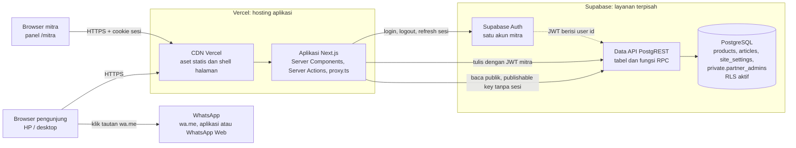
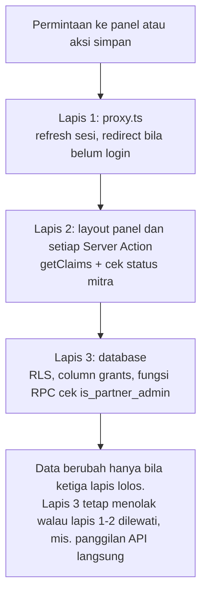
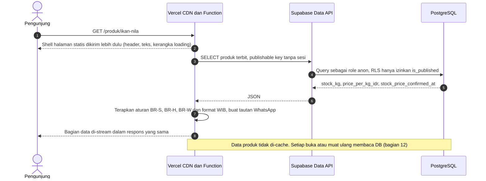
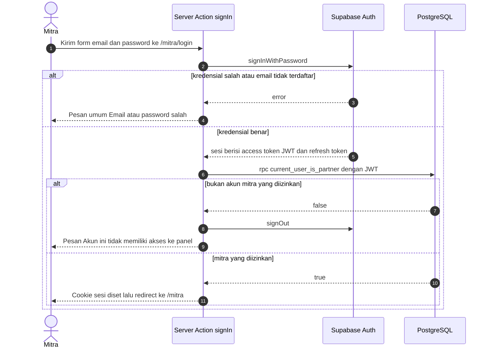
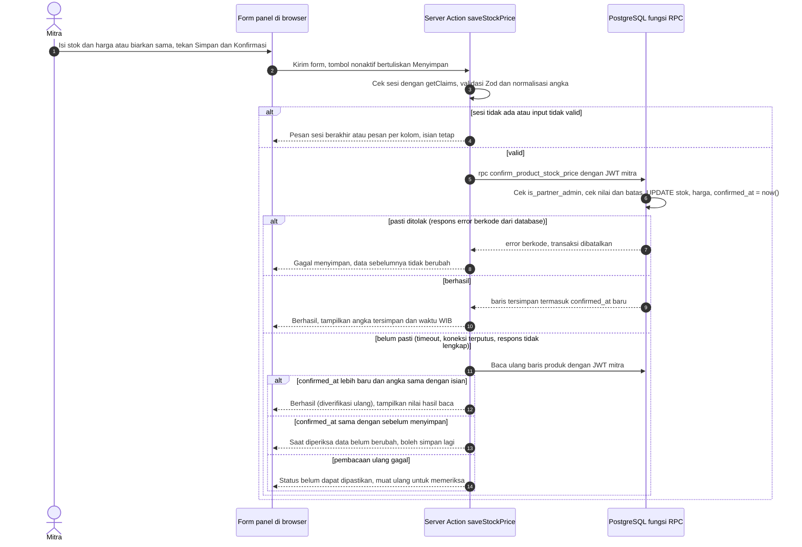
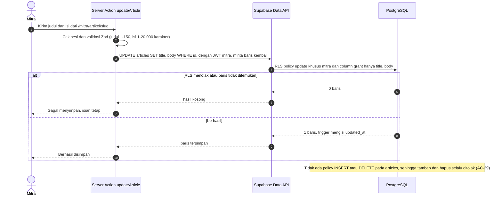
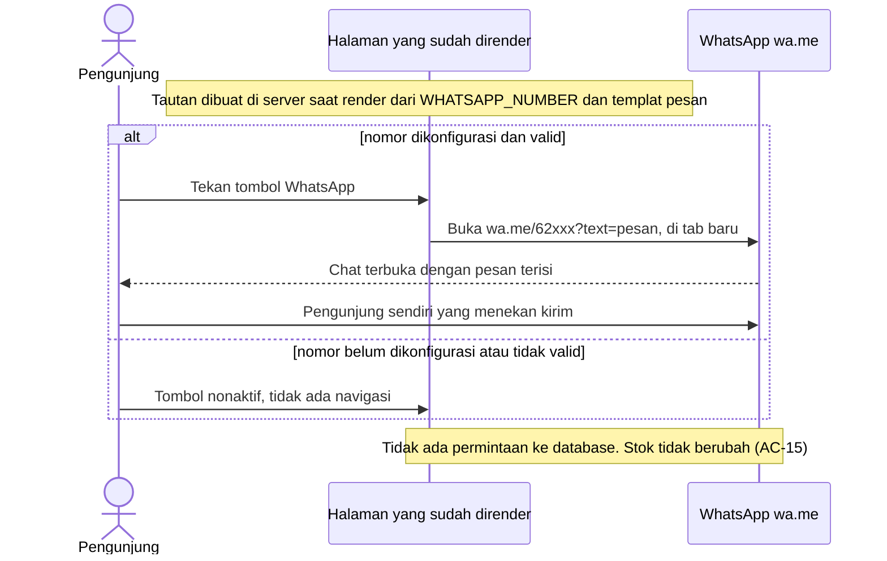
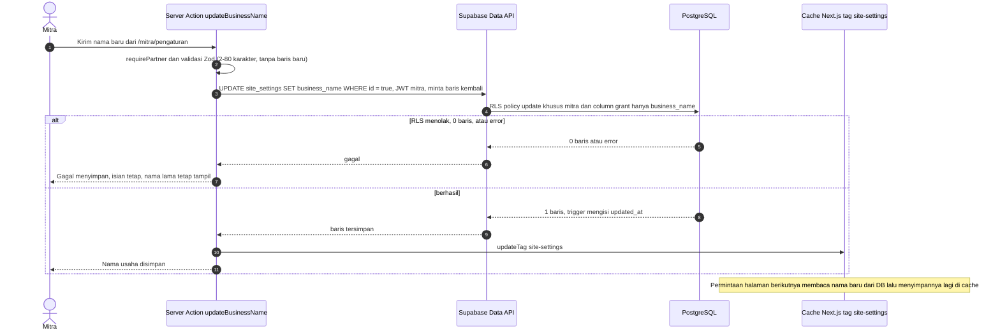
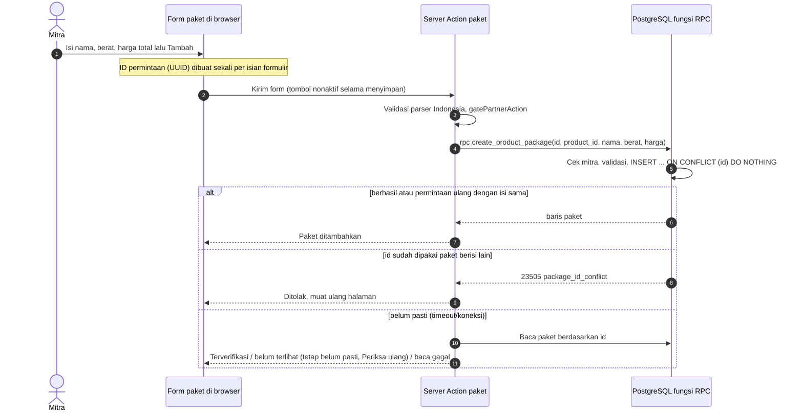
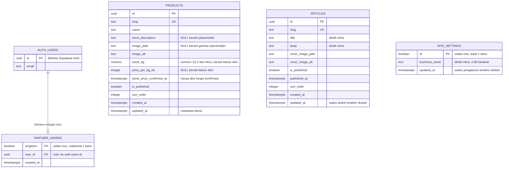

# ARCHITECTURE — Juki Fish Farm: Website Informasi & Promosi Ikan Nila

| Item | Keterangan |
|---|---|
| Versi dokumen | 0.8 (draf untuk ditinjau). Riwayat perubahan ada di bagian akhir dokumen. |
| Tanggal | 19 November 2026 |
| Status | Usulan, menunggu persetujuan. Proyek Supabase "PasarNila" adalah **dev/staging**, 11 versi migrasi, 0 pending. Unit 361/361, PGlite 145/145; Data API 26/26 adalah bukti historis. **Fase 9 selesai sebagian**: browser 81/81, responsif dan batas severity axe lulus. NFR-18 belum terverifikasi terpenuhi (host pengukuran tidak memadai); `test:db:cloud` terhalang jaringan (TCP 5432 ke Session pooler timeout, 0 assertion berjalan) meskipun URI sudah valid ([laporan fase 9 §19](./docs/verification/phase-9.md#19-tabel-kriteria-pekerjaan-selesai-dan-langkah-berikutnya)). Perubahan fase 9 masih di working tree (HEAD `173d9d6`). Tipe skema publik sudah dihasilkan dan dipakai. Belum ada deployment dan proyek belum dipakai klien. |
| Dokumen terkait | [`PRD.md`](./PRD.md): kebutuhan produk. ID `A-xx` (asumsi), `Q-xx` (pertanyaan), `AC-xx` (acceptance criteria), dan `BR-xx` (aturan bisnis) merujuk ke PRD. |

Label status yang dipakai sama dengan PRD: **[Dikonfirmasi]**, **[Asumsi A-xx]**, **[Pertanyaan Q-xx]**, **[Saran]**.
Hampir semua keputusan teknis dalam dokumen ini berstatus **[Saran]** sampai disetujui.

Potongan SQL/kode di dokumen ini adalah **sketsa konseptual** untuk menjelaskan desain. Potongan itu
bukan migrasi atau kode final.

---

## 1. Rekomendasi stack dan alasan pemilihan

### 1.1 Stack yang direkomendasikan **[Saran]**

| Lapisan | Pilihan | Alasan |
|---|---|---|
| Framework (frontend + backend) | **Next.js 16.4.6 (App Router) + TypeScript 5.9 (strict)** | Satu basis kode untuk halaman publik, panel, dan logika server (Server Components & Server Actions). Halaman bisa dirender di server sehingga data stok terbaru tersaji tanpa API terpisah. Didukung native oleh Vercel. Versi dikunci persis di `package.json` + `package-lock.json` (16.4.6 = rilis stabil terbaru saat fondasi dibuat, 9 November 2026). *Cache Components* dan *Partial Prefetching* di-set **eksplisit** di `next.config.ts`. Default framework 16.4.6 adalah `cacheComponents: false`; yang mengaktifkannya untuk aplikasi baru adalah template `create-next-app`, bukan default framework (diverifikasi dari dokumentasi resmi dan kode sumber, §12.0). |
| Runtime | **Node.js** (bawaan Vercel, Fluid Compute) | Edge runtime tidak diperlukan dan sudah tidak direkomendasikan. |
| Database | **PostgreSQL via Supabase** (region Singapura, A-19) | Postgres mendukung `numeric` untuk stok desimal, `timestamptz` untuk waktu, `CHECK` constraint, fungsi, dan RLS. Data proyek ini sangat kecil (1 produk, 2 artikel). Dashboard Supabase berguna untuk administrasi darurat oleh pengembang. |
| Autentikasi | **Supabase Auth** (email + password, A-08) via `@supabase/ssr` | Satu penyedia untuk database + autentikasi. JWT pengguna dipakai langsung oleh RLS sehingga hak akses ditegakkan di database. Registrasi publik bisa dimatikan. |
| Otorisasi | **RLS + tabel allowlist satu baris + fungsi RPC** | Perlindungan di level database, bukan hanya di UI (§9). |
| Styling | **Tailwind CSS v4** (4.3.3, lewat loader `@tailwindcss/turbopack` sesuai template resmi 16.4.6) | Ringan, tanpa runtime CSS, mudah dirawat untuk proyek kecil. Komponen UI dibuat sendiri dalam jumlah kecil. Pustaka komponen (mis. shadcn/ui) opsional, hanya bila mempercepat pembuatan form. |
| Validasi | **Zod 4** + parser angka murni | Parser stok/harga format Indonesia ditulis sebagai fungsi murni (§10.2). Zod dipakai untuk validasi konfigurasi lingkungan dan skema form di Server Action. |
| Render artikel | **react-markdown** tanpa HTML mentah | Format dasar yang aman. HTML/skrip dari input tidak dijalankan (AC-40). |
| Gambar | **File statis di repo + `next/image`** | Cukup untuk MVP karena mitra tidak mengunggah foto (A-12). Supabase Storage baru dibutuhkan bila mitra perlu mengunggah foto (§14). |
| Pengujian | **Vitest 5** (unit), **Vitest + PGlite** (database lokal tanpa Docker), **Vitest + `pg` / `supabase-js`** (database & Data API cloud dev/staging), **Playwright** (E2E, HP & desktop), **axe-core** (aksesibilitas) | Menguji aturan bisnis di setiap lapisan (§17). Laptop pengembang tidak menjalankan Docker. |
| Tooling DB | **Supabase CLI 3.2.0** (devDependency) + migrasi SQL di repo | Skema dapat direproduksi dan ditinjau lewat Git. Hanya perintah cloud (`db push --remote`, `--dry-run`); tidak memakai `supabase start`/`db reset`. |
| Package manager | **npm** (`package-lock.json`) | Perintah di dokumen ini memakai `npm run …`. Jangan mencampur dengan lockfile lain. |
| Hosting aplikasi | **Vercel** **[Dikonfirmasi]** | Target deployment yang disepakati. |

### 1.2 Mengapa usulan awal (Next.js + Supabase + Vercel + Tailwind) dipertahankan

1. **Sederhana untuk skala ini.** Tidak perlu server API terpisah, antrean, cache eksternal, atau CMS.
   Panel hanya berisi dua formulir.
2. **Hak akses aman tanpa secret key di aplikasi.** Semua penulisan dilakukan dengan sesi mitra (JWT) dan
   diperiksa RLS. Aplikasi di Vercel **tidak memerlukan** Supabase secret/service-role key sama sekali.
3. **Data terbaru mudah dijamin.** Server Components membaca database saat halaman diminta (§12).
4. **Kompatibel penuh dengan Vercel** dan biaya operasional rendah (lihat 1.4).

### 1.3 Perbandingan dengan teknologi Jokincay dan alternatif lain

| Aspek | Laravel 13 + Filament v3 + MySQL (stack Jokincay) | Next.js + Neon Postgres + Auth.js/Better Auth | **Next.js + Supabase (usulan)** |
|---|---|---|---|
| Kesederhanaan | Panel admin CRUD sangat cepat dibuat dengan Filament. Namun framework penuh dengan banyak fitur yang tidak terpakai. | Perlu merangkai sendiri tabel user, hash password, sesi, dan hak akses. | Auth + DB + RLS dalam satu layanan. Panel kustom kecil (2 form). |
| Pengalaman tim | Cocok bila tim menguasai PHP/Laravel **[Pertanyaan Q-20]** | Perlu TypeScript + pengetahuan keamanan auth | Perlu TypeScript + dasar SQL/RLS |
| Biaya | Butuh hosting PHP (VPS/shared hosting) di luar Vercel | Vercel + Neon (ada paket gratis) | Vercel + Supabase (ada paket gratis, dengan batasan, lihat 1.4) |
| Kompatibilitas Vercel | **Rendah.** PHP bukan runtime resmi Vercel (hanya runtime komunitas). Filesystem serverless tidak persisten, sehingga SQLite, sesi file, dan upload lokal tidak cocok. | Tinggi | Tinggi |
| Pemeliharaan | Pembaruan Composer + PHP. Server perlu dirawat bila VPS. | Pembaruan library auth ditanggung sendiri | Layanan terkelola. Pembaruan dependency JS. |
| Hak akses di level DB | Di aplikasi (policy/middleware Laravel) | Di aplikasi | **Di database (RLS)** + aplikasi |

**Kesimpulan:** Bila target tetap Vercel, stack Jokincay tidak disarankan. Laravel + Filament baru masuk
akal bila tim jauh lebih menguasai PHP **dan** bersedia memakai hosting selain Vercel (Q-20). Alternatif
"satu password admin di environment variable" sempat dipertimbangkan dan ditolak. Pendekatan itu
mengharuskan aplikasi memegang secret key database dan membuat mekanisme sesi sendiri, sehingga lebih
berisiko daripada Supabase Auth + RLS.

### 1.4 Catatan biaya dan paket (dicek November 2026, **wajib dicek ulang** di halaman harga resmi)

- **Vercel:** ketentuan *fair use* menyatakan paket **Hobby hanya untuk penggunaan pribadi non-komersial**.
  Website usaha termasuk penggunaan komersial, sehingga produksi memerlukan paket **Pro** (sumber
  sekunder menyebut sekitar US$20/pengguna/bulan). Lihat Q-10.
- **Supabase:** paket gratis cukup secara kapasitas, tetapi **proyek paket gratis dijeda otomatis bila
  aktivitasnya rendah selama 7 hari** (ada email peringatan, dan proyek bisa dipulihkan). Untuk website
  usaha dengan lalu lintas kecil, risikonya nyata (R5 di PRD). Pilihannya paket Pro (sekitar US$25/bulan
  menurut halaman harga), atau menerima risiko secara sadar dengan pemantauan.
- **Domain khusus** (opsional): biaya registrar tahunan. Domain bawaan `*.vercel.app` gratis.

---

## 2. Ringkasan hasil pemeriksaan repo Jokincay

### 2.1 Cakupan pemeriksaan

- Repo `https://github.com/Jayflux/Jokincay` **dapat diakses** (publik). Pemeriksaan dilakukan 17 November 2026
  dengan *shallow clone* commit `58bd4eb` (cabang `main`, satu commit: "docs: update README with project
  overview and setup guide", repo dibuat 27 September 2026).
- Pemeriksaan dilakukan dengan **membaca kode** (README, `composer.json`, `package.json`, `.env.example`,
  migrasi, model, enum, service, controller, route, Filament resource, seeder, test). Aplikasi dan test-nya
  **tidak dijalankan**, dan instruksi otomatis di file `CLAUDE.md`/`AGENTS.md` repo tersebut tidak diikuti.

### 2.2 Apa sebenarnya Jokincay

Menurut README dan kode, Jokincay adalah **dashboard & manajemen operasional layanan joki tugas**.
Pelanggan membuat pesanan tanpa akun, melacak status lewat nomor WhatsApp, dan mengunggah bukti transfer.
Admin menetapkan harga, memperbarui status/progres, memverifikasi pembayaran, dan mengekspor laporan.

### 2.3 Teknologi yang digunakan

| Komponen | Temuan |
|---|---|
| Bahasa/framework | PHP `^8.3`, `laravel/framework ^13.17` (README menyebut "Laravel 12", **tidak konsisten** dengan `composer.json`) |
| Panel admin | Filament v3 (`/admin`, login bawaan Filament) |
| Frontend | Blade + Tailwind CSS v4 + Vite 8 |
| Database | SQLite (default pengembangan), MySQL disebut untuk produksi |
| Autentikasi | Sesi Laravel melalui login Filament. Tabel `users` dengan kolom `role` (default `'admin'`). |
| Penyimpanan file | Disk lokal privat (lampiran tugas & bukti transfer) |
| Lain-lain | Rate limiter per IP untuk endpoint publik, PHPUnit (feature & unit test) |

Model data: `users`, `customers (name, whatsapp unik)`, `orders (order_number, customer_id, task_type,
description, attachment, price decimal(15,2) NULL, deadline, status, progress, notes, completed_at)`,
`payments (order_id, amount decimal(15,2), proof_path, status, uploaded_at, verified_at, verified_by,
rejection_reason)`.

### 2.4 Bagaimana mekanisme stok bekerja

**Tidak ada mekanisme stok.** Pencarian istilah `stok`, `stock`, `inventory`, `qty`, `quantity`, `kg`,
dan `berat` tidak menemukan logika domain apa pun. Tidak ada tabel produk/stok. Repo ini **bukan**
referensi monitoring stok. Hanya pola-pola terkait yang bisa dipelajari:

| Pola di Jokincay | Relevansi untuk website ikan nila |
|---|---|
| Admin memperbarui nilai manual lewat panel (harga, status, progres pesanan) | Mirip mitra memperbarui stok/harga manual. |
| `price` bisa NULL dan ditampilkan sebagai "belum ditentukan/negosiasi", terpisah dari angka | Mirip pembedaan "Belum tersedia" (NULL) vs angka. **Catatan:** kode pembayaran memperlakukan NULL dan 0 sama (`!$order->price \|\| $order->price <= 0`). Kita **harus** membedakannya. |
| Halaman pelacakan publik membaca data tersimpan terbaru saat diminta | Mirip halaman produk yang membaca data saat dibuka. |
| `WhatsAppService` membuat tautan `https://wa.me/{nomor}?text={urlencode(pesan)}`. `WhatsAppNormalizer` mengubah `08…`/`+62…`/`8…` menjadi `62…`. | Konsep yang sama dipakai untuk tombol WhatsApp (diimplementasikan ulang). |
| Format rupiah `number_format(x, 0, ',', '.')` | Kita memakai `Intl.NumberFormat('id-ID')`. |

### 2.5 Catatan yang **tidak** boleh ditiru

| Temuan | Risiko | Pendekatan kita |
|---|---|---|
| `User::canAccessPanel()` selalu `true`, dan kolom `role` default `'admin'` tanpa dipakai untuk otorisasi | Setiap akun di tabel `users` otomatis punya akses admin penuh | Allowlist eksplisit satu akun + RLS di database (§9). |
| Seeder membuat admin dengan password bawaan yang diketahui umum dan dicantumkan di README | Kredensial lemah/diketahui | Tidak ada kredensial di seed/repo. Akun dibuat manual (§9.6). |
| Nomor WhatsApp admin memiliki **nilai cadangan yang ditanam di kode/konfigurasi** bila env kosong | Pengunjung diarahkan ke nomor yang bukan milik usaha | Tanpa cadangan. Bila nomor tidak ada, tombol dinonaktifkan (§13). |
| Input harga di Filament `numeric()` tanpa batas minimum | Nilai negatif bisa tersimpan | Validasi server + `CHECK (... BETWEEN 0 AND batas wajar)` di DB + pemeriksaan di RPC dengan batas yang sama (§10.5). |
| `config/app.php` memakai zona waktu `UTC`, sementara laporan mencetak `now()` dengan label "WIB" tanpa konversi yang terlihat | Jam yang diberi label WIB kemungkinan sebenarnya UTC (selisih 7 jam) | Konversi eksplisit ke `Asia/Jakarta` saat menampilkan waktu (§11). |
| Efek samping lewat *model events* (pembayaran otomatis tersinkron saat harga berubah) | Perubahan tersembunyi sulit dilacak | Aksi eksplisit (fungsi `confirm_product_stock_price`). |

### 2.6 Bagian yang dapat dijadikan referensi

- **Konsep**: tautan WhatsApp `wa.me` + pesan terisi, normalisasi nomor Indonesia, pemisahan nilai kosong
  vs terisi, rate limiting endpoint publik, kategori pengujian (alur pembuatan data, normalisasi nomor,
  akses terlarang).
- **Yang perlu disederhanakan** untuk ikan nila: tidak ada pesanan, pembayaran, unggah file, pelacakan,
  laporan, dashboard statistik, atau data pelanggan. Yang tersisa hanya **produk (stok/harga/waktu),
  artikel, dan satu akun mitra**.

### 2.7 Lisensi dan penggunaan ulang kode

- GitHub API melaporkan **tidak ada lisensi** (`license: null`), dan **tidak ada file `LICENSE`** di repo.
- README menulis "lisensi terbuka MIT" dengan tautan ke `LICENSE` yang **tidak ada**. `composer.json`
  berisi `"license": "MIT"`, tetapi file itu masih membawa identitas *skeleton* Laravel (`"name":
  "laravel/laravel"`, deskripsi "The skeleton application for the Laravel framework"). Jadi nilai MIT
  tersebut kemungkinan warisan template, bukan pernyataan lisensi pemilik repo.
- **Kesimpulan:** status lisensi **tidak jelas**, sehingga **kode tidak disalin**. Secara teknis kode itu
  juga tidak cocok karena PHP/Blade, sedangkan proyek ini TypeScript/React. Yang dipakai hanya konsep umum
  yang ditulis ulang secara independen. Bila suatu saat ingin memakai bagian kode tertentu, minta pemilik
  repo menambahkan file `LICENSE` secara eksplisit terlebih dahulu.

---

## 3. Diagram arsitektur

### 3.1 Konteks sistem



### 3.2 Lapisan keamanan berlapis



---

## 4. Hubungan antarkomponen

| Komponen | Peran | Berhubungan dengan |
|---|---|---|
| **Browser pengunjung** | Membuka halaman publik. Tidak login dan tidak menyimpan cookie sesi. | Vercel (HTML/aset), WhatsApp (klik tautan). **Tidak** berhubungan langsung dengan Supabase. Semua data dirender di server. |
| **Browser mitra** | Membuka panel, mengirim formulir. Menyimpan cookie sesi Supabase (dikelola `@supabase/ssr`). | Vercel saja. Login dan penyimpanan dilakukan melalui Server Actions. |
| **Aplikasi Next.js di Vercel** | Merender halaman, menjalankan Server Actions, menyegarkan sesi (`proxy.ts`), membuat tautan WhatsApp. | Supabase Auth (login/sesi), Supabase Data API (baca/tulis), CDN Vercel. |
| **Supabase Auth** | Memverifikasi email+password dan menerbitkan JWT (access token) + refresh token. Registrasi publik dimatikan. | Aplikasi, Data API (JWT dibaca oleh RLS lewat `auth.uid()`). |
| **Database (Postgres)** | Menyimpan produk, artikel, pengaturan usaha (nama), dan allowlist mitra. Menegakkan RLS, constraint, dan fungsi konfirmasi. | Data API. Pengembang (migrasi via Supabase CLI). |
| **WhatsApp** | Layanan eksternal. Website hanya membuat **tautan** `wa.me`. | Browser pengunjung. **Tidak ada** integrasi API, webhook, atau penyimpanan pesan. |

Hal penting yang perlu dipahami klien:

- **Hosting aplikasi ≠ database.** Vercel menjalankan aplikasi dan CDN. Supabase menyimpan data dan akun.
  Keduanya layanan terpisah dengan akun, paket, tagihan, dan region masing-masing. Deployment di Vercel
  tidak otomatis membuat database.
- **WhatsApp tidak terhubung ke stok.** Klik dan chat tidak tercatat di sistem (BR-S5).

---

## 5. Alur data

### 5.1 Pembacaan stok dan harga oleh pengunjung



Bila langkah 3–6 gagal (DB tidak tersedia/timeout), komponen data menampilkan pesan gangguan (AC-12).
Tombol WhatsApp tetap dirender karena konfigurasinya berasal dari environment variable, bukan dari database.

### 5.2 Login mitra



Setelah login, `proxy.ts` (untuk `/mitra/*`) menyegarkan token yang kedaluwarsa di setiap permintaan
panel. Layout panel memeriksa sesi dan status mitra sebelum merender data panel.

**Implementasi (19 Nov 2026, `src/lib/auth/require-partner.ts`):** pemeriksaan sesi memakai
`supabase.auth.getUser()`, bukan `getClaims()`. `getUser()` memvalidasi token ke server Auth sehingga
pengguna yang dihapus/diblokir dan sesi yang dicabut terdeteksi; biayanya satu panggilan jaringan per
pemeriksaan. `getClaims()` (verifikasi tanda tangan lokal) tidak mendeteksi pencabutan sebelum token
kedaluwarsa. `getSession()` tidak dipakai untuk otorisasi. Keduanya bukan pengganti RLS. Hasilnya dibagi
tiga (`src/lib/auth/access-classify.ts`):

| Hasil | Halaman/layout panel | Server Action |
|---|---|---|
| `no_session` (tidak ada sesi, token ditolak Auth/PostgREST) | redirect `/mitra/login` | `session_expired`: "Sesi Anda telah berakhir…", isian tetap |
| `not_partner` (RPC menjawab `false`) | redirect `/mitra/akses-ditolak` | `forbidden` |
| `check_failed` (jaringan, Auth/DB 5xx/429, RPC error) | pesan "Pemeriksaan akses sedang terganggu", data panel tidak dirender | `access_check_failed`: operasi ditolak, **bukan** dilaporkan sebagai "bukan mitra" |

Login: kredensial ditolak → "Email atau password salah" (AC-18); gangguan jaringan/layanan → pesan gangguan
(bukan "password salah"); batas percobaan → pesan tunggu. Bila allowlist menjawab `false` **atau**
pemeriksaannya gagal, sesi di perangkat diakhiri (`signOut({ scope: "local" })`) dengan pesan yang berbeda.
Logout memakai `signOut()` (global); bila jaringan gagal, sesi lokal tetap dihapus.

### 5.3 Update atau konfirmasi ulang stok dan harga



- **Konfirmasi ulang** memakai jalur yang **sama persis**. Angka yang dikirim sama dengan yang tersimpan,
  dan fungsi tetap mengisi `stock_price_confirmed_at = now()` (AC-31). Server Action membandingkan nilai
  lama dan baru hanya untuk memilih teks pesan ("Data dikonfirmasi ulang…" vs "Data diperbarui…").
- Seluruh perubahan terjadi dalam **satu perintah UPDATE** di dalam fungsi, jadi bersifat atomik (NFR-20).
- **Atomik tidak sama dengan pasti diketahui.** Bila jawaban tidak sampai (timeout, koneksi terputus),
  transaksi mungkin sudah *commit* atau belum. Hasil seperti ini **tidak** boleh dilaporkan sebagai
  "data sebelumnya tidak berubah". Klasifikasi hasil dan prosedur baca ulang ada di §10.4.
- Ketidakpastian juga bisa terjadi di antara **browser mitra dan Server Action** (sinyal HP putus setelah
  form terkirim). Form di browser memperlakukan kegagalan jaringan saat memanggil Server Action sebagai
  hasil belum pasti dan memicu pembacaan ulang yang sama (§10.4).

### 5.4 Perubahan artikel



Catatan implementasi: UPDATE yang ditolak RLS di PostgREST **tidak** menghasilkan error. Hasilnya 0
baris. Server Action **wajib** memeriksa jumlah baris yang kembali dan memperlakukan 0 baris sebagai gagal
yang **pasti** (UPDATE sudah berjalan dan tidak mengubah apa pun). Timeout atau koneksi terputus
diperlakukan sebagai hasil **belum pasti** dan dibaca ulang dengan `updated_at` artikel sebagai pembanding
(§10.4).

### 5.5 Tombol pesan WhatsApp



### 5.6 Penggantian nama usaha



Sama seperti artikel, UPDATE yang ditolak RLS menghasilkan 0 baris, bukan error. Hasil 0 baris wajib
diperlakukan sebagai gagal yang pasti. Cache dibersihkan setelah penyimpanan berhasil. Untuk hasil
**belum pasti**, pemeriksaan ulang dilakukan lewat Server Action terpisah yang membaca nama tersimpan dan
**selalu** memanggil `updateTag('site-settings')`, karena membersihkan cache tidak berbahaya, sedangkan
melewatkannya setelah *commit* yang tidak terlaporkan membuat nama lama tetap tampil (§10.4).

Bila simpan berhasil tetapi `updateTag` melempar error, status tetap **tersimpan** disertai peringatan dan
tombol "Segarkan tampilan publik" (Server Action terpisah yang memanggil `updateTag` lagi). Penyimpanan
tidak pernah dilaporkan gagal karena invalidasi cache gagal.

### 5.7 Pengelolaan paket katalog (PRD §12.8)



- **Tidak ada paket ganda:** mengirim ulang permintaan yang sama (retry, hasil belum pasti, ketuk dua
  kali) memakai ID yang sama. Database mengembalikan baris yang sudah ada; ID yang sama dengan isi berbeda
  ditolak. ID baru dibuat browser hanya setelah tambah **pasti** berhasil.
- **Ubah:** `update_product_package(id, nama, berat, harga)`; baseline `updated_at` mentah untuk pembacaan
  ulang. **Hapus:** `delete_product_package(id)` dengan dialog konfirmasi yang menyebut paket. Hapus yang
  menjawab `P0002` berarti paket memang sudah tidak ada (tujuan tercapai).
- CRUD paket **tidak** menyentuh `public.products`: stok, harga satuan, dan `stock_price_confirmed_at` tetap.
- Halaman panel tidak menampilkan formulir bila produk atau daftar paket gagal dimuat, agar mitra tidak
  menambah paket tanpa melihat daftar.

---

## 6. Struktur halaman dan route

| Route | Jenis | Akses | Strategi render | Isi utama |
|---|---|---|---|---|
| `/` | Publik | Semua | Shell statis + bagian produk dinamis (Suspense) | Hero, ringkasan produk (stok/harga/waktu), cuplikan profil, 2 artikel, CTA WhatsApp |
| `/produk` | Publik | Semua | Shell statis + daftar produk & paket dinamis | Kartu produk aktif (MVP: 1) + ringkasan paket |
| `/produk/[slug]` | Publik | Semua | Shell statis + data produk & paket dinamis | Detail produk + kartu paket dengan WhatsApp per paket. Slug MVP: `ikan-nila`. Slug tak dikenal → 404 (Proxy) |
| `/profil` | Publik | Semua | Statis (nama usaha dari cache bertag, §12.5) | Profil usaha dari `src/config/site.ts` |
| `/artikel` | Publik | Semua | Dinamis (MVP) | Daftar artikel terbit |
| `/artikel/[slug]` | Publik | Semua | Dinamis (MVP) | Isi artikel. Slug tak dikenal → 404 |
| `/kontak` | Publik | Semua | Statis | WhatsApp, alamat, jam operasional |
| `/mitra/login` | Panel | Tamu | Dinamis | Form login. Bila sudah login sebagai mitra, redirect ke `/mitra` |
| `/mitra` | Panel | Mitra | Dinamis, `no-store` | Data tersimpan + form stok & harga |
| `/mitra/artikel` | Panel | Mitra | Dinamis, `no-store` | Daftar 2 artikel (tanpa tombol tambah/hapus) |
| `/mitra/artikel/[slug]` | Panel | Mitra | Dinamis, `no-store` | Form edit judul & isi + pratinjau |
| `/mitra/pengaturan` | Panel | Mitra | Dinamis, `no-store` | Form nama usaha |
| `/mitra/paket` | Panel | Mitra | Dinamis, `no-store` | Daftar, tambah, ubah, hapus paket katalog (§5.7) |
| `/robots.txt` | Sistem | — | Dinamis per env | `Disallow: /mitra`. `noindex` global sebelum peluncuran |
| `/sitemap.xml` | Sistem | — | Dinamis | Hanya halaman publik |

- **Logout** berupa Server Action (POST) dari tombol di header panel, **bukan** tautan GET.
- **Status 404 (diverifikasi dari dokumentasi Next.js 16.4.6 terbundel, `loading.md` §Status codes,
  `not-found.md`):** dengan Cache Components, shell prerender dikirim lebih dulu sehingga `notFound()` yang
  berjalan saat permintaan hanya menghasilkan status **200 + `noindex`**. Agar slug tak dikenal mendapat
  **404**, `src/proxy.ts` memeriksa slug `/produk/:slug` dan `/artikel/:slug` terhadap daftar slug
  `src/config/known-slugs.ts` (sama dengan migrasi data awal; diuji) dan menjawab 404 sebelum render, tanpa
  akses database. Slug dikenal yang tidak terbit tetap memakai `notFound()` (200 + `noindex`). Halaman
  `app/not-found.tsx` dan `app/(publik)/not-found.tsx` menampilkan pesan 404 yang ramah (PRD §7).
- **Cache-Control panel:** respons dinamis berbasis cookie mendapat
  `private, no-cache, no-store, max-age=0, must-revalidate` dari Next.js (dokumentasi `self-hosting.md`,
  `cdn-caching.md`). Shell prerender `/mitra/*` tidak memuat data sesi karena layout memeriksa sesi sebelum
  merender apa pun. Karena itu **tidak** ada header tambahan di `next.config.ts`. **Terverifikasi (19 Nov 2026, `next build` +
  `next start` lokal):** semua halaman `/mitra/*` menjawab `private, no-cache, no-store, max-age=0,
  must-revalidate`. Nilai di Vercel/CDN belum diuji (T-15/T-21).
- Path `/mitra` dipilih agar mudah dipahami. Merahasiakan path bukan bentuk keamanan, karena keamanan
  ditegakkan di lapis 2–3 (§3.2).

### 6.1 Implementasi beranda (`/`, 18 November 2026)

Route group `src/app/(publik)/` (layout: header, `<main>`, footer) dan `page.tsx`. Komponen bagian ada di
`src/components/publik/beranda/`. Urutan bagian dan sumber datanya:

| Bagian | Sumber data | Render |
|---|---|---|
| Header, footer | Nama usaha dari `getBusinessName()` (§12.5), nav dari `src/config/navigation.ts` | Shell statis |
| Hero | Teks tetap yang faktual (PRD §1.1); visual abstrak bertema air, **bukan foto** | Shell statis |
| Sorotan Ikan Nila | `loadPublishedProduct('ikan-nila')` + `getProductDisplay()`; stok, harga, dan waktu WIB tidak ditulis di kode | Dinamis, `<Suspense>` dengan kerangka. Menampilkan "Belum tersedia", "Stok habis", pesan gangguan (AC-12), atau "Produk belum tersedia" |
| Profil | `site.ts`; sejarah/gambaran dan jam operasional berupa `Placeholder` selama `null` | Shell statis |
| Artikel | `loadPublishedArticles()`, paling banyak 2 kartu; artikel bertanda `[PLACEHOLDER]` tampil sebagai kotak placeholder, bukan teks mentah | Dinamis, `<Suspense>` |
| Lokasi | Alamat dan `mapsUrl` dari `site.ts`; peta tertanam + tombol Google Maps (§13.1) | Shell statis |
| Kontak + footer | Tautan dari `src/lib/whatsapp-links.ts` (nomor hanya dari env, §13.2); nonaktif bila nomor belum dikonfigurasi (AC-14) | Shell statis |

Status: konten **placeholder, bukan final**: foto usaha dan produk, deskripsi produk, sejarah/gambaran usaha,
jam operasional, dan isi kedua artikel menunggu bahan klien (PRD K3–K5, K9). Menu kini mengarah ke route
`/produk`, `/artikel`, `/profil`, dan `/kontak` (§6.2). Animasi hanya transisi hover dan kemunculan section
ringan, dengan dukungan `prefers-reduced-motion`.

### 6.2 Halaman publik & panel (commit `4373729` + perbaikan audit, 19 November 2026)

- **Publik:** `/produk`, `/produk/[slug]`, `/artikel`, `/artikel/[slug]`, `/profil`, `/kontak`, `robots.txt`,
  `sitemap.xml`. Bagian produk beranda, katalog, dan detail memakai satu sumber
  (`src/components/publik/product/product-sections.tsx` → `loadPublishedCatalog`, tanpa cache lintas request).
  Produk dan paket terurut dibaca dalam satu query embed FK PostgREST sebagai anon; metadata detail dan
  render berbagi pembacaan per permintaan. Jika embed gagal, pembacaan produk saja membedakan kegagalan
  katalog paket dari kegagalan data produk. Produk gagal
  dimuat → pesan gangguan AC-12 tanpa stok, harga, maupun paket. Isi artikel dirender sebagai Markdown aman
  (`src/components/content/article-markdown.tsx`). Peta tertanam di beranda, profil, dan kontak memakai
  satu komponen dengan keterangan "peta mencari alamat tertulis" (`src/components/publik/map-embed.tsx`).
- **Panel:** `/mitra` (stok & harga), `/mitra/paket`, `/mitra/artikel`, `/mitra/artikel/[slug]`,
  `/mitra/pengaturan`, `/mitra/login`, `/mitra/akses-ditolak`. Pembacaan panel membedakan berhasil, kosong,
  tidak ditemukan, dan gagal dimuat; formulir tidak ditampilkan bila datanya gagal dibaca. Formulir nama
  usaha diisi nama **tersimpan** (bukan nama cadangan), sehingga "Ikan Nila" tidak dapat tersimpan tanpa
  sengaja menimpa nama asli.
- **Sitemap** hanya memuat halaman publik dan tidak pernah menghasilkan URL `localhost`: tanpa URL situs
  (pengembangan lokal) sitemap kosong; production mewajibkan `NEXT_PUBLIC_SITE_URL`.

---

## 7. Struktur folder proyek (usulan)

```text
PasarNila/
├── PRD.md
├── ARCHITECTURE.md
├── README.md                         # cara setup & menjalankan
├── AGENTS.md                         # dari template create-next-app: arahkan agen ke docs Next.js terbundel
├── .env.example                      # daftar env var + placeholder, tanpa nilai asli
├── .gitignore                        # mengabaikan .env* kecuali .env.example
├── next.config.ts                    # cacheComponents + partialPrefetching eksplisit, security headers
├── vercel.ts                         # opsional: region function (mis. sin1)
├── package.json / package-lock.json  # npm, versi dikunci
├── tsconfig.json                     # strict + noUncheckedIndexedAccess
├── eslint.config.mjs
├── vitest.config.mts                 # .mts agar dimuat sebagai ESM (paket ini CommonJS)
├── playwright.config.ts              # (fase pengujian E2E)
├── scripts/
│   └── check-env.ts                  # `npm run check:env`: laporkan NAMA & status env, tanpa nilai
├── public/
│   └── images/
│       ├── placeholders/             # SVG netral "Foto belum tersedia"
│       └── products/                 # foto asli dari klien (menyusul)
├── supabase/
│   ├── config.toml                   # pengaturan lokal; enable_signup = false
│   ├── migrations/                   # urutan timestamp = urutan ketergantungan (§8.8)
│   │   ├── <ts1>_schemas_and_helpers.sql  # schema private + fungsi trigger updated_at
│   │   ├── <ts2>_tables.sql               # 4 tabel, constraint (termasuk batas wajar), trigger, RLS aktif
│   │   ├── <ts3>_access_functions.sql     # private.is_partner_admin, public.current_user_is_partner + hak EXECUTE
│   │   ├── <ts4>_policies_and_grants.sql  # revoke/grant tabel & kolom, policy RLS (memakai fungsi <ts3>)
│   │   ├── <ts5>_rpc_functions.sql        # confirm_product_stock_price + hak EXECUTE
│   │   └── <ts6>_initial_content.sql      # produk "Ikan Nila", 2 artikel placeholder,
│   │                                      # 1 baris site_settings "Juki Fish Farm" (idempoten)
│   ├── seed.sql                      # data uji lokal saja; TANPA akun/password
│   └── tests/                        # (tidak dipakai; uji database ada di tests/db, §17.3)
├── src/
│   ├── proxy.ts                      # refresh sesi Supabase; matcher hanya /mitra/:path*
│   ├── app/
│   │   ├── layout.tsx                # <html lang="id">, font, metadata dasar
│   │   ├── not-found.tsx
│   │   ├── global-error.tsx
│   │   ├── robots.ts
│   │   ├── sitemap.ts
│   │   ├── (publik)/
│   │   │   ├── layout.tsx            # header, footer, tombol WhatsApp
│   │   │   ├── page.tsx              # beranda
│   │   │   ├── produk/page.tsx
│   │   │   ├── produk/[slug]/page.tsx
│   │   │   ├── profil/page.tsx
│   │   │   ├── artikel/page.tsx
│   │   │   ├── artikel/[slug]/page.tsx
│   │   │   ├── kontak/page.tsx
│   │   │   └── error.tsx
│   │   └── mitra/
│   │       ├── login/page.tsx
│   │       └── (terlindungi)/
│   │           ├── layout.tsx        # requirePartner(), header panel, tombol logout
│   │           ├── page.tsx          # stok & harga
│   │           ├── artikel/page.tsx
│   │           ├── artikel/[slug]/page.tsx
│   │           └── pengaturan/page.tsx  # nama usaha
│   ├── components/
│   │   ├── ui/                       # Button, Input, Alert, Badge, Skeleton
│   │   ├── publik/                   # ProductCard, StockStatus, PriceText, UpdatedAt,
│   │   │                             # WhatsAppButton, Placeholder
│   │   └── panel/                    # StockPriceForm, ArticleForm, MarkdownPreview,
│   │                                 # BusinessNameForm
│   ├── config/
│   │   ├── site.ts                   # info usaha selain nama; null = belum tersedia
│   │   └── whatsapp-messages.ts      # templat pesan terisi
│   ├── lib/
│   │   ├── env.ts                    # membaca & memvalidasi env var (pesan error hanya menyebut nama)
│   │   ├── supabase/
│   │   │   ├── public-client.ts      # klien tanpa cookie untuk baca publik
│   │   │   ├── server-client.ts      # klien ber-cookie untuk panel & Server Actions
│   │   │   └── proxy-session.ts      # updateSession() untuk proxy.ts
│   │   ├── auth/require-partner.ts   # getClaims + cek mitra; dipakai layout & actions
│   │   ├── data/products.ts          # query baca produk
│   │   ├── data/articles.ts          # query baca artikel
│   │   ├── data/site-settings.ts     # getSiteSettings() ber-cache, tag 'site-settings'
│   │   ├── actions/auth.ts           # signIn, signOut
│   │   ├── actions/stock-price.ts    # saveStockPrice
│   │   ├── actions/articles.ts       # updateArticle
│   │   ├── actions/site-settings.ts  # updateBusinessName + updateTag('site-settings')
│   │   ├── domain/limits.ts          # batas wajar stok/harga; HARUS sama dengan constraint DB (§10.5)
│   │   ├── domain/product-status.ts  # aturan Belum tersedia / Stok habis / angka / gagal dimuat
│   │   ├── validation/               # parser angka format Indonesia (+ skema Zod form)
│   │   ├── format/                   # datetime (WIB), rupiah, kg
│   │   └── whatsapp.ts               # normalisasi nomor, pembuat tautan, pesan terisi
│   └── types/database.ts             # hasil `supabase gen types typescript`
└── tests/
    ├── unit/                         # Vitest
    └── e2e/                          # Playwright (HP & desktop)
```

Prinsip: **aturan bisnis** (status stok, format WIB, parser angka, tautan WhatsApp) ditulis sebagai fungsi
murni di `src/lib/domain`, `src/lib/format`, `src/lib/validation`, dan `src/lib/whatsapp.ts` agar mudah diuji
unit tanpa database.

**Status per 18 November 2026:** sudah ada `package.json`/lockfile, konfigurasi (`next.config.ts`,
`tsconfig.json`, ESLint, `vitest.config.mts`), `.env.example`, `scripts/check-env.ts`, `src/app/layout.tsx` +
halaman sementara, `src/config/site.ts`, `src/config/whatsapp-messages.ts`, `src/lib/env.ts`,
`src/lib/domain/*`, `src/lib/validation/*`, `src/lib/format/*`, `src/lib/whatsapp.ts`, dan
`tests/unit/*`. Folder `supabase/`, klien Supabase, `proxy.ts`, halaman publik, dan panel **belum** dibuat.

**Pembaruan 18 November 2026:** folder `supabase/` (migrasi) dan klien baca publik
(`src/lib/supabase/public-client.ts`) kini ada, bersama lapisan data (`src/lib/data/*`), komponen publik
(`src/components/*`), layout publik, dan **beranda** (§6.1). `proxy.ts`, panel mitra, dan route publik selain
`/` **belum** dibuat.

---

## 8. Rancangan skema database awal

### 8.1 Diagram entitas



### 8.2 Tabel `public.products`

| Field | Tipe | Wajib (NOT NULL) | Nilai awal / NULL | Tujuan & aturan |
|---|---|---|---|---|
| `id` | `uuid` | Ya | `gen_random_uuid()` | Primary key. |
| `slug` | `text` | Ya | Diisi pengembang (`ikan-nila`) | URL stabil. `UNIQUE`. `CHECK` format `^[a-z0-9]+(-[a-z0-9]+)*$`. |
| `name` | `text` | Ya | Diisi pengembang ("Ikan Nila", A-01) | Nama tampilan. `CHECK` 1–100 karakter. Tidak diedit mitra di MVP. |
| `short_description` | `text` | Tidak | `NULL` | Deskripsi singkat. NULL → placeholder "[Deskripsi produk belum tersedia]". |
| `image_path` | `text` | Tidak | `NULL` | Path gambar statis di `/public/images/products/…`. NULL → gambar placeholder. |
| `image_alt` | `text` | Tidak | `NULL` | Teks alternatif gambar. |
| `stock_kg` | `numeric(10,2)` | Tidak | `NULL` = **belum pernah diisi** | Stok dalam kg. `CHECK (stock_kg BETWEEN 0 AND 100000)`, batas yang sama dengan validasi server (A-07, §10.5). `0` = "Stok habis". Presisi 2 desimal (A-03, dapat disesuaikan). Kapasitas tipe (hingga 99.999.999,99) sengaja lebih besar dari batas agar mengubah A-07 cukup dengan mengganti constraint. |
| `price_per_kg_idr` | `integer` | Tidak | `NULL` = **belum pernah diisi** | Harga rupiah bulat per kg (A-02). `CHECK (price_per_kg_idr BETWEEN 0 AND 10000000)`, batas yang sama dengan validasi server (A-07, §10.5). |
| `stock_price_confirmed_at` | `timestamptz` | Tidak | `NULL` = **belum pernah dikonfirmasi** | Waktu terakhir stok & harga disimpan/dikonfirmasi. **Hanya** diisi oleh fungsi `confirm_product_stock_price` dengan `now()` (§11). |
| `is_published` | `boolean` | Ya | `false` (data awal: `true`) | Tampil di publik atau tidak. Dikelola pengembang. |
| `sort_order` | `integer` | Ya | `0` | Urutan tampil bila produk > 1. |
| `created_at` | `timestamptz` | Ya | `now()` | Metadata teknis. |
| `updated_at` | `timestamptz` | Ya | `now()`, diperbarui trigger setiap UPDATE | Metadata teknis perubahan baris apa pun. **Tidak** ditampilkan sebagai "stok diperbarui". |

Constraint tambahan:

- **Integritas waktu:** `CHECK (stock_price_confirmed_at IS NOT NULL OR (stock_kg IS NULL AND price_per_kg_idr IS NULL))`.
  Artinya tidak boleh ada angka stok/harga tanpa waktu konfirmasi, sehingga tidak ada data yang tampil
  tanpa keterangan waktu.

**Mengapa `numeric(10,2)` untuk stok:** tipe `numeric` menyimpan desimal **tepat** (tanpa galat biner seperti
`float`/`real`), sehingga `12,5` tersimpan persis `12.50`. **Perhatian:** Postgres membulatkan diam-diam
nilai berpresisi lebih tinggi ke skala kolom (mis. `1.255` → `1.26`). Karena itu validasi aplikasi **dan**
fungsi RPC wajib **menolak** input lebih dari 2 desimal, bukan membiarkannya dibulatkan (§10).
Tipe `numeric` juga menerima nilai khusus `NaN` (dan `Infinity` di Postgres 14+). Di Postgres, `NaN`
dianggap lebih besar dari semua angka, sehingga `CHECK (stock_kg >= 0)` saja **tidak** menolaknya.
Constraint `BETWEEN` dengan batas atas menutup celah ini; fungsi RPC tetap memeriksa batas secara
eksplisit agar pesan errornya jelas (§9.5).

### 8.3 Tabel `public.articles`

| Field | Tipe | Wajib | Nilai awal / NULL | Tujuan & aturan |
|---|---|---|---|---|
| `id` | `uuid` | Ya | `gen_random_uuid()` | Primary key. |
| `slug` | `text` | Ya | Diisi pengembang | URL stabil, `UNIQUE`. Tidak berubah saat judul diedit (A-11). Slug final ditetapkan pengembang sebelum peluncuran setelah judul asli diketahui. |
| `title` | `text` | Ya | Placeholder bertanda jelas | Judul. `CHECK (char_length(btrim(title)) BETWEEN 1 AND 150)`. **Dapat diedit mitra.** |
| `body` | `text` | Ya | Placeholder bertanda jelas | Isi Markdown terbatas (A-10). `CHECK (char_length(btrim(body)) BETWEEN 1 AND 20000)`. **Dapat diedit mitra.** |
| `cover_image_path` | `text` | Tidak | `NULL` | Gambar sampul statis, dikelola pengembang. |
| `cover_image_alt` | `text` | Tidak | `NULL` | Teks alternatif sampul. |
| `is_published` | `boolean` | Ya | `false` (data awal: `true`) | Dikelola pengembang. |
| `published_at` | `timestamptz` | Tidak | `NULL` | Tanggal terbit yang ditampilkan. Diisi saat peluncuran. |
| `sort_order` | `integer` | Ya | `0` | Urutan tampil. |
| `created_at` | `timestamptz` | Ya | `now()` | Metadata teknis. |
| `updated_at` | `timestamptz` | Ya | `now()`, trigger | Waktu artikel terakhir diubah. Terpisah total dari waktu konfirmasi stok. Boleh ditampilkan sebagai "Terakhir diperbarui" di detail artikel **[Saran]**. |

Cuplikan (excerpt) di daftar artikel dihasilkan otomatis dari `body` (± 160 karakter pertama, tanpa
format) sehingga mitra hanya perlu mengurus judul dan isi.

### 8.4 Tabel `private.partner_admins` (otorisasi mitra)

| Field | Tipe | Wajib | Nilai awal | Tujuan |
|---|---|---|---|---|
| `singleton` | `boolean` | Ya | `true`, `PRIMARY KEY`, `CHECK (singleton)` | Menjamin **paling banyak satu baris**, jadi hanya satu akun yang bisa diizinkan. |
| `user_id` | `uuid` | Ya | Diisi manual oleh pengembang | `UNIQUE`, `REFERENCES auth.users(id) ON DELETE CASCADE`. Akun mitra yang diizinkan. |
| `created_at` | `timestamptz` | Ya | `now()` | Metadata. |

- Tabel ditempatkan di schema **`private`** yang **tidak diekspos** lewat Data API, dan RLS tetap diaktifkan
  tanpa policy apa pun. Pengunjung maupun mitra tidak dapat membaca atau mengubahnya lewat API.
- Mengganti mitra = mengganti `user_id` pada satu baris itu (oleh pengembang, via SQL editor).
- Tidak ada tabel profil tambahan. Email/password dikelola Supabase Auth (`auth.users`).

### 8.5 Data awal (migrasi `initial_content`, idempoten)

- 1 produk: `slug = 'ikan-nila'`, `name = 'Ikan Nila'`, `is_published = true`, stok/harga/waktu konfirmasi
  **NULL** (tampil "Belum tersedia" dan "Belum pernah diperbarui" sampai mitra mengisi). Klien sudah
  mengonfirmasi hanya menjual ikan nila (Q-01 terjawab), jadi satu baris ini adalah katalog final MVP.
- Harga dari klien (**Rp32.000/kg**, PRD BR-H9) **sengaja tidak** dimasukkan ke data awal. Constraint
  integritas waktu (§8.2) mewajibkan harga punya waktu konfirmasi. Mengisi waktu itu dari migrasi berarti
  membuat waktu konfirmasi palsu, padahal stok juga belum diketahui. Mitra mengisi Rp32.000 dan stok aktual
  lewat panel pada penyimpanan pertama.
- 1 baris `site_settings`: `id = true`, `business_name = 'Juki Fish Farm'` (nama awal dari klien).
  Migrasi memakai `ON CONFLICT DO NOTHING` agar nama yang sudah diganti mitra tidak tertimpa saat migrasi
  dijalankan ulang.
- 2 artikel: judul dan isi placeholder yang ditandai jelas, mis. judul `"[PLACEHOLDER] Artikel 1, menunggu
  bahan dari klien"`, `is_published = true`.
- **Tidak ada** akun pengguna, password, atau `partner_admins` di migrasi/seed. Akun dibuat manual per
  lingkungan (§9.6).

### 8.6 Perluasan ke beberapa pilihan produk (Q-01)

Desain ini sudah mengantisipasi varian tanpa perombakan:

1. **Opsi yang disarankan:** setiap pilihan yang dijual (mis. per ukuran/kondisi) menjadi **satu baris
   `products`** dengan stok, harga, dan waktu konfirmasinya sendiri. Fungsi RPC sudah bekerja per
   `product_id`, katalog sudah merender daftar, dan panel tinggal menampilkan satu formulir per produk.
   Bila perlu label pengelompokan, tambahkan kolom opsional (mis. `variant_label`) lewat migrasi.
2. **Bila pilihan berbagi deskripsi/foto:** tambahkan tabel induk `product_groups` dan kolom
   `products.group_id` (nullable) lewat migrasi. Data lama tetap valid.

Logika waktu konfirmasi, RLS, dan tampilan status tidak berubah pada kedua opsi.

### 8.7 Tabel `public.site_settings` (pengaturan usaha, PRD §12.7)

| Field | Tipe | Wajib | Nilai awal | Tujuan & aturan |
|---|---|---|---|---|
| `id` | `boolean` | Ya | `true`, `PRIMARY KEY`, `CHECK (id)` | Menjamin **tepat satu baris** pengaturan (pola yang sama dengan `partner_admins`). |
| `business_name` | `text` | Ya | `'Juki Fish Farm'` | Nama usaha yang tampil di seluruh website. `CHECK (char_length(btrim(business_name)) BETWEEN 2 AND 80 AND business_name !~ '[\r\n]')`. **Dapat diedit mitra.** |
| `updated_at` | `timestamptz` | Ya | `now()`, trigger | Metadata teknis. Terpisah total dari waktu konfirmasi stok dan tidak ditampilkan ke publik. |

- Tabel ini sengaja **terpisah** dari `products` sehingga mengganti nama tidak bisa menyentuh
  `stock_price_confirmed_at` (PRD BR-P5).
- Hanya `business_name` yang dapat diubah mitra di MVP. Bila nanti info lain (alamat, jam operasional)
  juga perlu diubah dari panel, tambahkan kolom di tabel yang sama lewat migrasi dan perluas column grant.
- Tidak ada policy `INSERT`/`DELETE`, jadi baris tunggal ini tidak bisa ditambah atau dihapus dari aplikasi
  (PRD AC-48).

### 8.8 Urutan migrasi berdasarkan ketergantungan

Migrasi dijalankan berurutan menurut timestamp nama file. Setiap objek harus sudah ada sebelum objek lain
merujuknya. Aturan Postgres yang menentukan urutan:

- **Fungsi `language sql`** divalidasi saat dibuat (`check_function_bodies` aktif secara bawaan), termasuk
  tabel yang dirujuk. Jadi `private.is_partner_admin()` baru bisa dibuat **setelah** tabel
  `private.partner_admins` ada.
- **Ekspresi policy RLS** di-*resolve* saat `CREATE POLICY`. Policy yang memanggil fungsi pemeriksa akses
  hanya bisa dibuat **setelah** fungsi itu ada.
- **Fungsi `plpgsql`** tidak memvalidasi isi query saat dibuat, tetapi tipe parameter dan tipe kembaliannya
  (`public.products`) harus sudah ada.
- **Trigger** membutuhkan fungsi triggernya sudah ada.

| # | File | Isi | Bergantung pada |
|---|---|---|---|
| 1 | `<ts1>_schemas_and_helpers.sql` | `create schema private` + `revoke all on schema private from public`. Fungsi trigger `private.set_updated_at()` + `revoke execute … from public`. | — |
| 2 | `<ts2>_tables.sql` | `public.products`, `public.articles`, `public.site_settings`, `private.partner_admins` beserta constraint (termasuk batas wajar §10.5 dan integritas waktu), trigger `updated_at`, dan `enable row level security` **di file yang sama** sehingga tidak ada tabel tanpa RLS. | #1 (schema `private`, fungsi trigger) |
| 3 | `<ts3>_access_functions.sql` | `private.is_partner_admin()` lalu `public.current_user_is_partner()`, keduanya `security definer` + `set search_path = ''`, beserta pengaturan hak EXECUTE (tabel di bawah). | #2 (`private.partner_admins`) |
| 4 | `<ts4>_policies_and_grants.sql` | Pencabutan hak tulis tabel, `grant select`, column grant (`articles.title/body`, `site_settings.business_name`), dan semua policy RLS. | #2 (tabel), #3 (fungsi pemeriksa) |
| 5 | `<ts5>_rpc_functions.sql` | `public.confirm_product_stock_price(...)` beserta hak EXECUTE. | #2 (`products`), #3 (`private.is_partner_admin`) |
| 6 | `<ts6>_initial_content.sql` | Produk, 2 artikel placeholder, 1 baris `site_settings` (idempoten, `on conflict do nothing`). Dijalankan sebagai pemilik migrasi sehingga tidak terhalang RLS. | #2 (dan sengaja setelah #4 agar data masuk ke skema yang sudah terkunci) |
| 7 | `20261119000001_product_packages.sql` | Tabel `public.product_packages` + constraint + trigger + RLS + 2 policy baca, fungsi validasi `private.*`, dan RPC tambah/ubah/hapus paket beserta hak EXECUTE (§8.10, §9.9). Tanpa data paket awal. | #1, #2, #3 |

**Hak EXECUTE fungsi.** Postgres secara bawaan memberi `EXECUTE` setiap fungsi baru kepada `PUBLIC`. Di
schema `public`, Supabase juga memberi hak bawaan kepada role `anon` dan `authenticated` (perilaku ini dicek
ulang saat implementasi dengan `has_function_privilege` di uji database). Karena itu setiap fungsi **langsung**
diikuti `revoke execute … from public, anon, authenticated`, lalu `grant execute` hanya kepada role yang
memang memerlukannya:

| Fungsi | Schema | Jenis | EXECUTE untuk | Alasan |
|---|---|---|---|---|
| `set_updated_at()` | `private` | trigger | Tidak ada role API | Hanya dipanggil trigger. Hak EXECUTE fungsi trigger diperiksa saat `CREATE TRIGGER` (oleh pemilik migrasi), bukan saat trigger berjalan. Dibuktikan oleh uji database (lulus di PGlite, 18 Nov 2026): mitra dapat mengubah artikel walau tidak punya EXECUTE pada fungsi ini. |
| `is_partner_admin()` | `private` | `security definer` | Tidak ada role API | Hanya dipanggil dari fungsi `security definer` lain (berjalan sebagai pemilik). Role API juga tidak diberi `USAGE` pada schema `private`. |
| `current_user_is_partner()` | `public` | `security definer` | `authenticated` | Dipakai aplikasi saat login (§5.2) **dan** di semua policy RLS khusus mitra. Hanya menjawab tentang pemanggil sendiri. `anon` tidak memerlukannya karena policy yang memanggilnya hanya berlaku `to authenticated`. |
| `confirm_product_stock_price(...)` | `public` | `security definer` | `authenticated` | Satu-satunya jalur ubah stok/harga. Fungsi menolak akun yang bukan mitra (`42501`). |
| `normalize_package_name(text)`, `assert_package_numbers(numeric, numeric)` | `private` | biasa | Tidak ada role API | Validasi paket, hanya dipanggil fungsi RPC paket (`security definer`). |
| `create_product_package(...)`, `update_product_package(...)`, `delete_product_package(uuid)` | `public` | `security definer` | `authenticated` | Satu-satunya jalur tulis paket. Menolak akun bukan mitra (`42501`) sebelum validasi. |

Catatan: *Security Advisor* Supabase dapat menandai fungsi `security definer` yang bisa dieksekusi
`authenticated` di schema yang diekspos. Untuk dua fungsi di atas hal itu disengaja, dan keduanya memeriksa
identitas pemanggil di dalam fungsi.

**Verifikasi urutan (tanpa Docker):** `npm run test:db` menerapkan seluruh migrasi dari nol ke PGlite
(Postgres WASM) + shim Supabase, dan juga dari rekonstruksi skema v0.3 cloud, lalu menjalankan uji
keamanan (§17.3). Proyek cloud dev/staging baru disentuh setelah uji lokal lulus dan target terverifikasi
(§16.2). Lulus di PGlite membuktikan logika SQL, bukan keadaan cloud.

### 8.9 Rekonsiliasi proyek cloud yang sudah ada

Lihat Lampiran C. Ringkas: cloud berisi skema v0.3 + 4 versi riwayat tanpa isi SQL; repo menyimpan 4 file
catatan riwayat dengan versi yang sama, lalu 6 migrasi v0.4 yang konvergen. Migrasi #7 (paket katalog)
menambah objek baru tanpa mengubah objek lama, dan **belum** diterapkan ke cloud.

### 8.10 Tabel `public.product_packages` (paket katalog, PRD §12.8)

| Kolom | Tipe | Aturan |
|---|---|---|
| `id` | `uuid` PK | Dibuat browser untuk tambah (idempoten, §5.7); default `gen_random_uuid()` untuk tulis langsung pengembang. |
| `product_id` | `uuid` not null | FK ke `public.products(id)` `on delete cascade`. Indeks `(product_id, weight_kg, price_total_idr, created_at)`. |
| `name` | `text` not null | `char_length(btrim(name)) between 1 and 60` dan tanpa baris baru. RPC merapikan spasi. |
| `weight_kg` | `numeric(10,2)` not null | `weight_kg > 0 and weight_kg <= 10000` (juga menolak NaN/Infinity). RPC menolak > 2 desimal **sebelum** cast, sehingga tidak dibulatkan. |
| `price_total_idr` | `integer` not null | `between 0 and 1000000000`. Parameter RPC `numeric` + `<> trunc()` agar pecahan ditolak, bukan dibulatkan. |
| `created_at`, `updated_at` | `timestamptz` | `updated_at` diisi trigger `private.set_updated_at()`: metadata paket, **bukan** waktu konfirmasi. |

- **Tidak ada** kolom stok per paket (stok total bersama di `products.stock_kg`, PRD A-21) dan **tidak ada**
  kolom penghematan/harga efektif (dihitung saat tampil, §11.4).
- Tidak ada data paket awal. Harga 1/10/20 kg yang pernah ditulis di kode (`volume-pricing.ts`, sudah dihapus)
  tidak dimigrasikan karena bukan data klien yang disetujui.
- Batas sama dengan `src/lib/domain/limits.ts` (`PACKAGE_*`) dan diuji di PGlite.

---

## 9. Rancangan hak akses

### 9.1 Matriks hak akses

| Aksi | Pengunjung (`anon`) | Akun login non-mitra (`authenticated`, tidak di allowlist) | Mitra (`authenticated` + allowlist) | Pengembang |
|---|---|---|---|---|
| Baca produk terbit | ✅ | ✅ | ✅ | ✅ |
| Baca produk tidak terbit | ❌ | ❌ | ✅ | ✅ |
| Ubah stok/harga (via RPC) | ❌ | ❌ (fungsi menolak) | ✅ | ✅ (SQL editor) |
| Ubah kolom produk lain (nama, foto, dll.) | ❌ | ❌ | ❌ (bukan cakupan MVP) | ✅ (migrasi/SQL) |
| Baca artikel terbit | ✅ | ✅ | ✅ | ✅ |
| Ubah judul/isi artikel | ❌ | ❌ | ✅ | ✅ |
| Ubah kolom artikel lain (slug, terbit, sampul) | ❌ | ❌ | ❌ | ✅ |
| Tambah/hapus artikel | ❌ | ❌ | ❌ (di luar MVP) | ✅ |
| Baca nama usaha (`site_settings`) | ✅ | ✅ | ✅ | ✅ |
| Ubah nama usaha | ❌ | ❌ | ✅ | ✅ |
| Tambah/hapus baris pengaturan | ❌ | ❌ | ❌ | ✅ |
| Baca paket milik produk terbit | ✅ | ✅ | ✅ | ✅ |
| Baca paket produk tidak terbit | ❌ | ❌ | ✅ | ✅ |
| Tambah/ubah/hapus paket (via RPC) | ❌ | ❌ (fungsi menolak) | ✅ | ✅ |
| Tulis langsung tabel paket | ❌ | ❌ | ❌ (hanya lewat RPC) | ✅ |
| Baca/ubah `partner_admins` | ❌ | ❌ | ❌ | ✅ |
| Mendaftar akun baru | ❌ (signup dimatikan) | — | — | ✅ (dashboard) |

"Pengembang" di sini berarti akses melalui dashboard Supabase/SQL editor/CLI dengan kredensial
pengembang, **bukan** melalui aplikasi.

### 9.2 Prinsip

1. **Aplikasi tidak memegang secret key.** Baca publik memakai *publishable key* (kunci publik yang aman bila
   RLS benar). Penulisan memakai **JWT sesi mitra**. Karena itu kebocoran kode frontend tidak membuka akses
   tulis.
2. **Perlindungan di database, bukan hanya UI.** Menyembunyikan tombol/halaman hanya untuk kenyamanan.
   Penolakan sesungguhnya dilakukan oleh RLS, column grants, dan pemeriksaan di fungsi.
3. **Deny by default.** RLS aktif di semua tabel. Hak `INSERT/UPDATE/DELETE` yang tidak perlu dicabut
   eksplisit. Supabase secara bawaan memberi hak tabel di schema `public` kepada role `anon`/`authenticated`
   dan mengandalkan RLS, sehingga keduanya harus diterapkan. Perilaku default ini dicek ulang saat
   implementasi.

### 9.3 Memastikan hanya satu akun yang diizinkan

- **Allowlist eksplisit** di `private.partner_admins`, dibatasi maksimal satu baris oleh constraint
  `singleton`. Login yang berhasil saja **tidak cukup**: akun harus terdaftar di allowlist.
- Fungsi pemeriksa (sketsa):

```sql
-- SKETSA KONSEPTUAL — migrasi #3 (§8.8). Schema private dibuat di #1, tabel partner_admins di #2.
create or replace function private.is_partner_admin()
returns boolean
language sql stable security definer set search_path = ''
as $$
  select exists (
    select 1 from private.partner_admins
    where user_id = (select auth.uid())
  );
$$;
revoke execute on function private.is_partner_admin() from public, anon, authenticated;

-- Wrapper publik: aplikasi bertanya "apakah SAYA mitra?" (hanya tentang pemanggil),
-- dan dipakai oleh policy RLS khusus mitra (§9.4).
create or replace function public.current_user_is_partner()
returns boolean
language sql stable security definer set search_path = ''
as $$ select private.is_partner_admin(); $$;
revoke execute on function public.current_user_is_partner() from public, anon, authenticated;
grant execute on function public.current_user_is_partner() to authenticated;
```

- Policy RLS memanggil **`public.current_user_is_partner()`**, bukan `private.is_partner_admin()` secara
  langsung. Ekspresi policy dievaluasi dengan hak pemanggil (role `authenticated`), sehingga bila policy
  memanggil fungsi `private`, role itu harus diberi `USAGE` pada schema `private` **dan** `EXECUTE` pada
  fungsinya. Dengan wrapper, fungsi `private` tidak memerlukan hak apa pun untuk role API (tabel hak
  EXECUTE di §8.8).
- Postgres secara bawaan memberi `EXECUTE` fungsi baru kepada `PUBLIC`, dan Supabase memberi hak bawaan
  kepada `anon`/`authenticated` di schema `public`, sehingga pencabutan eksplisit di atas wajib.

### 9.4 Kebijakan RLS dan grants (konseptual)

```sql
-- SKETSA KONSEPTUAL
-- Migrasi #2 (§8.8): RLS diaktifkan di file yang sama dengan pembuatan tabel.
--   alter table public.products        enable row level security;
--   alter table public.articles        enable row level security;
--   alter table public.site_settings   enable row level security;
--   alter table private.partner_admins enable row level security;  -- tanpa policy = tertutup

-- Migrasi #4: dijalankan SETELAH fungsi pemeriksa akses (#3) ada.
-- Cabut hak tulis langsung (deny by default), sisakan baca.
revoke all on public.products, public.articles, public.site_settings from anon, authenticated;
grant select on public.products, public.articles, public.site_settings to anon, authenticated;
-- Mitra hanya boleh mengubah DUA kolom artikel dan SATU kolom pengaturan
grant update (title, body) on public.articles to authenticated;
grant update (business_name) on public.site_settings to authenticated;

-- Produk
create policy "publik baca produk terbit" on public.products
  for select to anon, authenticated using (is_published);
create policy "mitra baca semua produk" on public.products
  for select to authenticated using ((select public.current_user_is_partner()));
-- Tidak ada policy INSERT/UPDATE/DELETE: stok & harga HANYA lewat fungsi RPC.

-- Artikel
create policy "publik baca artikel terbit" on public.articles
  for select to anon, authenticated using (is_published);
create policy "mitra baca semua artikel" on public.articles
  for select to authenticated using ((select public.current_user_is_partner()));
create policy "mitra ubah artikel" on public.articles
  for update to authenticated
  using ((select public.current_user_is_partner()))
  with check ((select public.current_user_is_partner()));
-- Tidak ada policy INSERT/DELETE: tambah/hapus artikel ditolak (AC-39).

-- Pengaturan usaha (nama)
create policy "publik baca pengaturan" on public.site_settings
  for select to anon, authenticated using (true);
create policy "mitra ubah nama usaha" on public.site_settings
  for update to authenticated
  using ((select public.current_user_is_partner()))
  with check ((select public.current_user_is_partner()));
-- Tidak ada policy INSERT/DELETE: baris tunggal tidak bisa ditambah/dihapus (AC-48).
-- private.partner_admins: tanpa grant dan tanpa policy untuk role API.
```

Peran RLS secara konseptual: setiap query via Data API berjalan sebagai role `anon` (tanpa login) atau
`authenticated` (dengan JWT). Postgres hanya menampilkan/mengubah baris yang lolos policy. Jika tidak ada
policy untuk suatu operasi, operasi itu ditolak.

### 9.5 Fungsi konfirmasi stok & harga (inti aturan waktu)

```sql
-- SKETSA KONSEPTUAL — migrasi #5 (§8.8)
create or replace function public.confirm_product_stock_price(
  p_product_id uuid,
  p_stock_kg numeric,
  p_price_per_kg_idr numeric   -- numeric, bukan integer: pecahan harus DITOLAK, bukan dibulatkan saat cast
) returns public.products
language plpgsql security definer set search_path = ''
as $$
declare v_row public.products;
begin
  if not private.is_partner_admin() then
    raise exception 'forbidden' using errcode = '42501';
  end if;
  if p_stock_kg is null or p_price_per_kg_idr is null then
    raise exception 'stock_price_required' using errcode = '22023';
  end if;
  -- Batas SAMA dengan src/lib/domain/limits.ts dan constraint tabel (§10.5).
  -- Perbandingan rentang juga menolak NaN/Infinity (NaN dianggap lebih besar dari semua angka).
  if p_stock_kg < 0 or p_stock_kg > 100000 then
    raise exception 'stock_out_of_range' using errcode = '22023';
  end if;
  if p_stock_kg <> round(p_stock_kg, 2) then          -- tolak > 2 desimal, jangan dibulatkan
    raise exception 'stock_too_many_decimals' using errcode = '22023';
  end if;
  if p_price_per_kg_idr < 0 or p_price_per_kg_idr > 10000000 then
    raise exception 'price_out_of_range' using errcode = '22023';
  end if;
  if p_price_per_kg_idr <> trunc(p_price_per_kg_idr) then   -- tolak pecahan, jangan dibulatkan
    raise exception 'price_not_whole' using errcode = '22023';
  end if;
  update public.products
     set stock_kg = p_stock_kg,
         price_per_kg_idr = p_price_per_kg_idr::integer,  -- aman: sudah dipastikan bulat & dalam batas
         stock_price_confirmed_at = now()                 -- jam database, bukan jam perangkat
   where id = p_product_id
  returning * into v_row;                                 -- constraint BETWEEN tetap berlaku sebagai jaring kedua
  if not found then
    raise exception 'product_not_found' using errcode = 'P0002';
  end if;
  return v_row;
end;
$$;
revoke execute on function public.confirm_product_stock_price(uuid, numeric, numeric)
  from public, anon, authenticated;
grant execute on function public.confirm_product_stock_price(uuid, numeric, numeric) to authenticated;
```

- Pesan exception berupa **kunci** (`stock_out_of_range`, `price_not_whole`, …), bukan kalimat. Server
  Action memetakan kunci itu ke pesan bahasa Indonesia per kolom (§10.3), sehingga teks untuk mitra hanya
  ada di satu tempat.
- Aplikasi mengirim stok sebagai string kanonik (mis. `"12.5"`) dan harga sebagai bilangan bulat hasil
  parser (§10.2). Pemeriksaan di fungsi tetap wajib karena fungsi dapat dipanggil langsung lewat Data API.

Karena hak `UPDATE` langsung pada `products` dicabut, **satu-satunya** cara mengubah stok, harga, atau waktu
konfirmasi dari aplikasi adalah lewat fungsi ini. Itu yang menjamin waktu konfirmasi tidak berubah oleh
hal lain (§11).

### 9.6 Pembuatan akun mitra awal (tanpa registrasi publik)

1. Di Supabase Dashboard → Authentication → pengaturan Sign In / Providers, **matikan "Allow new users to
   sign up"**. Di `supabase/config.toml` lokal: `enable_signup = false`. Lokasi menu dicek ulang saat
   setup.
2. Atur kebijakan password (panjang minimal, mis. 12 karakter) di pengaturan Auth.
3. Pengembang membuat pengguna lewat **Dashboard → Authentication → Users → Add user → Create new user**
   (email mitra + password acak kuat, dikonfirmasi otomatis). Tidak lewat kode, migrasi, atau seed.
4. Pengembang menambahkan `user_id` akun tersebut ke `private.partner_admins` lewat SQL editor (sekali
   per lingkungan).
5. Password sementara diserahkan lewat saluran aman (langsung/telepon, bukan grup chat). Catatan:
   fitur ganti password mandiri berada di pengembangan berikutnya (PRD §6.1, Q-11).
6. **Reset password di MVP** dilakukan pengembang dari dashboard (A-09). Layanan email bawaan Supabase
   hanya mengirim ke anggota tim proyek dan bersifat *best-effort* untuk non-produksi. Email reset ke
   mitra baru bisa dipakai setelah **custom SMTP** dikonfigurasi (pengembangan berikutnya).
7. **Mencabut akses:** hapus baris `partner_admins` dan/atau nonaktifkan/hapus pengguna di dashboard.
   Sesi yang masih ada langsung kehilangan hak tulis karena RLS memeriksa allowlist di setiap query.

Lapisan pengaman tambahan: walau signup tidak sengaja diaktifkan, akun baru **tetap tidak** dapat
mengubah data karena tidak ada di allowlist (AC-20).

### 9.7 Larangan secret di kode/repositori

- **Dilarang** menaruh Supabase secret key / service-role key, password database, password akun, atau token
  CLI di kode frontend, di variabel berawalan `NEXT_PUBLIC_`, maupun di repositori (termasuk riwayat Git).
- Aplikasi **tidak membutuhkan** secret key Supabase. Jangan set variabel itu di Vercel. Jika integrasi
  otomatis (mis. Vercel Marketplace) menambahkannya, pastikan kode tidak merujuknya, atau hapus bila
  tidak dipakai.
- `.env*.local` wajib di `.gitignore`. Hanya `.env.example` (tanpa nilai) yang di-commit.
- Aktifkan *secret scanning* GitHub. Bila secret bocor, **rotasi** kunci di dashboard Supabase.
- Gunakan **publishable key** baru (`sb_publishable_…`), bukan anon key lama. Supabase menargetkan kunci
  lama (`anon`/`service_role`) dihentikan sekitar akhir 2026 (tanggal pasti belum final).

### 9.8 Pengaman lain

- **Sesi:** `@supabase/ssr` menyimpan sesi di cookie. Proteksi halaman memakai `supabase.auth.getUser()`
  (validasi token ke server Auth; alasan & klasifikasi di §5.2), **bukan** `getSession()`.
- **Server Actions = endpoint POST publik.** Setiap action memanggil `requirePartner()` sendiri dan tidak
  bergantung pada layout. Next.js membandingkan header Origin/Host untuk Server Actions (perlindungan CSRF
  bawaan).
- **Respons panel tidak boleh di-cache** (`Cache-Control: private, no-store`). Respons ber-cookie yang
  ter-cache dapat membuat pengguna lain masuk sebagai orang yang salah (peringatan resmi Supabase).
  Next.js menetapkan header ini untuk respons dinamis (§6); terverifikasi di build produksi lokal (Lampiran E), belum di Vercel.
- **Server Action tidak pernah redirect karena sesi:** hasilnya dikembalikan ke formulir agar isian tetap
  ada (AC-24). Halaman/layout tetap redirect bila tidak ada sesi.
- **Rate limit login** memakai batas bawaan Supabase Auth (dapat diatur). CAPTCHA (Turnstile/hCaptcha)
  dan MFA masuk pengembangan berikutnya.
- **Security headers** (via `next.config.ts`): `X-Content-Type-Options: nosniff`,
  `Referrer-Policy: strict-origin-when-cross-origin`, `frame-ancestors 'none'`/`X-Frame-Options: DENY`,
  `Permissions-Policy` minimal.

### 9.9 Hak akses paket katalog (migrasi #7)

- `revoke all on public.product_packages from public, anon, authenticated` lalu `grant select` ke
  `anon, authenticated`. **Tidak ada** hak INSERT/UPDATE/DELETE/TRUNCATE dan tidak ada column grant.
- Policy: `"publik baca paket produk terbit"` (`exists (select 1 from public.products p where p.id = product_id
  and p.is_published)`, untuk anon & authenticated) dan `"mitra baca semua paket"`
  (`current_user_is_partner()`). Migrasi gagal bila ada policy lain pada tabel ini.
- Tulis hanya lewat tiga RPC `security definer` + `set search_path = ''` yang memeriksa
  `private.is_partner_admin()` **pertama kali**, lalu validasi, lalu satu perintah tulis. Hak EXECUTE hanya
  untuk `authenticated` (§8.8). Fungsi validasi di schema `private` tanpa hak untuk role API.
- Diuji di PGlite per role (anon, akun non-mitra, mitra): baca, tulis langsung, RPC, idempotensi tambah,
  isolasi terhadap stok/harga/waktu konfirmasi, batas, dan constraint sebagai jaring kedua.

---

## 10. Validasi input dan penanganan error

### 10.1 Tiga lapis validasi

| Lapis | Tujuan | Contoh |
|---|---|---|
| Browser (UX) | Umpan balik cepat. Bukan pengaman. | `inputMode="decimal"` untuk stok, `inputMode="numeric"` untuk harga, `required`, pratinjau "akan disimpan sebagai…". |
| Server Action (Zod) | Validasi otoritatif di aplikasi + normalisasi format Indonesia. | Lihat 10.2. |
| Database | Penjaga terakhir, termasuk terhadap panggilan API langsung. | Tipe kolom, `CHECK >= 0`, panjang judul/isi, penolakan > 2 desimal di RPC, RLS. |

### 10.2 Aturan parsing & validasi

Prinsip parser: **periksa format dulu, baru normalisasi.** Karakter tidak pernah dibuang sebelum polanya
dipastikan sah, sehingga salah ketik tidak berubah diam-diam menjadi angka lain. Implementasi:
`src/lib/validation/stock-price-input.ts`, diuji di `tests/unit/stock-price-input.test.ts`.

**Stok (kg)** (BR-S2, BR-S3, BR-S9, BR-S10)

1. Trim spasi. Kosong → "Stok wajib diisi."
2. Hapus akhiran `kg` (tanpa membedakan huruf besar/kecil) bila ada.
3. Diawali `-` → "Stok tidak boleh negatif."
4. Lebih dari satu pemisah (`1.250,5`, `1.000.000`) → ditolak (pemisah ribuan tidak diterima).
5. Harus cocok pola `^(0|[1-9]\d*)([.,]\d+)?$`: satu pemisah desimal (koma **atau** titik), tanpa nol di
   depan. Ditolak: huruf, notasi ilmiah (`1e3`), `.5`, `12.`, `012`.
6. Lebih dari 2 angka di belakang pemisah (`1,255`, `1.250`) → ditolak dengan pesan yang menyebut batas 2
   desimal **dan** larangan titik ribuan, karena `1.250` bisa berarti 1,25 maupun 1250.
7. Batas wajar 0 – 100.000 kg (A-07, `src/lib/domain/limits.ts`, §10.5).
8. Dikirim ke RPC sebagai **string kanonik** (mis. `"12.5"`), bukan hasil `parseFloat`, agar tidak ada galat
   biner. Postgres meng-*cast* ke `numeric`.

**Harga (Rp/kg)** (BR-H2, BR-H3, BR-H7, BR-H8)

1. Trim spasi. Kosong → "Harga wajib diisi."
2. Hapus awalan `Rp` atau `Rp.` (tanpa membedakan huruf besar/kecil) beserta spasi sesudahnya.
3. Diawali `-` → "Harga tidak boleh negatif."
4. Mengandung koma (`35000,5`, `35.000,50`) → "Harga harus dalam rupiah bulat."
5. **Validasi format sebelum titik dihapus.** Hanya dua bentuk yang sah:
   - angka polos `^(0|[1-9]\d*)$` (mis. `35000`, `0`);
   - kelompok ribuan `^[1-9]\d{0,2}(\.\d{3})+$` (mis. `35.000`, `1.250.000`).
   Input bertitik yang tidak cocok pola ribuan (`35.50`, `3.5`, `35.0000`, `0.500`) **ditolak** dengan pesan
   bahwa titik hanya untuk pemisah ribuan. Tanpa langkah ini, `35.50` akan menjadi `3550`.
6. Baru setelah lolos langkah 5, titik dihapus.
7. Batas wajar 0 – 10.000.000 (A-07, §10.5).
8. Nilai `0` → UI meminta konfirmasi tambahan sebelum mengirim (AC-34).

**Artikel** (BR-A6): judul dan isi di-trim, judul 1–150 karakter, isi 1–20.000 karakter. HTML tidak diizinkan
dirender. Teks disimpan apa adanya dan dirender dengan `react-markdown` tanpa `rehype-raw`.

**Nama usaha** (PRD BR-P3, A-20): di-trim, wajib 2–80 karakter, dan ditolak bila mengandung baris baru.
Spasi ganda di tengah dirapikan menjadi satu. Nama dirender sebagai teks biasa oleh React (otomatis
di-*escape*) dan tidak pernah lewat `dangerouslySetInnerHTML` (AC-50). Constraint yang sama ada di
database (§8.7).

**Paket** (PRD BR-PK8): nama memakai aturan satu baris (spasi tepi dibuang, spasi ganda dirapikan, tolak
baris baru), 1–60 karakter Unicode. Berat memakai parser stok (`parsePackageWeightInput`) dengan syarat
> 0 dan maksimal 10.000 kg. Harga total memakai parser harga (`parsePackagePriceInput`) dengan batas
Rp1.000.000.000 yang **terpisah** dari batas harga per kg. Panjang teks (nama usaha, artikel, paket)
dihitung per karakter Unicode, sama seperti `char_length` Postgres.

**Login:** email format valid, password wajib. Pesan gagal kredensial selalu umum; gangguan jaringan
dilaporkan sebagai gangguan (§5.2).

### 10.3 Pemetaan error → pesan untuk pengguna

| Kondisi | Deteksi | Pesan (Bahasa Indonesia) | Data |
|---|---|---|---|
| Input tidak valid | Parser/Zod gagal (tidak ada permintaan ke DB) / Postgres `22023` (kunci `stock_*`, `price_*`), `23514` | Pesan spesifik per kolom, mis. "Stok maksimal 2 angka di belakang koma." | **Pasti** tidak berubah |
| Sesi tidak ada/kedaluwarsa | `getClaims()` kosong / Auth error / PostgREST `PGRST3xx` (JWT) | "Sesi Anda telah berakhir. Silakan login kembali." (isian tetap terlihat) | **Pasti** tidak berubah |
| Bukan mitra | Postgres `42501` / RPC `current_user_is_partner` = false | "Akun ini tidak memiliki akses untuk menyimpan data." | **Pasti** tidak berubah |
| Artikel/produk tidak ditemukan atau ditolak RLS | Postgres `P0002` / UPDATE mengembalikan 0 baris | "Data tidak ditemukan atau Anda tidak memiliki akses." | **Pasti** tidak berubah |
| Database menolak dengan kode error lain | Respons error PostgREST yang memuat kode Postgres/PostgREST (mis. `57014` statement timeout) | "Gagal menyimpan. Data sebelumnya tidak berubah. Silakan coba lagi." | **Pasti** tidak berubah: PostgREST menjalankan permintaan dalam transaksi dan membatalkannya bila terjadi error |
| **Hasil belum pasti** | Timeout, koneksi terputus/di-*reset*, exception `fetch` setelah permintaan mungkin terkirim, HTTP 5xx dari gateway **tanpa** kode error database, respons tidak bisa dibaca; atau di browser: panggilan Server Action gagal di jaringan | "Status penyimpanan belum dapat dipastikan. Memeriksa data tersimpan…" lalu prosedur §10.4 | **Tidak diketahui**: jangan klaim berhasil, jangan klaim tidak berubah |
| Error tak terduga sebelum permintaan dikirim | Exception di kode aplikasi sebelum memanggil DB | "Terjadi kesalahan. Silakan coba lagi." | Pasti tidak berubah |

Aturan klasifikasi: hasil dianggap **pasti** hanya bila (a) permintaan belum dikirim, (b) ada jawaban sukses
berisi baris tersimpan, atau (c) ada jawaban error terstruktur dari PostgREST/Postgres. Selain itu, hasilnya
**belum pasti**.

**Implementasi (`src/lib/write/outcome.ts`, diuji `tests/unit/write-outcome.test.ts`):**

- `@supabase/postgrest-js` terpasang **tidak melempar** exception pada koneksi putus, timeout (AbortError),
  atau respons gateway non-JSON; library mengembalikan `{ error }` dengan `code` kosong. Karena itu
  klasifikasi membaca objek `error` + status HTTP, dan exception yang dilempar dinormalkan lewat `settle()`
  ke jalur yang sama. `catch` saja tidak cukup.
- Tidak semua error berkode pasti: SQLSTATE kelas `08` (koneksi), `57P01`–`57P05` (server dimatikan),
  `58` (sistem/I/O), dan `XX` (internal) diperlakukan **belum pasti** karena bisa terjadi saat COMMIT.
  `57014`, `40001`, `40P01` tetap pasti (statement dibatalkan sebelum commit). `PGRST3xx` = sesi/JWT.
- Error tanpa kode: timeout → belum pasti; HTTP ≥ 500 → belum pasti (gateway); kegagalan transport → belum
  pasti. Jawaban sukses yang isinya tidak dapat dibaca juga belum pasti (dibaca ulang).
- Pesan error mentah (`err.message`) tidak pernah ditampilkan ke mitra; hanya dicatat di log server tanpa
  nilai isian, token, atau cookie.

- Error dicatat di log server (Vercel) dengan kode error dan konteks minimal, **tanpa** password, token,
  atau isi cookie.
- **Halaman publik:** kegagalan baca data produk ditangkap di komponen data (pesan gangguan, AC-12).
  `error.tsx` mencegah halaman putih. Slug tak dikenal → `notFound()` → 404.
- **Status loading:** `Suspense` + skeleton untuk data produk. Tombol simpan menampilkan "Menyimpan…" dan
  nonaktif (`useActionState`/`useFormStatus`).
- **Status kosong:** "Belum tersedia" (stok/harga NULL), "Produk belum tersedia" (tidak ada produk terbit),
  "Artikel belum tersedia".

### 10.4 Hasil penyimpanan belum pasti: pembacaan ulang

Berlaku untuk stok & harga, artikel, dan nama usaha (PRD FR-33, AC-51, AC-52).

1. **Nilai pembanding.** Form membawa nilai *baseline* yang tampil saat form dirender: `stock_price_confirmed_at`
   untuk produk, `updated_at` untuk artikel dan pengaturan. Nilai ini hanya dipakai untuk memilih pesan,
   **bukan** untuk otorisasi. Setelah simpan yang berhasil, baseline di form diperbarui dari baris yang
   dikembalikan.
2. **Baca ulang.** Bila hasil belum pasti di Server Action, action menunggu sebentar (mis. ± 1 detik) lalu
   membaca baris itu dengan sesi mitra. Bila ketidakpastian terjadi di browser (Server Action tidak
   menjawab), form memanggil Server Action baca terpisah (mis. `recheckStockPrice`) atau memuat ulang data
   panel.
3. **Keputusan** (contoh produk):

   | Hasil baca ulang | Pesan | Isian |
   |---|---|---|
   | `confirmed_at` ≠ baseline **dan** stok/harga = isian | Berhasil (diverifikasi ulang) + nilai & waktu dari hasil baca | Diganti nilai tersimpan |
   | `confirmed_at` = baseline | **Tetap belum pasti** (19 Nov 2026): "Saat diperiksa, data tersimpan belum berubah. Permintaan Anda mungkin masih diproses atau tidak sampai… Tekan “Periksa ulang”… Bila tetap belum berubah, Anda boleh menyimpan lagi." Satu pembacaan data lama bukan bukti gagal. | Tetap |
   | `confirmed_at` ≠ baseline **dan** stok/harga ≠ isian | Tampilkan nilai yang benar-benar tersimpan + keterangan bahwa data diubah dari tempat lain | Tetap |
   | Baca ulang gagal | "Status penyimpanan belum dapat dipastikan. Periksa koneksi, lalu muat ulang halaman untuk melihat data tersimpan sebelum mencoba lagi." | Tetap |

4. **Menyimpan ulang aman untuk stok & harga.** Bila permintaan pertama ternyata masih diproses dan
   *commit* setelah pembacaan ulang, efeknya sama dengan simpan ulang: angka yang sama dan waktu konfirmasi
   yang lebih baru. Keduanya benar menurut BR-W3/BR-W4.
5. **Artikel:** pembanding `updated_at`, kecocokan dibandingkan pada `title` dan `body`.
6. **Nama usaha:** pembanding `updated_at`, kecocokan pada `business_name`. Action pemeriksa ulang **selalu**
   memanggil `updateTag('site-settings')` (hanya bisa di Server Action), karena bila *commit* sebenarnya
   berhasil tetapi jawabannya hilang, cache nama tidak akan terbersihkan oleh action pertama.
7. **Log:** catat kategori `uncertain` beserta kode/jenis error dan durasi, tanpa nilai isian, token, atau
   cookie.
8. **Implementasi (19 Nov 2026):** baseline berupa timestamp **mentah** dari database (ISO, dibandingkan per
   mikrodetik; string tampilan WIB ditolak sebagai baseline). Form panel memakai state terkontrol + `onSubmit`
   (bukan `<form action>`) sehingga isian tidak di-reset; panggilan Server Action yang gagal di jaringan
   menjadi "belum pasti"; tombol "Periksa ulang" mengirim **salinan isian yang dikirim**, bukan isian yang
   mungkin sudah diubah. Tidak ada pengiriman ulang otomatis. Logika ada di `src/lib/actions/core/*`
   (dependensi disuntikkan, diuji tanpa jaringan); file `"use server"` hanya menghubungkan Supabase dan
   revalidasi.
9. **Pesan stok & harga:** dibandingkan nilai **sebelum** simpan (baseline dari formulir, hanya untuk UX)
   dengan nilai yang diajukan: berbeda → "Data diperbarui: …", sama → "Data dikonfirmasi ulang (tidak ada
   perubahan angka): …", belum pernah dikonfirmasi → "Data tersimpan dan dikonfirmasi: …". Pesan memuat stok,
   harga per kg, dan waktu konfirmasi **dari baris yang dikembalikan database**.
10. **Paket:** tambah diverifikasi berdasarkan ID permintaan (ada & isi sama → tersimpan; belum ada → tetap
    belum pasti, menyimpan lagi aman); ubah memakai baseline `updated_at`; hapus terverifikasi bila paket tidak
    ada lagi.

### 10.5 Batas wajar yang selaras di server dan database

| Batas | Aplikasi (`src/lib/domain/limits.ts`) | Constraint tabel | Pemeriksaan RPC | Uji |
|---|---|---|---|---|
| Stok minimum | `0` | `stock_kg BETWEEN 0 AND 100000` | `p_stock_kg < 0` → `stock_out_of_range` | Unit: `-1` ditolak. uji DB: RPC `-0.01` ditolak |
| Stok maksimum | `STOCK_MAX_KG = 100000` | (sama) | `p_stock_kg > 100000` → `stock_out_of_range` | Unit: `100000` diterima, `100000,01` ditolak. uji DB: sama via RPC |
| Desimal stok | `STOCK_MAX_DECIMALS = 2` | `numeric(10,2)` (membulatkan, jadi **bukan** penjaga) | `p_stock_kg <> round(p_stock_kg, 2)` → `stock_too_many_decimals` | Unit & uji DB: `1.255` ditolak, tidak menjadi `1.26` |
| Harga minimum | `0` | `price_per_kg_idr BETWEEN 0 AND 10000000` | `< 0` → `price_out_of_range` | Unit & uji DB |
| Harga maksimum | `PRICE_MAX_IDR = 10000000` | (sama) | `> 10000000` → `price_out_of_range` | Unit: `10.000.000` diterima, `10.000.001` ditolak. uji DB: sama |
| Harga bulat | parser menolak koma & titik non-ribuan | tipe `integer` | parameter `numeric` + `<> trunc(...)` → `price_not_whole` | uji DB: RPC `35000.5` ditolak, tidak dibulatkan |
| NaN / Infinity | parser hanya menerima digit | `BETWEEN` menolak | pemeriksaan rentang menolak | uji DB: RPC `'NaN'` ditolak |

Mengubah A-07 berarti mengubah konstanta aplikasi **dan** membuat migrasi baru untuk constraint + fungsi
dalam satu perubahan (satu PR). Uji database (`tests/db`) memakai angka batas yang sama dengan unit test sehingga
ketidakselarasan terlihat saat CI.

---

## 11. Strategi pengelolaan waktu

### 11.1 Penyimpanan konsisten

- Semua kolom waktu bertipe **`timestamptz`**. Postgres menyimpannya sebagai titik waktu absolut (UTC).
- Waktu konfirmasi diisi oleh **`now()` di database** di dalam fungsi RPC, bukan oleh jam HP mitra atau jam
  server aplikasi (BR-W8).

### 11.2 Tampilan dalam WIB

- Selalu memformat dengan zona eksplisit, **jangan** mengandalkan zona default server/browser (server
  Vercel berjalan dalam UTC, inilah jebakan yang terlihat di Jokincay):

```ts
// SKETSA KONSEPTUAL
const fmt = new Intl.DateTimeFormat('id-ID', {
  timeZone: 'Asia/Jakarta',
  dateStyle: 'long',
  timeStyle: 'short',
});
// fmt.format(new Date('2026-11-17T07:05:00Z')) + ' WIB'
// → sekitar "17 November 2026 pukul 14.05 WIB" (output persis dikunci lewat unit test)
```

- Format dilakukan **di server** saat render agar tidak terjadi *hydration mismatch* dan hasilnya sama di
  semua perangkat.
- Asia/Jakarta = UTC+7, tanpa daylight saving. Label "WIB" ditambahkan sendiri.
- MVP hanya menampilkan **waktu absolut**. Waktu relatif ("2 jam lalu") tidak dipakai karena cepat usang
  dan rawan salah bila halaman di-cache **[Saran]**.

### 11.3 Membedakan waktu konfirmasi dari perubahan lain

| Kolom | Arti | Siapa yang mengubah | Ditampilkan? |
|---|---|---|---|
| `products.stock_price_confirmed_at` | Terakhir stok & harga disimpan/dikonfirmasi | **Hanya** fungsi `confirm_product_stock_price` | Ya, di halaman produk & panel |
| `products.updated_at` | Perubahan teknis baris produk apa pun (nama, foto, deskripsi, termasuk konfirmasi) | Trigger otomatis | Tidak |
| `articles.updated_at` | Terakhir artikel diubah | Trigger otomatis | Opsional di detail artikel |
| `site_settings.updated_at` | Terakhir nama usaha diubah | Trigger otomatis | Tidak |
| `product_packages.updated_at` | Terakhir paket diubah (metadata paket) | Trigger otomatis | Hanya di panel ("Paket terakhir diubah"). **Bukan** waktu konfirmasi harga paket. |

### 11.4 Perhitungan harga paket dan pembulatan (PRD BR-PK5–BR-PK7)

`src/lib/domain/package-pricing.ts`, diuji `tests/unit/package-pricing.test.ts`:

- Berat diubah ke **perseratus kg** (bilangan bulat) dan semua perkalian/pembagian memakai `BigInt`.
  - pembanding = `centi × harga_satuan / 100`
  - penghematan = `(centi × harga_satuan − harga_paket × 100) / 100`
  - harga efektif = `harga_paket × 100 / centi`
- Hasil berpecahan rupiah dibulatkan **sekali** di akhir ke rupiah terdekat, setengah ke atas
  (`floor((2n + d) / 2d)`), dan ditandai "sekitar". Penghematan dihitung dari pembanding tepat, sehingga sama
  dengan `round(pembanding) − harga_paket`.
- Contoh: 100 kg × Rp35.000 = Rp3.500.000; paket Rp3.100.000 → hemat Rp400.000, setara Rp31.000/kg.
  0,5 kg × Rp35.001 = Rp17.500,5 → "sekitar Rp17.501". Rp100.000 ÷ 3 kg → "Setara sekitar Rp33.333/kg".
- Badge hanya bila penghematan (setelah dibulatkan) > 0 dan harga satuan tersedia.
- Ketersediaan paket membandingkan berat dengan stok total tercatat (perseratus kg): tidak diketahui,
  habis, melebihi stok tercatat, atau dalam stok tercatat. Tidak ada pengurangan stok.

Mekanisme yang mencegah waktu konfirmasi berubah karena hal lain (BR-W5, AC-32):

1. Kolom waktu konfirmasi **terpisah** dari `updated_at` umum.
2. Hak `UPDATE` langsung pada `products` dicabut dari `anon`/`authenticated`, sehingga aplikasi hanya bisa
   lewat RPC.
3. RPC mengisi waktu konfirmasi **secara eksplisit** setiap dipanggil, termasuk bila angka sama.
4. Perubahan nama/deskripsi/foto oleh pengembang memakai UPDATE biasa yang tidak menyentuh kolom ini.
   Sebaliknya, pengembang **tidak** mengubah kolom ini secara manual kecuali untuk koreksi yang disengaja.
5. Artikel dan pengaturan usaha berada di tabel lain sehingga tidak bisa memengaruhi waktu produk.
6. Sengaja **tidak** memakai trigger "isi waktu bila stok/harga berubah". Trigger semacam itu tidak bisa
   membedakan konfirmasi ulang (angka sama) dari tidak ada aksi.

---

## 12. Strategi agar data produk terbaru muncul saat halaman dibuka/dimuat ulang

### 12.0 Hasil verifikasi konfigurasi cache (Next.js 16.4.6, 18 November 2026)

Sumber: dokumentasi resmi yang **dibundel di paket terpasang** (`node_modules/next/dist/docs/`, sesuai
versi yang dikunci) dan kode sumber `node_modules/next/dist/server/config-shared.js` / `config.js`. Klaim
sumber sekunder di versi 0.3 dokumen ini **tidak** lagi dipakai sebagai dasar keputusan.

| Hal | Hasil verifikasi | Dampak pada proyek |
|---|---|---|
| Default `cacheComponents` | `false` di `config-shared.js`. Dokumen `cacheComponents.md`: diaktifkan dengan men-set `true`. Dokumen `caching.md`: aplikasi baru dari `create-next-app` dengan pilihan default **sudah** mengaktifkannya. Dicek langsung: template `create-next-app@16.4.6` menulis `cacheComponents: true` dan `partialPrefetching: true` ke `next.config.ts`, juga dengan `--yes`. | Klaim "bawaan untuk aplikasi baru" benar **hanya di level template**, bukan default framework. `next.config.ts` proyek ini men-set keduanya **eksplisit**, jadi perilaku tidak bergantung pada default. |
| `partialPrefetching` | Diperkenalkan 16.3.0. Wajib bersama `cacheComponents` (tanpa itu `next dev`/`next build` gagal). Tidak di-set → berperilaku `false` + peringatan. Kedua opsi direncanakan aktif permanen di *major* berikutnya. | Di-set `true`. Link mem-*prefetch* App Shell; data yang bergantung pada `params` di-*resolve* setelah navigasi. |
| Segment config lama | `dynamic`, `dynamicParams`, `revalidate`, `fetchCache` **dihapus** bila Cache Components aktif (16.0.0). `runtime` juga tidak didukung. | Jangan memakai `export const dynamic = 'force-dynamic'`, `revalidate`, atau `runtime`. Data tanpa cache otomatis berjalan saat permintaan. |
| Data tanpa `'use cache'` | Dinamis secara bawaan. Akses data tanpa cache di luar `<Suspense>` memicu error validasi saat dev/build. | Komponen data produk dibungkus `<Suspense>`. |
| `connection()` (`next/server`) | "Prerendering stops here"; kode sesudahnya hanya berjalan saat permintaan. | Dipakai sebagai penanda eksplisit di komponen data produk. |
| Router cache klien | `experimental.staleTimes` (eksperimental): default `dynamic: 0` (tidak di-cache), `static: 300` detik. Tidak mengubah perilaku *back/forward*. Layout bersama tidak di-*refetch* setiap navigasi. Konten dari `'use cache'` disimpan browser minimal 30 detik. | Jangan set `staleTimes`. Jaminan PRD adalah **buka URL / muat ulang**; tombol *Back* dan navigasi klien dapat menampilkan salinan di memori. |
| Penyimpanan `'use cache'` | Handler bawaan: **in-memory per instance**; di serverless entri biasanya tidak bertahan antar permintaan. Hasil prerender (shell statis) disimpan sebagai HTML di penyimpanan durable platform di belakang CDN. Semua cache terikat pada satu deployment (deploy baru = cache baru). | Lihat §12.5 untuk nama usaha. Data produk tidak memakai `'use cache'`. |
| `updateTag` | Hanya di Server Action. Langsung meng-*expire* tag; permintaan berikutnya menunggu data baru (*read-your-own-writes*). | Dipakai setelah simpan nama usaha (§12.5, §10.4). |
| `cacheLife('hours')` | Profil bawaan: `stale` 5 menit, `revalidate` 1 jam, `expire` 1 hari. | Jaring pengaman nama usaha bila DB diubah langsung. |
| `proxy.ts` | Konvensi `middleware` sudah *deprecated* dan berganti nama menjadi `proxy`; runtime bawaan Node.js. | Tetap memakai `src/proxy.ts`. |

**Belum terverifikasi (wajib diuji, bukan diasumsikan):** cara infrastruktur Vercel menerapkan `updateTag`
pada shell statis yang tersimpan di CDN (antar-region dan antar-instance), serta nilai header cache yang
muncul untuk halaman PPR. Keduanya diuji di Vercel preview (T-15, T-22) sebelum produksi.

### 12.1 Prinsip

Data stok, harga, dan waktu konfirmasi **selalu dibaca dari database saat permintaan halaman**. Data itu
tidak di-cache saat build, tidak di-cache di CDN, dan tidak memakai `'use cache'`. Lalu lintas proyek ini
kecil dan query-nya hanya satu baris, sehingga biayanya sangat kecil, sementara jaminan kesegarannya sangat
penting (FR-07, AC-09).

### 12.2 Implementasi di Next.js 16.4.6

- **`cacheComponents: true` dan `partialPrefetching: true`** di-set eksplisit di `next.config.ts` (§12.0).
  - Bagian statis halaman (header, teks, layout) diprerender menjadi *shell*.
  - Komponen data produk **tidak** memakai `'use cache'`, memanggil `await connection()` sebagai penanda
    eksplisit "render saat request", dan dibungkus `<Suspense fallback={<ProductSkeleton />}>`.
- **Jangan** memakai `export const dynamic`, `revalidate`, `fetchCache`, atau `runtime`. Opsi itu dihapus
  bila Cache Components aktif. (Versi 0.3 dokumen ini menyebut `force-dynamic` sebagai alternatif; itu hanya
  berlaku untuk mode tanpa Cache Components dan tidak dipakai di proyek ini.)
- Jangan memakai `unstable_cache`, `fetch` dengan `cache: 'force-cache'`, atau `'use cache'` untuk data
  produk.
- Klien Supabase untuk baca publik **tanpa cookie** (`public-client.ts`), supaya bagian lain halaman tetap
  statis dan tidak ada data sesi yang ikut ter-render.
- **Router cache sisi klien:** jangan set `experimental.staleTimes`. Default `dynamic: 0` membuat data
  dinamis tidak disimpan di router cache. Perhatikan bahwa tombol *Back/Forward* dan rute yang disembunyikan
  lewat React `<Activity>` dapat menampilkan salinan di memori; jaminan PRD (AC-09, AC-11) adalah data
  terbaru setelah **membuka URL atau memuat ulang**.

### 12.3 Strategi per halaman

| Halaman | Strategi | Alasan |
|---|---|---|
| `/`, `/produk`, `/produk/[slug]` | Shell statis + bagian produk & paket dinamis | Data produk & paket wajib segar: paket dibaca tanpa `'use cache'` (`loadPublishedCatalog` + `connection()`), jadi perubahan paket terlihat setelah reload tanpa invalidasi tag. `revalidatePath` di action paket hanya menyegarkan router cache. |
| `/artikel`, `/artikel/[slug]` | Dinamis (MVP) | Edit mitra langsung terlihat setelah muat ulang. Paling sederhana dan tanpa bug invalidasi. |
| `/profil`, `/kontak` | Statis | Info usaha dari file konfigurasi (perubahan lewat redeploy). Nama usaha dari cache bertag (§12.5). |
| Header, footer, metadata semua halaman publik | Cache bertag `site-settings` | Nama usaha tampil di semua halaman. Lihat §12.5. |
| `/mitra/*` | Dinamis, `no-store` | Berbasis sesi |

**Optimasi opsional nanti [Saran]:** artikel bisa di-cache dengan `'use cache'` + `cacheTag('articles')`,
lalu `updateTag('articles')` dipanggil di Server Action edit artikel agar perubahan langsung terlihat.
Pola ini hanya dipakai bila diperlukan.

### 12.4 Cache di Vercel/CDN dan browser

- Jangan menambahkan header `Cache-Control: s-maxage`/`public` pada halaman berisi data produk.
- Dengan PPR, **shell statis** halaman produk boleh dilayani dari CDN, sedangkan bagian data produk
  di-*stream* saat permintaan dalam respons yang sama. Karena itu header cache (mis. `x-vercel-cache`)
  **tidak** dijadikan bukti tunggal: header itu bisa menunjukkan cache untuk shell walaupun data produknya
  segar. (Versi 0.3 dokumen ini mensyaratkan header bukan `HIT`; syarat itu dikoreksi.)
- **Bukti yang dipakai berbasis isi:** buka halaman produk → simpan nilai baru dari panel → muat ulang →
  angka dan waktu konfirmasi baru tampil. Header dicatat sebagai informasi pendukung.
- Tombol *Back* di browser bisa menampilkan salinan halaman dari memori browser (bfcache). Kebutuhan
  "dibuka atau dimuat ulang" tetap terpenuhi karena muat ulang selalu mengambil data baru (AC-11).
- **Uji wajib di build produksi** (`next build && next start` dan di Vercel preview), **bukan hanya** `next dev`,
  karena perilaku cache berbeda antara mode pengembangan dan produksi.

### 12.5 Nama usaha: cache bertag dengan invalidasi saat disimpan

Nama usaha dipakai di **layout** (header, footer, `generateMetadata`, gambar OG) sehingga ikut di setiap
halaman. Membaca database tanpa cache di layout akan membuat **seluruh** halaman dinamis. Dengan
`cacheComponents`, data tak ber-cache di layout juga harus dibungkus `Suspense`, sehingga nama berkedip
saat dimuat. Karena itu nama diperlakukan berbeda dari stok:

```ts
// SKETSA KONSEPTUAL: src/lib/data/site-settings.ts
import { cacheTag, cacheLife } from 'next/cache';

export async function getSiteSettingsCached() {
  'use cache';
  cacheTag('site-settings');
  cacheLife('hours');              // jaring pengaman bila DB diubah langsung lewat SQL editor
  const { data, error } = await publicClient
    .from('site_settings').select('business_name').single();
  if (error) throw error;          // JANGAN ditangkap di sini: fallback tidak boleh ikut ter-cache
  return data;
}

export async function getBusinessName() {
  try {
    return (await getSiteSettingsCached()).business_name;
  } catch (e) {
    log.error('site_settings gagal dimuat', e);
    return site.fallbackDisplayName;   // "Ikan Nila" (PRD BR-P6), tidak di-cache
  }
}
```

```ts
// SKETSA KONSEPTUAL: src/lib/actions/site-settings.ts
'use server';
export async function updateBusinessName(prev, formData) {
  await requirePartner();
  // validasi Zod → UPDATE via klien ber-JWT → cek 1 baris kembali
  updateTag('site-settings');      // hanya setelah berhasil; mitra langsung melihat nama baru
}
```

- `updateTag` (khusus Server Action) membersihkan cache bertag dan membuat permintaan berikutnya
  membaca nilai baru (*read-your-own-writes*). Halaman prerender yang memakai tag ini ikut diperbarui.
- Fungsi ber-cache memakai **klien publik tanpa cookie**. Data sesi tidak boleh ada di dalam
  `'use cache'`.
- Bila database diubah langsung oleh pengembang (bukan lewat panel), nama baru muncul paling lambat
  setelah masa `cacheLife` habis, atau segera setelah redeploy.
- **Sudah dicek (§12.0):** `cacheTag`, `cacheLife('hours')`, dan `updateTag` tersedia di 16.4.6 dengan
  perilaku seperti di atas. Handler `'use cache'` bawaan bersifat in-memory per instance, jadi kesegaran
  nama **tidak** boleh bergantung pada cache in-memory itu, melainkan pada shell prerender + `updateTag`.
- **Belum terverifikasi:** penerapan `updateTag` terhadap shell statis di CDN Vercel. Bila invalidasi
  ternyata tidak andal, **alternatifnya**: baca nama secara dinamis (`connection()`) di komponen
  header/footer yang dibungkus `Suspense`. Pilihan ini sedikit lebih lambat tetapi pasti segar.
- **Risiko build:** nama dibaca saat `next build` untuk shell statis, sehingga build membutuhkan akses baca
  ke database. Bila pembacaan gagal saat build, fallback "Ikan Nila" bisa ikut tertanam di shell statis
  sampai shell diperbarui. Saat implementasi, kegagalan membaca `site_settings` **pada fase build** harus
  menggagalkan build (atau memakai alternatif dinamis), bukan diam-diam memakai fallback.
- Pengunjung yang tabnya sudah terbuka melihat nama baru setelah **memuat ulang** (layout bersama tidak
  di-*refetch* saat navigasi klien). Ini sesuai BR-P4/AC-46.
- Diuji di build produksi dan Vercel preview (T-22).

---

## 13. Strategi konten placeholder dan konfigurasi nomor WhatsApp

### 13.1 Placeholder

- **Info usaha** di `src/config/site.ts`. Setiap field bertipe `string | null`, dan `null` berarti belum
  tersedia (A-18). Nilai yang sudah diberikan klien (PRD §1.1) langsung diisi:

```ts
// SKETSA KONSEPTUAL
export const site = {
  // Nama usaha TIDAK disimpan di sini: ada di tabel site_settings dan diganti mitra (§8.7, §12.5).
  fallbackDisplayName: 'Ikan Nila', // hanya dipakai bila pengaturan gagal dimuat (PRD BR-P6)
  tagline: null,
  profile: null,                   // [[PLACEHOLDER: Sejarah dan gambaran usaha]], menyusul dari klien
  address:
    'Jl. Setia Bersama, RT 05/RW 11, Kelurahan Meruyung, Kecamatan Limo, ' +
    'Kota Depok, Provinsi Jawa Barat',
  mapsUrl: 'https://share.google/u0j1tZY5Q6MoMTD5P',
  operatingHours: null,            // mis. [{ day: 'Senin', hours: '...' }], menunggu klien
  socials: [],
} as const;
```

- **Nama usaha diganti mitra dari panel** (Q-21 terjawab). `site_settings.business_name` (§8.7) adalah
  **satu-satunya** sumber nama, dibaca lewat `getBusinessName()` (§12.5). Header, footer, judul halaman
  (`generateMetadata` + template judul), gambar bagikan (OG), dan templat pesan WhatsApp
  (`{businessName}`) semuanya memakai fungsi ini. Tidak ada nama usaha yang ditulis langsung di komponen,
  teks halaman, atau `site.ts`. Pemeriksaan otomatis (lint/grep di CI) dapat memastikan string
  "Juki Fish Farm" hanya muncul di migrasi data awal.
- **Tautan peta:** `mapsUrl` adalah tautan berbagi Google (`share.google`) yang mengalihkan ke Google Maps,
  dipakai untuk tombol "Buka di Google Maps" (`target="_blank"`). Klien sudah mengonfirmasi tautan ini
  membuka titik yang benar, sehingga **hanya tautan ini** yang dianggap titik lokasi terkonfirmasi.
- **Peta tertanam (beranda, atas permintaan pemilik proyek):** `src/lib/maps.ts` membentuk URL
  `https://www.google.com/maps?q=<alamat dari site.ts>&output=embed`, ditampilkan di dalam kartu pada bagian
  Lokasi (`loading="lazy"`, `title` deskriptif, atribut `sandbox`). Tanpa API key dan tanpa koordinat
  tebakan. Karena peta mencari **alamat tertulis**, titiknya bisa kurang tepat; keterangan di bawah peta
  mengarahkan pengunjung ke tombol "Buka di Google Maps", yang selalu tersedia sebagai fallback (juga bila
  iframe gagal dimuat atau diblokir).
- **Konten pihak ketiga:** iframe memuat halaman Google, sehingga Google dapat menerima data permintaan
  pengunjung (mis. alamat IP) menurut kebijakan Google. Header keamanan saat ini hanya membatasi
  `frame-ancestors` dan tidak membatasi `frame-src`. Bila CSP nanti diperketat, `https://www.google.com`
  harus diizinkan di `frame-src`.

- **Logo program & klaim usaha (19 Nov 2026):** logo Diktisaintek Berdampak, Ditjen Risbang, dan Mahasiswa
  Berdampak (ditambahkan di commit `4373729`) **tidak ditampilkan** karena dukungan/kemitraan belum
  terkonfirmasi tertulis (PRD K16); komponen `program-logos.tsx` dan file `public/images/logos/` disimpan.
  Kalimat klaim tanpa sumber (kualitas budidaya, ikan hidup/segar, pengiriman, bibit, respons cepat, harga
  grosir, dll.) dihapus dan diganti placeholder/teks netral dari PRD §1.1 (PRD K17).
- Komponen `<Placeholder label="Alamat" />` merender penanda yang **jelas tidak asli**, mis. kotak bergaris
  putus-putus bertuliskan "[Alamat belum tersedia]". Tidak ada data realistis palsu (BR-K2).
- **Artikel** berisi placeholder bertanda `[PLACEHOLDER]` di database (§8.5). Mitra/pengembang
  menggantinya dengan bahan klien.
- **Gambar:** SVG netral "Foto belum tersedia". **Bukan** foto stok realistis yang terkesan sebagai foto
  usaha.
- **Daftar periksa peluncuran [Saran]:** skrip `npm run check:launch` (fase implementasi) melaporkan field
  `site.ts` yang masih `null`, artikel yang masih mengandung `[PLACEHOLDER]`, `WHATSAPP_NUMBER` kosong,
  dan `ALLOW_INDEXING` yang belum aktif.
- Sebelum peluncuran: `noindex` di seluruh situs (A-17) agar placeholder tidak terindeks mesin pencari.

### 13.2 Konfigurasi nomor WhatsApp

- Disimpan di env var **`WHATSAPP_NUMBER`** (server-side). Tidak ada nomor di kode, dan **tidak ada nomor
  cadangan** (A-13).
- **Nilai production dari klien: `6281575723540`** (+62 815-7572-3540). Nomor ini sudah dalam format `62…`
  dan lolos validasi `^62[1-9]\d{7,12}$` di bawah. Seluruh layanan pemesanan berlangsung lewat chat ke nomor
  ini (PRD §1.1).
- `src/lib/whatsapp.ts`:
  1. **Validasi karakter dulu:** hanya digit, spasi, `+`, `-`, `.`, `(`, `)` yang diterima. Karakter lain
     (mis. huruf) membuat nilai **tidak valid**, bukan dibuang diam-diam.
  2. Normalisasi: buang pemisah. Awalan `0` menjadi `62`, `+62` menjadi `62`, `8` menjadi `628`.
  3. Validasi pola `^62[1-9]\d{7,12}$` (total 10–15 digit, sama dengan rentang versi 0.3). Angka setelah `62`
     tidak boleh `0`, sehingga salah tulis `+62 0812…` (menjadi `620812…`) ditolak, bukan menjadi tautan ke
     nomor yang salah.
  4. Hasil: `{ configured: true, number }` atau `{ configured: false, reason }`. Nilai kosong/tidak valid
     **selalu** menghasilkan `configured: false` dan peringatan di log build/server (tanpa mencetak nilainya).
  5. Tautan: `https://wa.me/${number}?text=${encodeURIComponent(pesan)}`. Fungsi pembuat tautan hanya
     menerima konfigurasi yang valid, sehingga tautan tanpa nomor tidak mungkin terbentuk.
- **Dilarang** membuat tautan `https://wa.me/?text=…` tanpa nomor, karena tautan itu membuka pemilih kontak
  dan pesan bisa terkirim ke orang yang salah.
- Komponen `WhatsAppButton`:
  - Dikonfigurasi: `<a href=… target="_blank" rel="noopener noreferrer">`, label jelas mis. "Tanya/Pesan via WhatsApp".
  - Belum dikonfigurasi: `<button disabled aria-disabled="true">` bertuliskan "Nomor WhatsApp belum tersedia",
    **tanpa** atribut `href` (AC-14).
- Templat pesan di `src/config/whatsapp-messages.ts` (PRD §12.4), dengan variabel `{productName}`,
  `{productUrl}`, dan `{businessName}` (dari `getBusinessName()`, §12.5). Variabel yang kosong dihilangkan dengan rapi. `productUrl` dibentuk
  dari `NEXT_PUBLIC_SITE_URL`.
- **Pesan paket** (PRD BR-WA7): templat `package_order` / `package_check` / `package_out_of_stock` dengan
  variabel `{packageName}`, `{packageWeight}`, `{packagePrice}` (harga total yang tertera) dan tautan produk.
  Pilihan templat mengikuti status stok total terhadap berat paket. Pesan produk umum tetap tanpa angka.
- Perubahan env var di Vercel baru berlaku setelah **redeploy**. Halaman statis (profil/kontak) membaca nilai
  saat build.
- Lingkungan *preview* boleh memakai nomor uji milik tim. Nomor itu **tidak boleh** ikut ke lingkungan
  *production* (env var di-scope per lingkungan).

---

## 14. Pertimbangan gambar

| Aspek | Keputusan |
|---|---|
| Placeholder | SVG netral di `public/images/placeholders/` dengan teks "Foto belum tersedia". Teks alternatif menjelaskan bahwa itu placeholder. |
| Penyimpanan MVP | File statis di repo (`public/images/products/`) atau impor statis agar ukuran gambar diketahui otomatis. Cukup karena gambar sedikit dan dikelola pengembang (A-12). |
| Optimasi | `next/image` (ukuran responsif `sizes`, format modern otomatis, lazy-load di bawah lipatan, `priority` untuk gambar hero). Foto asli diperkecil sebelum di-commit (lebar ± 1600 px, ukuran file wajar). Kuota optimasi gambar Vercel per paket perlu dicek, meski cukup untuk skala ini. |
| Hak penggunaan | Hanya foto **milik klien** atau berlisensi jelas, dengan konfirmasi tertulis (PRD K12). **Tidak** mengambil gambar dari situs referensi. Gambar ilustrasi/AI tidak boleh disajikan sebagai foto produk asli. |
| Aksesibilitas | Teks alternatif bahasa Indonesia yang deskriptif. |
| Kapan perlu penyimpanan terpisah | Bila mitra harus **mengunggah/mengganti foto dari panel** (Q-12), atau jumlah gambar bertambah banyak (galeri, banyak varian). Pilihannya **Supabase Storage** (bucket publik untuk dibaca, policy unggah khusus mitra, batas ukuran & tipe file) atau Vercel Blob. Tidak dibutuhkan di MVP. |

---

## 15. Environment variable

| Nama | Wajib | Sifat | Lingkungan | Keterangan |
|---|---|---|---|---|
| `NEXT_PUBLIC_SUPABASE_URL` | Ya | Publik (aman) | Semua | URL proyek Supabase. |
| `NEXT_PUBLIC_SUPABASE_PUBLISHABLE_KEY` | Ya | Publik (aman **bila** RLS benar) | Semua | Kunci `sb_publishable_…`. Jangan pakai anon key lama untuk proyek baru. |
| `NEXT_PUBLIC_SITE_URL` | Ya (production) | Publik | Production, Preview | URL kanonik, mis. `https://<nama-proyek>.vercel.app`, lalu domain khusus. Dipakai untuk metadata, sitemap, dan tautan produk di pesan WhatsApp. Preview boleh jatuh ke `VERCEL_URL`. |
| `WHATSAPP_NUMBER` | Tidak (kosong = belum dikonfigurasi) | Server-side (nilainya akan tampil di tautan publik) | Per lingkungan | Format `62…`. Production: `6281575723540`. Kosong/tidak valid → tombol nonaktif. |
| `ALLOW_INDEXING` | Tidak (default `false`) | Server-side | Production | `true` hanya saat peluncuran. Selain itu `noindex`. |
| `VERCEL_ENV`, `VERCEL_URL` | Otomatis | Sistem Vercel | — | Deteksi lingkungan. Tidak perlu diset manual. |

**Tidak dipakai oleh aplikasi dan tidak boleh diset di Vercel:** `SUPABASE_SECRET_KEY` /
`SUPABASE_SERVICE_ROLE_KEY`, password database.

**Hanya untuk tooling lokal/CI** (disimpan di password manager atau secret CI, **tidak** di repo):

| Nama | Kegunaan |
|---|---|
| `SUPABASE_PROJECT_REF` | ID proyek untuk `supabase link`. Bukan rahasia, tetapi menentukan proyek mana yang akan diubah CLI. `check:env` memeriksa kecocokannya dengan host `NEXT_PUBLIC_SUPABASE_URL` bila keduanya terisi. |
| `SUPABASE_ACCESS_TOKEN` | Login Supabase CLI untuk `supabase link` / `db push`. |
| `SUPABASE_DB_PASSWORD` | Password database untuk migrasi via CLI. |
| `E2E_PARTNER_EMAIL`, `E2E_PARTNER_PASSWORD` | Akun mitra **uji** (hanya di proyek dev/staging). |
| `E2E_OUTSIDER_EMAIL`, `E2E_OUTSIDER_PASSWORD` | Akun login **bukan mitra** untuk uji akses terlarang. |

Catatan konfigurasi lokal:

- `.env.example` (di-commit) berisi semua nama di atas dengan placeholder. `.env.local` (diabaikan Git)
  berisi nilai asli.
- `npm run check:env` memuat `.env*` dengan cara yang sama seperti Next.js lalu melaporkan **nama** dan
  status (`tersedia`, `kosong`, `tidak valid`, `tidak boleh ada`) saja, tanpa nilai. Hasil "tersedia"
  **tidak** berarti proyek Supabase dapat dihubungi atau migrasinya sudah diterapkan.
- Next.js memuat semua variabel `.env.local` ke proses server lokal, termasuk variabel tooling. Variabel
  tanpa awalan `NEXT_PUBLIC_` tidak dikirim ke browser, tetapi variabel tooling tetap **tidak** boleh diset
  di Vercel.
- `check:env` menandai `SUPABASE_SECRET_KEY`/`SUPABASE_SERVICE_ROLE_KEY` bila ada, serta variabel
  `NEXT_PUBLIC_*` yang nilainya tampak seperti kunci rahasia.

---

## 16. Alur setup dan deployment konseptual

> Tahap dokumentasi ini **tidak** melakukan langkah-langkah berikut. Daftar ini adalah rencana.

### 16.1 Akun & kepemilikan (Q-10)

1. Repo **GitHub** privat.
2. **Vercel**: sebaiknya tim/akun milik klien. Paket Pro untuk produksi komersial.
3. **Supabase**: organisasi milik klien. Paket sesuai keputusan risiko penjedaan (§1.4).
4. Kredensial disimpan di password manager. Akses pengembang diberikan sebagai anggota tim, bukan dengan
   berbagi password pemilik.

### 16.2 Database (Supabase)

1. Proyek **dev/staging** dan **production** terpisah. Laptop pengembang hanya terhubung ke dev/staging.
   Region: A-19 menyarankan Singapura; proyek cloud yang ada saat ini berada di `ap-northeast-1` (Tokyo),
   lihat PRD Q-22.
2. Matikan signup publik, atur kebijakan password, dan set *Site URL*. (`supabase/config.toml` tidak
   otomatis mengubah cloud.)
3. **Tanpa Docker, uji lokal dulu:** `npm run test:db` (PGlite). Jangan menjalankan `supabase start` atau
   `db reset`.
4. Nyatakan peruntukan di `.env.local` (`SUPABASE_TARGET_ENV=development|staging`, `SUPABASE_PROJECT_REF`
   cocok dengan URL). Jalankan `npm run check:env` dan `npm run db:preflight` (read-only). Pastikan
   `SUPABASE_ACCESS_TOKEN`/`SUPABASE_DB_PASSWORD` yang dipakai memang milik proyek tujuan; nilai dari
   environment sistem bisa mengalahkan `.env.local`.
5. Dry-run: `npx supabase db push --remote=<ref> --dry-run --skip-vault`. Catatan terverifikasi (CLI 3.2.0):
   riwayat migrasi tidak berubah, tetapi CLI menyetel role sementara `cli_login_postgres` di cloud.
6. Terapkan: `npx supabase db push --remote=<ref> --skip-vault`, lalu `npm run test:db:cloud` dan
   `npm run test:api:cloud`.
7. Buat akun mitra + isi `partner_admins` secara manual (§9.6). Di staging, buat juga akun uji
   "outsider".

**Status (19 Nov 2026):** langkah 4–6 sudah dijalankan untuk proyek "PasarNila" setelah pemilik
mengonfirmasinya sebagai dev/staging; hasilnya di Lampiran E. Catatan nyata dari pelaksanaan: (a) `db push`
dan `--dry-run` memakai token dari `.env.local` yang diinjeksikan per proses (token di environment sistem
berbeda dan tidak dipakai); (b) CLI melabeli proyek `environment: production` karena itu label bawaan
Supabase untuk branch utama, bukan peruntukan; (c) penjaga target (`tests/support/cloud-target.ts`) tetap
menjadi bukti peruntukan di sisi repo.
6. Opsi lain: menghubungkan Supabase lewat **integrasi Vercel Marketplace** (env var tersinkron otomatis,
   tagihan lewat Vercel). Pilihan ini diputuskan bersama klien. Periksa env var yang ditambahkan otomatis
   (§9.7).

### 16.3 Aplikasi (Vercel)

1. Import repo GitHub ke Vercel (framework Next.js terdeteksi otomatis).
2. Set env var per lingkungan (§15): **Production** memakai proyek Supabase production, **Preview** memakai
   staging.
3. Set **region function dekat database** (mis. `sin1` Singapura) lewat pengaturan proyek atau `vercel.ts`
   agar latensi Vercel ↔ Supabase rendah.
4. Setiap push ke cabang/PR menghasilkan **preview deployment**. Merge ke `main` menghasilkan
   **production deployment**.
5. Production awalnya memakai **domain bawaan** `https://<nama-proyek>.vercel.app` (gratis, HTTPS otomatis,
   A-16) dengan `ALLOW_INDEXING=false`.
6. Catatan: preview deployment Vercel umumnya dilindungi *Deployment Protection* (perlu login Vercel). Untuk
   UAT klien, pakai URL production (masih `noindex`) atau atur akses preview.

### 16.4 Peluncuran & domain

1. Ganti placeholder yang tersisa (sejarah/gambaran usaha, foto, jam operasional, artikel), isi
   `WHATSAPP_NUMBER=6281575723540` di production, minta mitra mengisi stok & harga (Rp32.000/kg atau harga
   terbaru), dan jalankan daftar periksa peluncuran.
2. Set `ALLOW_INDEXING=true` lalu redeploy.
3. **Domain khusus (opsional, Q-14):** tambahkan di Vercel → atur DNS di registrar → HTTPS otomatis →
   perbarui `NEXT_PUBLIC_SITE_URL` dan *Site URL* Supabase → redeploy. Domain `.vercel.app` tetap bisa
   diarahkan ke domain baru. Sebaiknya domain final ditetapkan **sebelum** website dipromosikan luas agar
   tautan yang sudah tersebar tidak berubah.

### 16.5 Operasional

- Pantau log fungsi di Vercel dan penggunaan/status proyek di Supabase.
- Data sangat kecil. Migrasi + konten awal ada di repo, dan ekspor berkala tabel `products`/`articles` sudah
  memadai. Kebijakan backup per paket Supabase perlu dicek.
- Perbarui dependency secara berkala (keamanan).

---

## 17. Strategi pengujian

### 17.1 Jenis uji

| Jenis | Alat | Lingkup |
|---|---|---|
| Unit | Vitest | Parser angka, formatter WIB/rupiah/kg, status stok/harga, normalisasi & tautan WhatsApp, pemilihan templat pesan |
| Database (lokal) | Vitest + PGlite + shim Supabase (`npm run test:db`), tanpa Docker | Migrasi dari nol & dari v0.3, RLS per role, column grants, hak EXECUTE, RPC, batas, constraint |
| Database (cloud) | Vitest + `pg` (`npm run test:db:cloud`), setiap kasus di-ROLLBACK | Kasus yang sama di dev/staging terverifikasi |
| Data API (cloud) | Vitest + `@supabase/supabase-js` dengan sesi anon/non-mitra/mitra (`npm run test:api:cloud`) | Bukti akses aplikasi lewat PostgREST/Auth sungguhan, tanpa service-role key |
| Integrasi/E2E | Playwright pada `next build && next start` + Supabase cloud dev/staging | Alur publik & panel, HP & desktop |
| Aksesibilitas | `@axe-core/playwright` + uji keyboard manual | Semua halaman |
| Performa | Lighthouse (manual/CI) | Beranda & detail produk (mobile) |
| Smoke pasca-deploy | Playwright/manual di URL Vercel | Data terbaru, WhatsApp, login |

### 17.2 Kasus uji utama

| ID | Area | Kasus | AC |
|---|---|---|---|
| T-01 | Alur publik | Beranda → katalog → detail produk → tombol WhatsApp. Semua halaman publik 200. Slug tak dikenal 404. | AC-13, AC-35 |
| T-02 | Stok habis vs belum tersedia | Unit: `null` → "Belum tersedia", `0` → "Stok habis", `12.5` → "12,5 kg". E2E dengan data seed tiap kondisi. | AC-01–AC-03 |
| T-03 | Harga 0 vs belum diisi | Unit: `null` → "Belum tersedia", `0` → "Rp0 / kg", `35000` → "Rp35.000 / kg". | AC-04–AC-06 |
| T-04 | Waktu WIB | Unit: `07:05Z` → "…pukul 14.05 WIB", `18:30Z` → tanggal berikutnya 01.30 WIB, `null` → "Belum pernah diperbarui". | AC-07, AC-08 |
| T-05 | Gagal memuat | Simulasikan DB tidak tersedia → pesan gangguan, tidak ada "Stok habis"/"Belum tersedia", WhatsApp tetap ada. | AC-12 |
| T-06 | Login & akses terlarang | Tanpa sesi → redirect dari semua `/mitra/*`. Password salah → pesan umum. Akun outsider → ditolak + signOut. Signup via API → ditolak. | AC-17–AC-22 |
| T-07 | Akses terlarang di DB | uji DB (`tests/db`): `anon` & outsider tidak bisa UPDATE/INSERT/DELETE `products`/`articles`, tidak bisa eksekusi RPC dengan sukses, tidak bisa membaca `partner_admins`. Mitra tidak bisa INSERT/DELETE artikel atau UPDATE kolom selain `title`/`body`. `has_function_privilege`: `anon` tidak punya EXECUTE pada fungsi proyek mana pun; `authenticated` hanya pada `current_user_is_partner` dan `confirm_product_stock_price`; tidak ada role API dengan EXECUTE pada fungsi di schema `private` atau USAGE pada schema `private`. Migrasi diterapkan dari database kosong tanpa error (urutan §8.8). | AC-21, AC-39 |
| T-08 | Simpan stok desimal & harga | `12,5` & `12.5` → 12.50. `35.000` & `Rp 35.000` → 35000. Pesan berhasil memuat angka & waktu. | AC-26, AC-27 |
| T-09 | Nilai tidak valid | Tabel input dari AC-28 → ditolak di parser/Zod **dan** (via panggilan RPC langsung) di DB. Termasuk `1.255` yang **tidak boleh** dibulatkan diam-diam, harga `35.50` yang **tidak boleh** menjadi `3550`, serta nilai batas di §10.5 (RPC: `100000.01`, `10000001`, `35000.5`, `'NaN'` ditolak; `100000` dan `10000000` diterima). Data & waktu tidak berubah. | AC-28 |
| T-10 | Gagal simpan yang pasti | Simulasikan respons error berkode dari DB → pesan "Gagal menyimpan. Data sebelumnya tidak berubah.", isian tetap, DB tetap. | AC-29, AC-41 |
| T-23 | Hasil simpan belum pasti | Simulasikan (a) timeout **setelah** RPC *commit*, (b) timeout **sebelum** permintaan sampai, (c) baca ulang ikut gagal, (d) jaringan browser putus saat memanggil Server Action. Pastikan pesan "belum dapat dipastikan" lalu hasil baca ulang yang benar (berhasil / belum berubah / belum dapat dipastikan). Pesan "Data sebelumnya tidak berubah" **tidak** muncul pada kasus ini. Untuk nama usaha, `updateTag` dipanggil saat pemeriksaan ulang. | AC-51, AC-52 |
| T-11 | Konfirmasi ulang | Simpan angka sama → angka tetap, `confirmed_at` maju. Publik menampilkan waktu baru setelah reload. | AC-31 |
| T-12 | Isolasi waktu | Edit artikel / UPDATE nama produk via SQL / login-logout → `confirmed_at` tetap. | AC-32 |
| T-13 | Stok 0 & harga 0 | Simpan stok 0 → publik "Stok habis". Harga 0 → dialog konfirmasi (lanjut/batal). | AC-33, AC-34 |
| T-14 | Edit artikel | Ubah judul & isi → publik berubah setelah reload, slug tetap, jumlah artikel tetap 2. Validasi panjang. Isi `<script>` tampil sebagai teks. | AC-37, AC-38, AC-40 |
| T-15 | Data terbaru setelah reload | Di build produksi & Vercel preview: buka halaman produk → simpan dari panel → reload → nilai & waktu baru. Bukti berbasis isi; header cache dicatat sebagai informasi saja (§12.4). | AC-09–AC-11 |
| T-16 | WhatsApp | Env terisi → `href` `https://wa.me/62…?text=…` memuat "Ikan Nila", `target=_blank`. Env kosong/tidak valid → tombol disabled, HTML tanpa `wa.me` dan tanpa nomor. Stok habis → templat "kapan tersedia lagi". | AC-13–AC-16 |
| T-17 | Klik WA tidak mengubah stok | Klik tombol → tidak ada request ke DB. Nilai stok tetap. | AC-15 |
| T-18 | Tampilan HP & desktop | Playwright proyek viewport 360×800, 768×1024, 1280×800 (+ emulasi Android/iPhone): tanpa gulir horizontal, tombol ≥ 44 px, form panel dapat dipakai, papan ketik angka (`inputMode`). | AC-42 |
| T-19 | Aksesibilitas | axe tanpa pelanggaran *critical/serious*. Navigasi keyboard penuh di form panel. Pesan hasil simpan terbaca pembaca layar. | AC-43 |
| T-20 | Indeks | `/mitra/*` `noindex` + tidak di sitemap. `ALLOW_INDEXING=false` → `noindex` global. | AC-44 |
| T-21 | Logout & sesi | Logout → `/mitra` minta login. Sesi kedaluwarsa saat form terbuka → pesan sesi, data tidak berubah. | AC-23, AC-24 |
| T-24 | Paket: perhitungan | Unit: 100 kg/Rp3.100.000/Rp35.000 → hemat Rp400.000, setara Rp31.000/kg; harga sama/lebih tinggi → tanpa badge; harga satuan kosong → tanpa pembanding; pembulatan setengah ke atas; berat desimal tepat. | AC-55, AC-56 |
| T-25 | Paket: akses & isolasi | Uji DB: anon/outsider tidak dapat menulis/RPC; publik hanya paket produk terbit; mitra hanya lewat RPC; tambah idempoten (id sama); CRUD tidak mengubah stok/harga/waktu konfirmasi; ubah harga satuan tidak menimpa harga paket; batas & constraint. | AC-53, AC-54, AC-57, AC-58 |
| T-26 | Paket: tampilan & WhatsApp | Render: produk gagal → tanpa angka/paket; paket gagal → pesan gangguan; tanpa paket; stok tak diketahui/melebihi/habis; pesan WhatsApp menyebut produk, paket, berat, harga total, tautan. E2E di build produksi: tambah paket → reload katalog. | AC-59, AC-60 |
| T-27 | Paket: hasil belum pasti | Unit: tambah tanpa paket terlihat tetap belum pasti; terverifikasi bila terbaca; hapus terverifikasi bila sudah tidak ada. | AC-61 |
| T-28 | 404 slug | Unit: Proxy menjawab 404 untuk slug tak dikenal; daftar slug sama dengan migrasi. Build produksi: status HTTP diperiksa (belum). | T-01 |
| T-22 | Nama usaha | Unit: validasi nama (kosong, spasi saja, 1 karakter, 81 karakter, baris baru → ditolak). uji DB (`tests/db`): `anon`/outsider tidak bisa UPDATE `site_settings`, mitra hanya bisa UPDATE `business_name`, tidak ada yang bisa INSERT/DELETE. E2E di build produksi **dan** Vercel preview: ganti nama → reload beberapa halaman publik → header, footer, `<title>`, dan `href` WhatsApp memakai nama baru tanpa redeploy. `confirmed_at` produk tetap. Nama berisi `<script>` tampil sebagai teks. Simulasi DB gagal saat cache kosong → nama netral "Ikan Nila", dan nama asli kembali setelah DB pulih. | AC-45–AC-50 |

---

## 18. Risiko teknis dan mitigasi

| # | Risiko | Mitigasi |
|---|---|---|
| RT1 | RLS/grants keliru sehingga data bisa diubah tanpa hak | Deny by default, uji database per role (T-07, `npm run test:db`) di CI, tinjauan kebijakan sebelum produksi. |
| RT2 | Data produk ter-cache sehingga data lama tampil | Render dinamis + `connection()`, tanpa `'use cache'` untuk produk, uji di build produksi (T-15). |
| RT3 | Proyek Supabase gratis dijeda karena sepi | Paket berbayar untuk produksi (Q-10). Halaman tetap tampil dengan pesan gangguan + WhatsApp (AC-12). Pemantauan email peringatan Supabase. |
| RT4 | Pembulatan diam-diam `numeric` (mis. 1.255 → 1.26) | Tolak > 2 desimal di Zod **dan** RPC (T-09). |
| RT5 | Salah zona waktu (UTC dilabeli WIB) | `timeZone: 'Asia/Jakarta'` eksplisit + unit test lintas tengah malam (T-04). |
| RT6 | Secret bocor ke frontend/repo | Aplikasi tanpa secret key, `.gitignore`, secret scanning, rotasi kunci. |
| RT7 | Server Action tanpa cek auth | `requirePartner()` wajib di setiap action. Uji akses langsung (T-06/T-07). |
| RT8 | UPDATE ditolak RLS dianggap sukses (0 baris) | Periksa jumlah baris yang kembali. Uji T-10/T-14. |
| RT9 | Perubahan versi Next.js (Cache Components, `proxy.ts`) atau `@supabase/ssr` | Kunci versi, ikuti dokumentasi resmi saat implementasi, uji E2E sebelum upgrade. |
| RT10 | Kunci Supabase lama dihentikan | Pakai publishable key sejak awal. |
| RT11 | Tidak bisa reset password via email | Reset manual oleh pengembang (A-09). Custom SMTP di tahap berikutnya. |
| RT12 | Dua perangkat mitra menyimpan hampir bersamaan | Risiko rendah (satu mitra). *Last write wins* dan pesan berhasil menampilkan nilai yang benar-benar tersimpan. Pengecekan konflik (versi/`confirmed_at` yang diharapkan) bisa ditambah nanti. |
| RT13 | Latensi Vercel ↔ Supabase tinggi | Region berdekatan (Singapura) untuk DB dan function. |
| RT14 | Env var WhatsApp/URL salah di production | Validasi saat build/start + daftar periksa peluncuran + smoke test pasca-deploy. |
| RT15 | Cache nama usaha tidak terinvalidasi (nama lama tetap tampil), atau fallback ikut ter-cache / tertanam di shell saat build | `updateTag` setelah simpan berhasil **dan** saat pemeriksaan ulang hasil belum pasti, error tidak ditangkap di dalam fungsi ber-cache, build gagal bila `site_settings` tidak terbaca, `cacheLife` sebagai jaring pengaman, uji T-22 di Vercel. Alternatif: baca dinamis + `Suspense` (§12.5). |
| RT16 | Hasil simpan yang belum pasti dilaporkan sebagai gagal ("tidak berubah") atau berhasil | Klasifikasi pasti/belum pasti (§10.3) + baca ulang dengan baseline (§10.4), uji T-23. |
| RT17 | Batas stok/harga di server dan database tidak selaras, sehingga panggilan API langsung bisa menyimpan nilai di luar batas | Constraint `BETWEEN` + pemeriksaan RPC dengan angka yang sama dengan `limits.ts`, perubahan dalam satu PR, uji batas di unit test dan uji database (§10.5, T-09). |
| RT18 | Hak EXECUTE fungsi terlalu luas (bawaan `PUBLIC` / bawaan Supabase) | `revoke` eksplisit setelah setiap fungsi, `grant` hanya ke `authenticated` bila perlu, uji `has_function_privilege` (§8.8, T-07). |

---

## 19. Urutan implementasi yang disarankan (tahap berikutnya)

| # | Langkah | Selesai jika |
|---|---|---|
| 0 | **Gerbang:** PRD & ARCHITECTURE disetujui. Q-10 (akun/biaya) dan Q-01 (varian) dijawab atau default diterima. | Persetujuan tertulis. |
| 1 | Scaffold Next.js 16 + TypeScript strict + Tailwind v4 + ESLint (non-interaktif), kunci versi, `git init`, `.gitignore`, `.env.example`, Vitest, Playwright, CI dasar (lint, typecheck, unit). | `npm run lint/typecheck/test` lulus di CI. **Sebagian selesai (18 Nov 2026):** semua kecuali Playwright dan CI; lint, typecheck, test, dan `next build` lulus secara lokal. |
| 2 | Fungsi domain murni + unit test terlebih dulu: parser stok/harga, formatter WIB/rupiah/kg, status produk, WhatsApp (normalisasi, tautan, templat), validasi env. | T-02, T-03, T-04, T-16 (unit) lulus. **Selesai secara lokal (18 Nov 2026).** Validasi nama usaha & artikel (BR-P3, BR-A6) menyusul bersama Server Action. |
| 3 | Migrasi sesuai urutan §8.8 (schema & helper → tabel + RLS → fungsi pemeriksa akses → policy & grant → RPC → konten awal), konvergen terhadap skema v0.3 cloud (§8.9). Uji database tanpa Docker (PGlite). | Migrasi berjalan dari nol dan dari v0.3 tanpa error. T-07, T-09 (DB), T-12 (DB) lulus. **Selesai secara lokal (18 Nov 2026):** 86 uji PGlite lulus. |
| 4 | Proyek Supabase dev/staging terverifikasi: preflight + dry-run, `db push --remote`, signup mati, akun mitra uji + outsider, `test:db:cloud`, `test:api:cloud`, generate tipe TS. | **Sebagian selesai (19 Nov 2026):** 11/11 versi, signup mati, akun uji berfungsi; Data API 26/26 historis. Tipe TS skema publik dihasilkan dari staging (read-only), dipakai klien dan adapter Server Action; validasi runtime dipertahankan. **Belum:** terhalang jaringan — TCP 5432 ke Session pooler timeout dari host ini (DNS lulus, TCP 443 ke API normal), sehingga 0 kasus SQL cloud berjalan; jalankan dari host yang menjangkau pooler (laporan fase 9 §19.2). |
| 5 | Halaman publik dengan placeholder: layout, beranda, katalog, detail produk (dinamis + Suspense), profil, kontak, artikel, WhatsApp, loading/kosong/error, metadata, robots/sitemap, `noindex`. | T-01, T-05, T-15 (lokal), T-16, T-17, T-20 lulus. **Sebagian dikerjakan (18 Nov 2026):** layout publik dan beranda (§6.1) dengan placeholder. **Diperbarui 19 Nov 2026:** semua halaman publik ada (§6.2); T-01 (404 via Proxy), T-05, T-16, T-17, T-20 dicakup unit test; T-15 (build produksi) belum. |
| 6 | Autentikasi: klien Supabase, `proxy.ts` (`/mitra/*`), login/logout, `requirePartner()`, halaman akses ditolak. | T-06, T-21 lulus. **Kode selesai (19 Nov 2026)** + unit test klasifikasi sesi/allowlist/login. Belum diuji terhadap Supabase Auth cloud. |
| 7 | Panel stok & harga: form mobile-first, pratinjau, Server Action → RPC, pesan berhasil/gagal, konfirmasi ulang, dialog harga 0. | T-08–T-13 lulus. **Kode selesai** + unit test (pasti/belum pasti, pesan, baseline); uji DB T-09/T-11/T-12 lulus di PGlite. E2E belum. |
| 8 | Panel artikel: daftar, form edit, pratinjau Markdown, Server Action, cek 0 baris. Panel pengaturan: form nama usaha, Server Action + `updateTag`, nama dari `getBusinessName()` di layout/metadata/WhatsApp. | T-14, T-22 lulus. **Kode selesai** + unit test; T-22 di Vercel belum. |
| 8a | Paket katalog (PRD §12.8): migrasi #7, RPC, panel `/mitra/paket`, kartu publik, WhatsApp per paket. | T-24–T-27 lulus. **Kode selesai, lulus lokal** (unit + PGlite). Migrasi belum diterapkan ke cloud; E2E belum. |
| 9 | Pengerasan: security headers, uji responsif & aksesibilitas, Lighthouse. | **Sebagian selesai (19 Nov 2026):** run akhir browser 81/81, pemeriksaan responsif 65/65, axe 36 scan tanpa pelanggaran; 12 `incomplete` ditinjau, pembaca layar/perangkat fisik belum diverifikasi. NFR-18 belum terverifikasi terpenuhi: host tidak memadai (baterai, Balanced, SwiftShader; kontrol halaman statis tanpa JS hanya 80), tanpa perubahan source ronde terakhir. Langkah benchmark di host pembanding: laporan fase 9 §19.3. Lihat [laporan fase 9](./docs/verification/phase-9.md). |
| 10 | Vercel: hubungkan repo, env var per lingkungan, region, preview & production di `*.vercel.app` (`noindex`). | Smoke test pasca-deploy lulus, termasuk T-15 di Vercel. |
| 11 | UAT bersama klien & mitra + panduan singkat 1 halaman untuk mitra. | Klien menyetujui UAT. |
| 12 | Konten final & peluncuran (daftar periksa §13.1, §16.4). | Website live tanpa placeholder. |

---

## 20. Keputusan yang masih menunggu konfirmasi klien

| Keputusan | Pilihan | Default bila belum dijawab | Menghambat? | Ref |
|---|---|---|---|---|
| ~~Varian produk~~ | **Terjawab:** ikan nila saja, satu produk, Rp32.000/kg | — | Tidak | Q-01, A-01 |
| ~~Siapa yang mengubah nama usaha~~ | **Terjawab:** mitra via panel (`site_settings`, §8.7, §12.5) | — | Tidak | Q-21, A-18 |
| Kepemilikan akun & biaya hosting/DB | Akun klien vs pengembang. Vercel Pro. Supabase Free vs Pro. | Akun milik klien | **Ya, untuk deployment produksi** | Q-10 |
| Presisi stok | 0,1 kg / 0,01 kg | 0,01 kg | Tidak | Q-04, A-03 |
| Harga sen | Bulat / desimal | Bulat | Tidak | Q-03, A-02 |
| Harga Rp0 | Izinkan dengan peringatan / tolak | Izinkan + peringatan | Tidak | Q-05, A-06 |
| Harga grosir/minimal order | Ada / tidak | Tidak ada | Tidak | Q-06 |
| Label "data lama" | Tidak ada / setelah X jam | Tidak ada | Tidak | Q-07 |
| Isi pesan WhatsApp | Usulan PRD §12.4 / versi klien | Usulan PRD | Tidak | Q-08, A-14 |
| Nomor WhatsApp | **Terjawab:** satu nomor `6281575723540` via env. Tersisa: apakah nomor dipegang mitra. | Satu nomor via env | Tidak | Q-09, A-13 |
| Email mitra & reset password | Reset manual / SMTP + lupa password | Reset manual | Tidak | Q-11, A-09 |
| Unggah foto oleh mitra | Tidak / ya (Storage) | Tidak | Tidak | Q-12, A-12 |
| Format artikel | Markdown dasar / editor kaya + gambar | Markdown dasar | Tidak | Q-13, A-10 |
| Domain khusus | Bawaan Vercel / domain sendiri | Bawaan Vercel | Tidak | Q-14, A-16 |
| Stack bila tim lebih menguasai PHP | Next.js + Supabase / Laravel di hosting lain | Next.js + Supabase | Tidak | Q-20 |
| Integrasi Supabase | Langsung di supabase.com / via Vercel Marketplace | Diputuskan bersama saat setup | Tidak | §16.2 |

---

## Lampiran — Sumber verifikasi (diakses November 2026)

Referensi proyek:

- Referensi tampilan: https://sentraikanlaut.com/ (beranda, `/produk/`, `/blog/`, `/tentang-kami/`)
- Referensi repo: https://github.com/Jayflux/Jokincay (commit `58bd4eb`)

Platform (dicek ulang saat implementasi karena dapat berubah):

- Vercel fair use (Hobby non-komersial): https://vercel.com/docs/limits/fair-use-guidelines
- Supabase project pausing (paket gratis): https://supabase.com/docs/guides/platform/free-project-pausing
- Supabase API keys (publishable/secret, penghentian kunci lama): https://supabase.com/docs/guides/api/api-keys dan https://supabase.com/docs/guides/getting-started/migrating-to-new-api-keys
- Supabase server-side auth untuk Next.js (`@supabase/ssr`, `getClaims`, proxy): https://supabase.com/docs/guides/auth/server-side/nextjs
- Supabase custom SMTP (batasan email bawaan): https://supabase.com/docs/guides/auth/auth-smtp
- Next.js Cache Components: https://nextjs.org/docs/app/getting-started/cache-components
- Next.js `cacheTag` / `updateTag` (invalidasi nama usaha, §12.5): https://nextjs.org/docs/app/api-reference/functions/cacheTag dan https://nextjs.org/docs/app/api-reference/functions/updateTag
- **Sumber utama konfigurasi cache (sesuai versi terkunci 16.4.6, diperiksa 18 November 2026):**
  dokumentasi resmi terbundel di `node_modules/next/dist/docs/01-app/` — `03-api-reference/05-config/01-next-config-js/cacheComponents.md`,
  `partialPrefetching.md`, `staleTimes.md`; `03-api-reference/04-functions/connection.md`, `updateTag.md`, `cacheLife.md`;
  `03-api-reference/01-directives/use-cache.md`, `use-cache-remote.md`; `03-api-reference/03-file-conventions/02-route-segment-config/index.md`,
  `proxy.md`; `01-getting-started/08-caching.md`, `09-revalidating.md`; `02-guides/migrating-to-cache-components.md`.
  Kode sumber: `node_modules/next/dist/server/config-shared.js` (nilai default) dan `config.js` (validasi
  `partialPrefetching`). Template `create-next-app@16.4.6` diperiksa langsung (§12.0).
- ~~Info Next.js 16.4 (sumber sekunder): https://www.buildmvpfast.com/blog/nextjs-16-4-cache-components-default-upgrade-2026~~
  Tidak lagi dipakai sebagai dasar keputusan sejak versi 0.4; digantikan verifikasi di §12.0.

---

## Riwayat dokumen

| Versi | Tanggal | Perubahan |
|---|---|---|
| 0.1–0.2 | 17 November 2026 | Draf awal arsitektur dan penyesuaian data usaha dari klien. |
| 0.3 | 17 November 2026 | Nama usaha dapat diganti mitra dari panel (`site_settings`, §8.7, §12.5). |
| 0.4 | 18 November 2026 | **(1) Urutan migrasi** disusun menurut ketergantungan (§7, §8.8): fungsi pemeriksa akses dibuat sebelum policy RLS yang memakainya; policy memanggil `public.current_user_is_partner()` sehingga fungsi di schema `private` tidak memerlukan hak apa pun dari role API; setiap fungsi langsung dicabut hak EXECUTE-nya dari `public`/`anon`/`authenticated` lalu diberikan hanya ke role yang perlu (§9.3–§9.5). **(2) Hasil simpan belum pasti** (timeout/koneksi terputus) dibedakan dari penolakan yang pasti dan dibaca ulang dengan baseline (§5.3–§5.6, §10.3, §10.4, T-23, RT16). **(3) Parser harga** memvalidasi format sebelum titik dihapus, sehingga `35.50` ditolak (§10.2). **(4) Batas stok/harga** diselaraskan antara aplikasi, constraint tabel `BETWEEN`, dan RPC; parameter harga RPC menjadi `numeric` agar pecahan ditolak, bukan dibulatkan; NaN/Infinity tertutup (§8.2, §9.5, §10.5, T-09, RT17). **(5) Konfigurasi cache** diverifikasi dari dokumentasi resmi terbundel dan kode sumber Next.js 16.4.6, menggantikan klaim sumber sekunder (§1.1, §12.0); koreksi: `force-dynamic` tidak berlaku bila Cache Components aktif, `staleTimes` berada di `experimental`, header CDN bukan bukti tunggal kesegaran data pada PPR, dan risiko fallback nama usaha tertanam di shell saat build (§12.2, §12.4, §12.5, RT15). **(6)** Normalisasi WhatsApp memvalidasi karakter dulu dan menolak `620…` (§13.2). **(7)** Env: `SUPABASE_PROJECT_REF`, `npm run check:env`, dan catatan environment sistem (§15). **(8)** Status fondasi aplikasi (header, §7, §19). Aturan "stok/harga terbaru tampil setelah reload, termasuk build produksi" dipertahankan. |
| 0.5 | 18 November 2026 | **Alur tanpa Docker.** Laptop menjalankan Next.js lokal; database & auth memakai Supabase cloud dev/staging yang terpisah dari production; deployment Vercel di tahap berikutnya. Uji database lokal memakai PGlite + shim Supabase, uji cloud memakai `pg` (rollback) dan Data API dengan sesi pengguna (§1.1, §8.8, §16.2, §17.1, §19, Lampiran C). **Rekonsiliasi cloud:** skema v0.3 + 4 versi riwayat tanpa isi SQL ditemukan; migrasi v0.4 dibuat konvergen + 4 file catatan riwayat (§8.9). Terverifikasi read-only: default privileges Supabase, `postgres` BYPASSRLS, definisi `auth.uid()`, signup cloud masih aktif. Catatan CLI 3.2.0: dry-run menyetel role sementara `cli_login_postgres`. Rancangan keamanan dan kebutuhan bisnis tidak berubah. |
| 0.6 | 18 November 2026 | **Beranda publik** dibuat (§6.1). **Peta Google tertanam** di bagian Lokasi atas permintaan pemilik proyek: menggantikan pernyataan "penyematan peta tidak termasuk MVP" di §13.1; memakai alamat tertulis tanpa API key atau koordinat, tombol Google Maps tetap sebagai fallback, dan konten pihak ketiga Google dicatat. Kebutuhan bisnis lain tidak berubah. |
| 0.7 | 19 November 2026 | **Paket katalog dikelola mitra** (PRD §12.8): §5.7, §6, §8.8 (#7), §8.10, §9.1, §9.9, §10.2, §11.3, §11.4, §12.3, §13.2, T-24–T-28, §19 langkah 8a. **Perbaikan audit commit `4373729`** (Lampiran D): klasifikasi hasil tulis & pembacaan ulang (§10.3, §10.4), sesi/allowlist tiga keadaan dan alasan `getUser()` (§5.2, §9.8), 404 slug via Proxy dan header cache panel (§6), halaman publik & panel (§6.2), logo/klaim tanpa sumber disembunyikan (§13.1). |
| 0.8 | 19 November 2026 | **Integrasi cloud dev/staging** (Lampiran E): peruntukan proyek dikonfirmasi pemilik; migrasi #7 diterapkan; signup dimatikan; `test:api:cloud` diperluas dengan kasus paket dan saluran fixture Management API (`tests/support/cloud-fixture.ts`); build produksi + smoke test HTTP; perbaikan `connection()` pada pemeriksaan akses halaman (`require-partner.ts`). Status baris Lampiran D #10/#11 diperbarui. |

## Lampiran C — Alur tanpa Docker & rekonsiliasi cloud (18 November 2026)

**§8.9 Rekonsiliasi.** Proyek cloud "PasarNila" (region ap-northeast-1) sudah berisi skema v0.3 dengan 4
versi riwayat tanpa isi SQL (`20261117000001–04`). Repo menyimpan 4 file catatan riwayat (`select 1`)
dengan versi yang sama, lalu 6 migrasi v0.4 (`20261118000001–06`) yang **konvergen**: aman di database
kosong maupun di skema v0.3, gagal keras bila kolom/policy tidak sesuai, dan tidak menimpa data.
Terverifikasi read-only di cloud: default privileges Supabase di `public` (tabel & fungsi) untuk
anon/authenticated; `postgres` bukan superuser tetapi BYPASSRLS dan pemilik semua objek; definisi `auth.uid()`.

**§16.6 Alur tanpa Docker.** (1) `npm run test:db` (PGlite + shim). (2) Nyatakan peruntukan di `.env.local`.
(3) `npm run db:preflight` + dry-run CLI. (4) `npx supabase db push --remote=<ref> --skip-vault` hanya ke
dev/staging terverifikasi. (5) `npm run test:db:cloud` dan `test:api:cloud`. Production memakai proyek
Supabase terpisah dan tidak pernah diubah dari laptop pengembang.

**§17.3 Batasan uji lokal.** PGlite = PostgreSQL 18.6, cloud = 17.12; `postgres` di PGlite superuser.
Lulus di PGlite membuktikan logika SQL, **bukan** keadaan cloud.

## Lampiran D — Perbaikan temuan audit commit `4373729` (19 November 2026)

Status "selesai" berarti kode + uji lokal (unit/PGlite) lulus. Perilaku cloud, build produksi, dan Vercel
belum diverifikasi.

| # | Temuan | Perbaikan | Bukti |
|---|---|---|---|
| 1 | Hasil belum pasti dilaporkan "tidak berubah" | Klasifikasi objek error + exception, kelas SQLSTATE ambigu, pembacaan ulang dengan baseline mentah, "Periksa ulang" | `write-outcome.test.ts`, `stock-price-action.test.ts`, `article-settings-action.test.ts` |
| 2 | Harga paket di kode tampil saat DB gagal | `volume-pricing.ts` dihapus; paket dari database (§8.10); produk gagal → tanpa paket | `catalog-render.test.tsx` |
| 3 | `/produk` & detail tanpa pesan gangguan | Komponen bersama dengan pesan AC-12 | `catalog-render.test.tsx` |
| 4 | Logo program tanpa konfirmasi | Disembunyikan; aset disimpan (PRD K16) | Pencarian kode: tidak ada pemakaian `ProgramLogos` |
| 5 | Klaim usaha tanpa sumber | Diganti placeholder/teks PRD §1.1 (PRD K17) | Tinjauan halaman profil/kontak/produk |
| 6 | Pesan & baseline stok/harga | Pembanding nilai sebelum vs diajukan; baseline ISO mentah | `stock-price-action.test.ts` |
| 7 | Sesi berakhir menghapus isian; gangguan akses = bukan mitra | Action mengembalikan `session_expired`/`access_check_failed`; form terkontrol | `access-classify.test.ts`, uji action |
| 8 | Simpan artikel dari Pratinjau kehilangan input | Input selalu di formulir; ringkasan error terlihat dari tab aktif | `panel-forms.test.tsx` |
| 9 | Artikel bukan Markdown | `react-markdown@10.1.0` tanpa `rehype-raw`, elemen dasar saja | `panel-forms.test.tsx` (HTML tampil sebagai teks, `javascript:` dibuang) |
| 10 | 404 saat streaming | Proxy menjawab 404 untuk slug tak dikenal (dokumentasi Next.js 16.4.6) | `routing-404.test.ts`; **terverifikasi di build produksi lokal (19 Nov 2026):** `/produk/ikan-mas`, `/artikel/tidak-ada`, `/halaman-ngawur` → HTTP 404 + `noindex` (Lampiran E) |
| 11 | Header cache panel | Diverifikasi dari dokumentasi: dinamis → `private, no-store`; tidak ada header tambahan | **Terverifikasi di build produksi lokal:** semua `/mitra/*` → `private, no-cache, no-store`; Vercel belum |
| 12 | Panel mencampur gagal muat & kosong | Hasil `ok/not_found/error`; formulir disembunyikan saat gagal; nama usaha tanpa fallback | `panel-forms.test.tsx` |
| 13 | Merek, sitemap, keterangan peta, fungsi sesi, whitespace, dokumen | "PasarNila" dihapus dari teks UI; sitemap tanpa localhost; `MapEmbed` bersama; `getUser()` didokumentasikan (§5.2); EOF bersih; dokumen diperbarui | `routing-404.test.ts`, `git diff --check` |

## Lampiran E — Integrasi cloud dev/staging (19 November 2026)

Dasar peruntukan: pemilik proyek mengonfirmasi bahwa proyek Supabase "PasarNila" belum dipakai untuk
operasional klien dan untuk pekerjaan ini adalah dev/staging; penggunaan operasional menunggu seluruh fase
selesai (PRD Q-22, sebagian). Kesimpulan di bawah **tidak** menyatakan proyek siap dipakai klien.

**Target terverifikasi (nonrahasia).** ref `fgxx…` (20 karakter): sama pada URL aplikasi,
`supabase/.temp/linked-project.json`, dan respons Management API (`GET /v1/projects/{ref}`: nama "PasarNila",
`ap-northeast-1`, `ACTIVE_HEALTHY`); kunci publishable valid untuk proyek itu (REST menjawab 200); versi
PostgreSQL 17.12. `SUPABASE_PROJECT_REF` dan `SUPABASE_TARGET_ENV=staging` diisi di `.env.local` (dua
variabel nonrahasia); variabel lain tidak diubah. Sumber kredensial: hanya `.env.local`. Environment sistem
memuat `SUPABASE_ACCESS_TOKEN` dan `SUPABASE_DB_PASSWORD` yang **tidak** dipakai (asal-usulnya belum
terverifikasi); `SUPABASE_DB_PASSWORD` di `.env.local` kosong.

**Migrasi.** Sebelum: 10 versi sudah tercatat di cloud (4 catatan riwayat + 6 tahap v0.4, seluruhnya cocok
dengan repo); pending hanya `20261119000001_product_packages.sql`. Dry-run resmi (`supabase db push --remote
--dry-run --skip-vault`) mencantumkan hanya file itu; dry-run dan push membuat role login sementara CLI
(`Initialising login role`). Sesudah: 11/11 cocok, pending 0. Dibandingkan dengan baseline: `product_packages`
ada (RLS aktif, 0 baris, tanpa hak tulis untuk `anon`/`authenticated`, tanpa hak kolom), tiga fungsi paket
EXECUTE hanya untuk `authenticated`, fungsi validasi `private.*` tanpa hak role API, dua policy baca baru,
`USAGE` schema `private` tetap tertutup; ringkasan data (produk, artikel, pengaturan, allowlist, pengguna
auth) dan snapshot produk **identik** dengan baseline; tidak ada paket contoh.

**Auth.** Pendaftaran publik **aktif** sebelumnya (`disable_signup=false`). Dinonaktifkan dengan satu field
lewat Management API (`PATCH /v1/projects/{ref}/config/auth {disable_signup:true}`), bukan `config push`;
endpoint publik `/auth/v1/settings` menyusul `true` setelah jeda propagasi. Tidak ada akun yang dibuat,
dihapus, atau di-reset. **Catatan:** `password_min_length` saat itu 6, di bawah anjuran §9.6 butir 2 (≥ 12);
**dinaikkan ke 12 pada fase 9** (lihat `docs/verification/phase-9.md`). Batas baru hanya berlaku untuk password
yang dibuat/diganti sesudahnya; password akun yang sudah ada tidak diperiksa ulang.

**Uji cloud.**

| Suite | Hasil | Catatan |
|---|---|---|
| `npm run test:db:cloud` | **Terhalang jaringan** (0 kasus dijalankan) | `SUPABASE_DB_URL` kini valid, tetapi TCP 5432 ke Session pooler timeout dari host ini (laporan fase 9 §13, §17). Kredensial sistem yang berbeda tidak dipakai. Perilaku role yang sama dibuktikan lewat Data API di bawah, tetapi 145 kasus SQL tidak diulang di cloud. |
| `npm run test:api:cloud` | **26/26 lulus** | 11 kasus lama (termasuk "signup dimatikan" dan RPC positif pada produk uji tersembunyi) + 15 kasus paket (`tests/api/packages.cloud.test.ts`): anon/non-mitra ditolak (RPC dan tulis langsung), paket produk tersembunyi tidak terbaca publik, paket produk terbit terbaca publik, CRUD mitra lewat fungsi, tulis langsung mitra ditolak, input tidak valid ditolak database, tambah idempoten (ID sama, konflik `23505`), CRUD tidak mengubah stok/harga/waktu konfirmasi, harga satuan tidak menimpa harga paket, tidak ada sisa. |

Fixture: produk uji tersembunyi (`uji-paket-…`, `uji-api-…`) dibuat dan dihapus lewat saluran fixture baru
`tests/support/cloud-fixture.ts`: `SUPABASE_DB_URL` bila ada, jika tidak Management API dengan
`SUPABASE_ACCESS_TOKEN` pada ref yang sama dengan target terverifikasi, dengan parameter dibatasi ke pola
aman (`tests/unit/cloud-fixture.test.ts`). Paket sementara pada produk terbit dinamai `UJI-API-…`, dilacak
per ID, dan dihapus. Pasca-uji diverifikasi dari database: tidak ada produk `uji-%`, tidak ada paket, snapshot
produk dan ringkasan data identik dengan baseline. Catatan: kasus lama "mitra dapat UPDATE judul artikel & nama
usaha (nilai sama)" menulis ulang nilai yang sama, sehingga `updated_at` `articles.artikel-1` dan
`site_settings` berubah (isi tidak).

**Build produksi lokal** (`npm run build`, memakai `.env.local` dev/staging; membaca `site_settings` dari
cloud): lulus. Perbaikan yang ditemukan dari log build: pemeriksaan akses halaman menelan sinyal prerender
`cookies()` di dalam `try` (log `[data:auth_client]` pada setiap route `/mitra`); sekarang `connection()`
dipanggil sebelum `try` di `getPartnerAccess` dan log itu hilang.

**Smoke test HTTP** (`next start` di 127.0.0.1:3100; bukan uji browser):

- Halaman publik (`/`, `/produk`, `/produk/ikan-nila`, `/artikel`, `/artikel/artikel-1`, `/profil`,
  `/kontak`) → 200, `noindex, nofollow` (ALLOW_INDEXING=false), header keamanan lengkap, tanpa logo/klaim
  lama, tanpa teks "PasarNila"; `robots.txt` `Disallow: /`; sitemap tanpa `/mitra`. Slug tak dikenal →
  **404** + `noindex` + pesan ramah (Proxy, §6). Katalog tanpa paket menampilkan "Belum ada pilihan paket".
- `/mitra/*` tanpa sesi: redirect streaming ke login tanpa data/formulir; `Cache-Control: private, no-cache,
  no-store`.
- Dengan cookie sesi dari login akun uji (dibuat dengan `@supabase/ssr`, Server Action dipanggil dengan format
  `encodeReply` React): panel mitra terender; non-mitra → redirect `akses-ditolak` dan Server Action
  `forbidden`; tanpa sesi → `session_expired`; tambah (+ ulang ID sama → tidak ganda), ubah, hapus paket;
  input tidak valid ditolak; katalog publik berubah setelah reload (Hemat Rp400.000 / Setara Rp31.000/kg untuk
  100 kg Rp3.100.000 pada harga satuan Rp35.000; "Melebihi stok tercatat" untuk paket di atas stok; tanpa
  badge untuk harga di atas pembanding); pesan WhatsApp paket menyebut nama, berat, harga total, dan tautan,
  tanpa angka stok; setelah hapus katalog kembali kosong; stok/harga/waktu konfirmasi produk tidak berubah.
  **Ganti nama usaha lewat panel tampil di halaman publik setelah reload tanpa redeploy** (`updateTag`
  efektif di build produksi lokal, AC-46), lalu dipulihkan. Semua data uji dipulihkan/dihapus dan diverifikasi.
- Gangguan terkontrol (proses kedua dengan `fetch` ke `*.supabase.co` digagalkan lewat preload Node; cloud tidak
  dihubungi): `/`, `/produk`, `/produk/ikan-nila` → pesan gangguan tanpa stok/harga/paket, WhatsApp tetap ada;
  `/artikel` dan `/artikel/artikel-1` → pesan gagal muat (bukan 404); panel mitra → "Pemeriksaan akses sedang
  terganggu" (bukan "akses ditolak"), tanpa formulir. Tiap halaman menunggu ~7 detik karena klien Supabase
  mencoba ulang pembacaan GET sebelum menyerah; perilaku ini belum diubah.

**Tindak lanjut.** Untuk hasil browser, responsif, axe, keamanan, minimum password dan Lighthouse sesudah
integrasi ini, lihat [laporan fase 9](./docs/verification/phase-9.md). Masih terbuka: NFR-18, UAT, Vercel
(CDN, `updateTag` pada shell di edge, T-15, T-22 di preview), dan `test:db:cloud`. `NEXT_PUBLIC_SITE_URL`
di `.env.local` masih `http://localhost:3000` (sitemap dan tautan WhatsApp mengikutinya; wajib diganti sebelum
peluncuran); region dan akun production (PRD Q-22 sisa, Q-10).
