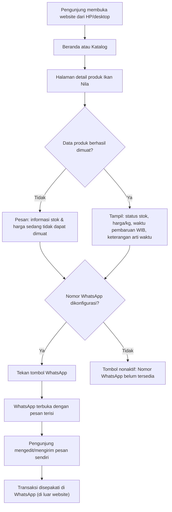
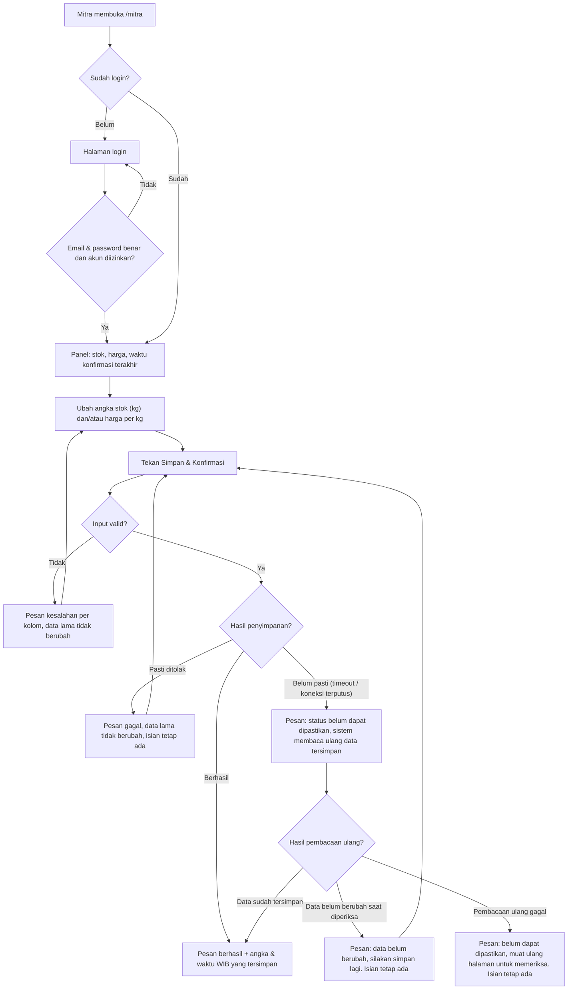

# PRD — Juki Fish Farm: Website Informasi & Promosi Ikan Nila

| Item | Keterangan |
|---|---|
| Versi dokumen | 0.8 (draf untuk ditinjau) |
| Tanggal | 19 November 2026 |
| Status | Menunggu tinjauan dan persetujuan klien |
| Dokumen terkait | [`ARCHITECTURE.md`](./ARCHITECTURE.md) (arsitektur teknis) |
| Nama usaha | **Juki Fish Farm** (nama awal, dapat diganti mitra dari panel, lihat §1.1 dan §12.7) |

---

## 0. Cara membaca dokumen ini

Setiap kebutuhan diberi label agar jelas statusnya:

| Label | Arti |
|---|---|
| **[Dikonfirmasi]** | Kebutuhan yang sudah disepakati dengan klien. |
| **[Asumsi A-xx]** | Asumsi sementara supaya pekerjaan bisa jalan. Masih bisa berubah. Daftar lengkap ada di §14. |
| **[Pertanyaan Q-xx]** | Hal yang perlu ditanyakan ke klien. Daftar lengkap ada di §15. |
| **[Saran]** | Saran dari tim pengembang, belum menjadi kebutuhan wajib sebelum disetujui. |

Penulisan `[[PLACEHOLDER: ...]]` menandai konten yang **belum tersedia** dan nanti harus diganti dengan
bahan asli dari klien. Data usaha yang **sudah diberikan klien** (nama, lokasi, produk, harga awal, dan
nomor WhatsApp) dirangkum di §1.1. Sejarah/gambaran usaha, foto, jam operasional, isi artikel, stok,
testimoni, dan keunggulan produk **belum diberikan**, jadi tidak dimuat dan tidak dikarang.

---

## 1. Ringkasan produk

Website untuk usaha penjualan **ikan nila** yang berfungsi sebagai media **informasi dan promosi**.
Pengunjung dapat mengenal usaha, melihat **stok (kg)**, **harga per kg**, dan **waktu terakhir stok &
harga diperbarui**, membaca artikel, lalu menghubungi usaha melalui **WhatsApp** dengan pesan yang sudah
terisi. Pemesanan dan kesepakatan transaksi tetap dilakukan di WhatsApp. **[Dikonfirmasi]**

Satu **mitra** memiliki satu akun untuk masuk ke **panel mitra**. Di panel itu mitra memperbarui stok dan
harga secara manual, mengonfirmasi ulang data yang tidak berubah, mengelola pilihan paket katalog
(§12.8), mengedit dua artikel yang sudah disediakan, dan mengganti nama usaha. **[Dikonfirmasi]**

Website ini **bukan toko online**: tidak ada keranjang, checkout, pembayaran, atau akun pembeli.

### 1.1 Identitas usaha (data dari klien, 17 November 2026)

| Item | Data | Status |
|---|---|---|
| Nama usaha | **Juki Fish Farm** | **[Dikonfirmasi]** sebagai nama awal. **Mitra dapat menggantinya sendiri dari panel** (Q-21 terjawab). Nama disimpan di tabel pengaturan di database dan dipakai di seluruh website (§12.7). |
| Sejarah & gambaran usaha | `[[PLACEHOLDER: Sejarah dan gambaran usaha]]` | Menyusul dari klien (K5). |
| Lokasi usaha | Jl. Setia Bersama, RT 05/RW 11, Kelurahan Meruyung, Kecamatan Limo, Kota Depok, Provinsi Jawa Barat | **[Dikonfirmasi]** (penulisan RT 05/RW 11 dikonfirmasi klien) |
| Tautan peta | https://share.google/u0j1tZY5Q6MoMTD5P | **[Dikonfirmasi]**. Tautan berbagi Google. Klien mengonfirmasi tautan ini membuka titik lokasi yang benar. Beranda juga menampilkan peta Google tertanam (permintaan pemilik proyek) yang mencari alamat tertulis di atas, sehingga bisa kurang tepat. Tombol "Buka di Google Maps" ke tautan ini tetap tersedia dan menjadi acuan titik lokasi. |
| Produk | **Ikan nila saja** (satu produk) | **[Dikonfirmasi]**: menjawab Q-01 dan mengonfirmasi A-01. |
| Harga | **Rp32.000 / kg** | **[Dikonfirmasi]** sebagai harga saat ini. Harga tetap diisi dan diperbarui mitra lewat panel (BR-H9). |
| Layanan | Penjualan ikan secara online. Pemesanan dan transaksi dilayani **lewat chat WhatsApp**. | **[Dikonfirmasi]**: sesuai cakupan MVP (tanpa checkout/pembayaran di website). |
| Nomor WhatsApp | **+62 815-7572-3540** (`6281575723540`) | **[Dikonfirmasi]**. Dipasang lewat konfigurasi lingkungan, bukan di kode (BR-WA5). |
| Foto usaha | `[[PLACEHOLDER: Foto usaha]]` | Menyusul. Klien akan mengirim (K3, K4). |

---

## 2. Latar belakang dan masalah yang ingin diselesaikan

### 2.1 Latar belakang

**Juki Fish Farm** berlokasi di Meruyung, Limo, Kota Depok, dan hanya menjual **ikan nila** dengan harga
saat ini **Rp32.000/kg**. Usaha ini ingin menjual secara online, dengan pemesanan tetap dilayani lewat
chat WhatsApp. Untuk itu usaha membutuhkan kanal resmi di internet agar calon pembeli bisa mendapatkan
informasi dasar sebelum menghubungi penjual. Sejarah dan gambaran usaha belum diberikan klien, jadi bagian
profil akan dilengkapi setelah bahan tersedia.

### 2.2 Masalah yang ingin diselesaikan

| # | Masalah | Solusi di website |
|---|---|---|
| M1 | Calon pembeli tidak tahu ketersediaan dan harga sebelum bertanya, sehingga muncul pertanyaan berulang di WhatsApp. | Halaman produk menampilkan stok (kg), harga/kg, dan waktu pembaruan terakhir. |
| M2 | Calon pembeli tidak tahu seberapa baru informasi yang dilihat. | Waktu pembaruan ditampilkan dalam WIB beserta penjelasan artinya. |
| M3 | Mitra perlu cara memperbarui informasi sendiri tanpa bantuan pengembang. | Panel mitra yang sederhana dan nyaman dipakai di HP. |
| M4 | Mitra sering memeriksa stok yang ternyata tidak berubah. Tanpa penanda, pengunjung mengira data sudah lama. | Fitur konfirmasi ulang memperbarui waktu tanpa mengubah angka. |
| M5 | Calon pembeli perlu cara cepat untuk menghubungi penjual. | Tombol WhatsApp dengan pesan terisi yang menyebutkan produk. |
| M6 | Usaha perlu konten edukasi/promosi. | Halaman daftar dan detail untuk dua artikel. Isinya dapat diedit mitra. |

### 2.3 Referensi yang dipelajari

**a. Referensi tampilan dan struktur informasi: `https://sentraikanlaut.com/`** (diperiksa 17 November 2026:
beranda, halaman produk, blog, dan tentang kami)

- **Pola yang layak diadopsi:** navigasi ringkas (Beranda, Produk, Blog/Artikel, Profil, Kontak), kartu
  produk dengan tombol "pesan via WhatsApp" pada setiap produk, pesan WhatsApp terisi yang menyebutkan
  nama produk dan tautan halaman produk, bagian artikel di beranda, serta alamat/kontak di footer.
- **Perbedaan utama:** referensi **tidak** menampilkan harga atau stok pada daftar produk. Website ini
  justru menonjolkan **stok (kg), harga/kg, dan waktu pembaruan**.
- **Tidak diadopsi:** klaim usaha (lama berdiri, sertifikasi, logo klien), banyak kategori produk, promo,
  daftar area kurir, katalog PDF, lowongan kerja, serta desain, teks, dan foto referensi. Tidak ada yang
  disalin.
- **Keterbatasan pemeriksaan:** halaman detail produk, detail artikel, kontak, dan formulir order
  referensi tidak dibuka. Tampilan di HP tidak dinilai secara visual.

**b. Referensi logika stok: `https://github.com/Jayflux/Jokincay`** (diperiksa 17 November 2026, commit `58bd4eb`)

- Repo dapat diakses. Ternyata isinya **sistem manajemen pemesanan jasa joki tugas** (Laravel +
  Filament) dengan fitur pesanan, pembayaran, pelacakan, dan laporan. **Repo ini tidak memiliki logika
  stok.** Yang relevan hanya pola-pola umumnya: admin memperbarui nilai secara manual, nilai kosong
  dibedakan dari nilai yang sudah diisi, dan tautan WhatsApp dengan pesan terisi.
- **Status lisensi tidak jelas.** Tidak ada file LICENSE. README menyebut MIT dan menautkan ke file yang
  tidak ada, dan GitHub tidak mendeteksi lisensi. Karena itu **kode tidak disalin** dan hanya dijadikan
  referensi konsep.
- Analisis teknis lengkap ada di `ARCHITECTURE.md` §2.

---

## 3. Tujuan website

| # | Tujuan | Indikator keberhasilan (usulan) |
|---|---|---|
| T1 | Menyediakan informasi produk yang jujur dan terbaru. | Stok, harga, dan waktu pembaruan tampil benar sesuai data tersimpan setiap kali halaman dibuka atau dimuat ulang. |
| T2 | Memudahkan calon pembeli menghubungi penjual. | Tombol WhatsApp berfungsi dari setiap halaman produk dan halaman kontak. Pesan terisi menyebutkan produk. |
| T3 | Memudahkan mitra memperbarui data. | Dari HP, mitra dapat memperbarui atau mengonfirmasi stok dan harga dalam waktu kurang dari 1 menit setelah login **[Saran: target]**. |
| T4 | Membangun citra dan kepercayaan usaha. | Profil usaha dan dua artikel tampil dengan konten asli klien saat peluncuran. |
| T5 | Tidak menampilkan data palsu. | Saat peluncuran, tidak ada nomor, alamat, harga, stok, foto, atau klaim yang tidak berasal dari klien. |

---

## 4. Target pengguna dan kebutuhannya

### 4.1 Pengunjung / calon pembeli

Contohnya pembeli rumahan atau pelaku usaha kuliner. Segmen pasti belum diketahui **[Pertanyaan Q-16]**.
Kebanyakan diperkirakan membuka website dari HP.

| Kebutuhan | Cara website memenuhinya |
|---|---|
| Mengetahui apakah ikan nila tersedia | Status stok: angka kg, "Stok habis", atau "Belum tersedia". |
| Mengetahui harga per kg | Harga dalam rupiah per kg, atau "Belum tersedia". |
| Mengetahui seberapa baru informasinya | Tanggal dan jam pembaruan terakhir (WIB) beserta penjelasannya. |
| Menghubungi penjual dengan cepat | Tombol WhatsApp dengan pesan terisi. |
| Mempercayai usaha | Profil usaha, alamat, jam operasional, dan artikel (setelah konten klien tersedia). |
| Akses nyaman di HP | Tampilan responsif dan ringan. |

### 4.2 Mitra / admin (satu orang, satu akun)

| Kebutuhan | Cara website memenuhinya |
|---|---|
| Masuk ke panel dengan aman | Login email + password. Tidak ada pendaftaran publik. |
| Melihat data yang sedang tampil | Panel menampilkan stok, harga, dan waktu konfirmasi terakhir. |
| Memperbarui stok/harga dengan cepat dari HP | Satu formulir sederhana dengan papan ketik angka di HP. Koma desimal diterima. |
| Menandai bahwa data sudah diperiksa walau angkanya sama | Tombol simpan/konfirmasi tetap bisa dipakai tanpa mengubah angka. |
| Yakin penyimpanan berhasil | Pesan berhasil/gagal yang jelas, lengkap dengan angka dan waktu yang tersimpan. |
| Memperbaiki artikel | Mengedit judul dan isi dua artikel yang sudah tersedia. |
| Mengganti nama usaha | Halaman pengaturan berisi satu kolom nama usaha. Nama baru tampil di seluruh website tanpa bantuan pengembang. |

### 4.3 Pemilik usaha / klien dan tim pengembang (pengguna sekunder)

- **Klien:** memastikan hanya mitra yang dapat mengubah data dan tidak ada informasi palsu yang tampil.
- **Pengembang:** membuat akun mitra, mengganti placeholder dengan konten asli, mengatur nomor WhatsApp,
  dan memelihara sistem.

---

## 5. Ruang lingkup MVP **[Dikonfirmasi]**

### 5.1 Halaman publik

1. Beranda / landing page.
2. Katalog atau bagian produk ikan nila. Berisi satu produk: ikan nila **[Dikonfirmasi, §1.1]**, dengan
   pilihan paket (nama, berat, harga total) yang dikelola mitra **[Dikonfirmasi, 19 Nov 2026, §12.8]**.
3. Profil usaha: nama dan lokasi sudah tersedia. Sejarah/gambaran dan foto berupa placeholder sampai
   bahan tersedia.
4. Daftar artikel dan detail artikel (dua artikel).
5. Kontak.
6. Tombol pesan melalui WhatsApp.

### 5.2 Panel mitra

1. Login untuk satu mitra yang diizinkan.
2. Melihat stok dan harga yang tersimpan.
3. Mengubah stok dalam kg, termasuk nilai desimal.
4. Mengubah harga per kg.
5. Menyimpan atau mengonfirmasi kembali stok dan harga.
6. Melihat waktu terakhir data produk dikonfirmasi.
7. Mengedit judul dan isi dua artikel yang sudah disediakan.
8. Mengganti nama usaha (§12.7).
9. Logout.
10. Mengelola pilihan paket katalog: menambah, mengubah nama/berat/harga total, dan menghapus paket (§12.8).

### 5.3 Tombol WhatsApp

- Mengarahkan pengguna ke WhatsApp dengan pesan yang sudah terisi. Pengguna tetap harus menekan kirim
  sendiri.
- Pesan dapat menyebutkan nama produk.
- Jika nomor belum dikonfigurasi, tombol menampilkan kondisi yang jelas dan tidak mengarah ke nomor
  fiktif.

---

## 6. Hal yang tidak termasuk MVP **[Dikonfirmasi]**

- Checkout dan keranjang.
- Payment gateway atau pembayaran otomatis.
- Akun pembeli.
- Pengurangan stok otomatis setelah pembelian atau klik WhatsApp.
- Sinkronisasi realtime di layar pengunjung yang sedang terbuka.
- Integrasi kurir atau perhitungan ongkir.
- Dashboard analitik kompleks.
- Aplikasi mobile terpisah.
- Manajemen banyak mitra.
- Fitur bagi mitra untuk menambah dan menghapus artikel.
- Mengubah info usaha **selain nama** (alamat, tautan peta, jam operasional, profil) dari panel. Info itu
  diubah pengembang di MVP (A-18).

### 6.1 Pengembangan berikutnya **[Saran]** (bukan kebutuhan wajib MVP)

| Usulan | Manfaat | Catatan |
|---|---|---|
| Ganti password dari panel | Mitra dapat mengganti password sementara sendiri. | Upaya kecil. Lihat Q-11. |
| Lupa password via email | Mitra dapat memulihkan akun tanpa pengembang. | Perlu layanan email (SMTP) khusus. Lihat `ARCHITECTURE.md` §9. |
| Riwayat perubahan stok & harga | Melacak kapan dan berapa angka diubah, berguna bila ada selisih. | Satu tabel log tambahan. Lihat Q-17. |
| Label "data mungkin sudah lama" | Mengingatkan pengunjung bila data tidak diperbarui lebih dari X jam. | Ambang X perlu disepakati. Lihat Q-07. |
| Pengingat pembaruan stok untuk mitra | Data lebih sering terbarui. | Bisa lewat email/notifikasi. |
| Beberapa pilihan produk (ukuran/kondisi) | Mendukung variasi produk. | Struktur data sudah disiapkan. Lihat Q-01. |
| Unggah/ganti foto dari panel | Mitra bisa mengganti foto sendiri. | Perlu penyimpanan file terpisah. Lihat Q-12. |
| Hitungan klik tombol WhatsApp | Mengukur minat pengunjung. | Analitik sederhana, bukan dashboard kompleks. |
| Autentikasi dua langkah (MFA) untuk mitra | Keamanan akun lebih tinggi. | Didukung Supabase Auth. |
| Data terstruktur SEO (LocalBusiness) | Tampil lebih baik di mesin pencari. | Alamat sudah diberikan klien (§1.1). Jam operasional masih menunggu. |
| Domain khusus | Alamat website lebih profesional. | Lihat Q-14. |

---

## 7. Daftar halaman dan fungsi utama

URL di bawah adalah usulan. Detail route ada di `ARCHITECTURE.md` §6.

| Halaman | URL usulan | Akses | Fungsi utama | Konten placeholder |
|---|---|---|---|---|
| Beranda | `/` | Publik | Perkenalan usaha, ringkasan produk (stok, harga, waktu pembaruan), cuplikan profil, artikel, lokasi (alamat, peta Google tertanam, tombol Google Maps), ajakan WhatsApp. | Tagline, foto, deskripsi singkat. (Nama usaha sudah tersedia.) |
| Katalog produk | `/produk` | Publik | Daftar produk aktif. Untuk MVP satu produk "Ikan Nila", disertai stok, harga, waktu pembaruan, ringkasan pilihan paket, dan tombol WhatsApp. | Foto & deskripsi produk. |
| Detail produk | `/produk/ikan-nila` | Publik | Informasi lengkap produk, status stok, harga/kg, waktu pembaruan, keterangan arti waktu, kartu pilihan paket (§12.8) dengan tombol WhatsApp per paket. | Foto & deskripsi produk. |
| Profil usaha | `/profil` | Publik | Nama usaha, lokasi, sejarah dan gambaran usaha. | Sejarah & gambaran usaha, foto usaha. (Nama & lokasi sudah tersedia.) |
| Daftar artikel | `/artikel` | Publik | Daftar dua artikel (judul, cuplikan). | Judul & isi artikel. |
| Detail artikel | `/artikel/[slug]` | Publik | Isi lengkap artikel. | Judul & isi artikel. |
| Kontak | `/kontak` | Publik | Tombol WhatsApp, alamat + tautan Google Maps, jam operasional. | Jam operasional. (Alamat, tautan peta, dan nomor WhatsApp sudah tersedia.) |
| Login mitra | `/mitra/login` | Tamu | Form email + password. | — |
| Panel: stok & harga | `/mitra` | Mitra | Melihat data tersimpan, mengubah stok/harga, menyimpan/konfirmasi ulang, melihat waktu konfirmasi terakhir. | — |
| Panel: daftar artikel | `/mitra/artikel` | Mitra | Daftar dua artikel yang bisa diedit. | — |
| Panel: edit artikel | `/mitra/artikel/[slug]` | Mitra | Edit judul & isi, pratinjau, simpan. | — |
| Panel: pengaturan usaha | `/mitra/pengaturan` | Mitra | Melihat dan mengganti nama usaha, simpan. | — |
| Panel: paket katalog | `/mitra/paket` | Mitra | Daftar paket, tambah, ubah nama/berat/harga total, hapus dengan konfirmasi, pratinjau harga efektif & badge Hemat. | — |
| Halaman tidak ditemukan | (otomatis) | Publik | Pesan 404 yang ramah dan tautan kembali. | — |

Tombol logout tersedia di header panel, bukan sebagai halaman tersendiri.

---

## 8. User stories dan prioritas

Prioritas memakai metode **MoSCoW**: **Must** = wajib MVP, **Should** = sebaiknya ada di MVP, **Could** =
bila sempat, **Later** = pengembangan berikutnya.

### 8.1 Pengunjung

| ID | Sebagai | Saya ingin | Agar | Prioritas | Status |
|---|---|---|---|---|---|
| US-01 | Pengunjung | Melihat profil usaha | Saya mengenal dan bisa mempercayai penjual | Must | Dikonfirmasi |
| US-02 | Pengunjung | Melihat katalog/produk ikan nila | Saya tahu apa yang dijual | Must | Dikonfirmasi |
| US-03 | Pengunjung | Melihat stok dalam kg, termasuk status "Stok habis" atau "Belum tersedia" | Saya tahu ketersediaan sebelum bertanya | Must | Dikonfirmasi |
| US-04 | Pengunjung | Melihat harga per kg dalam rupiah | Saya bisa memperkirakan biaya | Must | Dikonfirmasi |
| US-05 | Pengunjung | Melihat kapan stok dan harga terakhir diperbarui (WIB) | Saya bisa menilai seberapa baru informasinya | Must | Dikonfirmasi |
| US-06 | Pengunjung | Menekan tombol WhatsApp dan langsung mendapat pesan terisi yang menyebutkan produk | Saya cepat bertanya/memesan | Must | Dikonfirmasi |
| US-07 | Pengunjung | Tetap bisa bertanya lewat WhatsApp walau stok habis | Saya bisa menanyakan ketersediaan berikutnya | Must | Dikonfirmasi |
| US-08 | Pengunjung | Membaca daftar dan detail artikel | Saya mendapat informasi yang berguna | Must | Dikonfirmasi |
| US-09 | Pengunjung | Melihat kontak, alamat, dan jam operasional | Saya tahu cara dan waktu menghubungi | Must | Dikonfirmasi (konten menyusul) |
| US-10 | Pengunjung | Website nyaman dipakai di HP | Saya bisa mengaksesnya di mana saja | Must | Dikonfirmasi |
| US-11 | Pengunjung | Tombol WhatsApp mengambang di semua halaman publik | Saya bisa menghubungi dari halaman mana pun | Should | Saran |

### 8.2 Mitra

| ID | Sebagai | Saya ingin | Agar | Prioritas | Status |
|---|---|---|---|---|---|
| US-12 | Mitra | Login dengan akun saya | Hanya saya yang bisa mengubah data | Must | Dikonfirmasi |
| US-13 | Mitra | Melihat stok, harga, dan waktu konfirmasi terakhir yang tersimpan | Saya tahu apa yang sedang dilihat pengunjung | Must | Dikonfirmasi |
| US-14 | Mitra | Mengubah stok dalam kg dengan desimal (mis. 12,5) | Data sesuai timbangan | Must | Dikonfirmasi |
| US-15 | Mitra | Mengubah harga per kg | Harga di website sesuai harga terbaru | Must | Dikonfirmasi |
| US-16 | Mitra | Menyimpan ulang stok dan harga yang tidak berubah | Pengunjung tahu data sudah saya periksa kembali | Must | Dikonfirmasi |
| US-17 | Mitra | Mendapat pesan jelas saat penyimpanan berhasil atau gagal | Saya tidak ragu apakah data sudah tersimpan | Must | Dikonfirmasi |
| US-18 | Mitra | Mengedit judul dan isi dua artikel | Artikel bisa saya perbaiki tanpa pengembang | Must | Dikonfirmasi |
| US-19 | Mitra | Logout | Akun aman bila memakai perangkat bersama | Must | Dikonfirmasi |
| US-27 | Mitra | Mengganti nama usaha dari panel | Nama di website sesuai keinginan usaha tanpa menunggu pengembang | Must | Dikonfirmasi (Q-21) |
| US-20 | Mitra | Melihat pratinjau artikel sebelum menyimpan | Saya yakin tampilannya benar | Should | Saran |
| US-21 | Mitra | Diberi peringatan sebelum menyimpan harga Rp0 | Saya tidak salah ketik | Should | Saran (Q-05) |
| US-22 | Mitra | Mengganti password sendiri | Akun lebih aman | Later | Saran (Q-11) |
| US-23 | Mitra | Melihat riwayat perubahan stok & harga | Saya bisa menelusuri perubahan | Later | Saran (Q-17) |

### 8.3 Klien / pemilik

| ID | Sebagai | Saya ingin | Agar | Prioritas | Status |
|---|---|---|---|---|---|
| US-24 | Klien | Tidak ada nomor, alamat, harga, foto, atau klaim palsu di website | Usaha tidak dirugikan informasi keliru | Must | Dikonfirmasi |
| US-25 | Klien | Hanya akun mitra yang diizinkan yang dapat mengubah data | Data tidak diubah orang lain | Must | Dikonfirmasi |
| US-26 | Klien | Placeholder mudah diganti dengan konten asli | Peluncuran tidak tertunda karena perubahan kode besar | Must | Dikonfirmasi |

---

## 9. Alur pengguna

### 9.1 Pengunjung melihat produk dan menghubungi WhatsApp

Langkah utama:

1. Pengunjung membuka beranda atau katalog, lalu memilih produk Ikan Nila.
2. Halaman menampilkan status stok, harga per kg, dan waktu pembaruan terakhir sesuai data tersimpan
   **pada saat halaman dimuat**.
3. Pengunjung menekan tombol WhatsApp. WhatsApp (aplikasi atau WhatsApp Web) terbuka di tab/jendela baru
   dengan pesan terisi.
4. Pengunjung menekan kirim sendiri. Website **tidak** mengirim pesan dan **tidak** mengubah stok.

Alur alternatif:

- **Stok habis:** status "Stok habis" tampil. Tombol WhatsApp tetap aktif dengan pesan yang menanyakan
  ketersediaan.
- **Stok/harga belum pernah diisi:** tampil "Belum tersedia". Tombol WhatsApp tetap aktif untuk bertanya.
- **Nomor belum dikonfigurasi:** tombol tampil nonaktif dengan teks "Nomor WhatsApp belum tersedia" dan
  tidak mengarah ke mana pun.
- **Data gagal dimuat:** tampil pesan gangguan, **bukan** "Stok habis" atau "Belum tersedia". Tombol
  WhatsApp tetap berfungsi bila nomor dikonfigurasi.

### 9.2 Mitra memperbarui stok dan harga

1. Mitra login (jika belum), lalu otomatis masuk ke halaman stok & harga.
2. Panel menampilkan stok, harga, dan waktu konfirmasi terakhir yang sedang tampil di website.
3. Mitra mengisi stok (mis. `12,5`) dan harga per kg (mis. `35000` atau `35.000`).
   Angka di contoh ini hanyalah ilustrasi format, bukan harga usaha.
4. Panel menampilkan pratinjau cara angka akan disimpan, mis. "12,5 kg" dan "Rp35.000 / kg"
   **[Saran]**.
5. Mitra menekan **Simpan & Konfirmasi**. Tombol nonaktif selama proses agar tidak tersimpan dua kali.
6. Jika berhasil, muncul pesan dengan angka tersimpan dan waktu konfirmasi baru (WIB). Pengunjung yang
   membuka atau memuat ulang halaman produk sesudahnya melihat data baru.
7. Jika penyimpanan **pasti ditolak** (server/database menjawab dengan penolakan), muncul pesan yang
   jelas. Data lama tidak berubah sama sekali dan isian formulir tidak hilang.
8. Jika hasilnya **belum pasti** (batas waktu habis, koneksi HP terputus, atau jawaban server tidak
   lengkap), panel **tidak** mengklaim berhasil dan **tidak** mengklaim data tidak berubah. Panel membaca
   ulang data tersimpan lalu menampilkan hasil sebenarnya (AC-51). Menyimpan ulang angka yang sama aman,
   karena hasilnya hanya memperbarui waktu konfirmasi.

### 9.3 Mitra mengonfirmasi ulang data yang nilainya tetap sama

1. Mitra membuka panel dan memeriksa stok fisik serta harga. Ternyata angkanya sama dengan yang tersimpan.
2. Tanpa mengubah angka, mitra menekan **Simpan & Konfirmasi**.
3. Sistem menyimpan angka yang sama dan **memperbarui waktu konfirmasi** ke waktu saat ini.
4. Pesan berhasil menyebutkan bahwa data dikonfirmasi ulang tanpa perubahan angka, beserta waktu baru.
5. Halaman produk publik menampilkan waktu pembaruan yang baru setelah dimuat ulang.

### 9.4 Mitra mengedit artikel yang sudah tersedia

1. Mitra membuka menu **Artikel** di panel dan melihat daftar dua artikel. Tidak ada tombol tambah atau
   hapus.
2. Mitra memilih satu artikel. Formulir menampilkan judul dan isi saat ini.
3. Mitra mengubah judul dan/atau isi, lalu melihat pratinjau **[Saran]**.
4. Mitra menekan **Simpan**. Jika valid dan berhasil, muncul pesan berhasil. Jika gagal, muncul pesan
   gagal dan isian tetap ada.
5. Pengunjung yang membuka atau memuat ulang halaman artikel melihat judul dan isi baru. Alamat (URL)
   artikel **tidak berubah** walaupun judulnya diganti **[Asumsi A-11]**.
6. Mengedit artikel **tidak** mengubah waktu pembaruan stok & harga.

### 9.5 Mitra mengganti nama usaha

1. Mitra membuka menu **Pengaturan** di panel. Formulir menampilkan nama usaha yang sedang tampil
   (awalnya "Juki Fish Farm").
2. Mitra mengetik nama baru, lalu menekan **Simpan**. Tombol nonaktif selama proses.
3. Jika valid dan berhasil, muncul pesan "Nama usaha disimpan: {nama baru}".
4. Pengunjung yang membuka atau memuat ulang halaman mana pun melihat nama baru di header, footer, judul
   tab browser, dan pesan WhatsApp terisi. Tidak perlu bantuan pengembang atau redeploy.
5. Jika gagal (tidak valid, sesi berakhir, gangguan), muncul pesan gagal, isian tetap ada, dan nama lama
   tetap tampil.
6. Mengganti nama **tidak** mengubah waktu pembaruan stok & harga, URL halaman, atau isi artikel.

---

## 10. Kebutuhan fungsional

| ID | Kebutuhan | Prioritas | Status | AC terkait |
|---|---|---|---|---|
| FR-01 | Beranda menampilkan perkenalan usaha, ringkasan produk (stok, harga, waktu pembaruan), cuplikan artikel, dan ajakan WhatsApp. | Must | Dikonfirmasi | AC-01–AC-12, AC-36 |
| FR-02 | Katalog menampilkan produk aktif. Untuk MVP satu produk; tampilan mendukung lebih dari satu produk. | Must | Dikonfirmasi / A-01 | AC-01–AC-08 |
| FR-03 | Detail produk menampilkan nama, foto/placeholder, deskripsi/placeholder, status stok, harga/kg, waktu pembaruan WIB, keterangan arti waktu, dan tombol WhatsApp. | Must | Dikonfirmasi | AC-01–AC-16 |
| FR-04 | Status stok mengikuti aturan BR-S (angka kg / "Stok habis" / "Belum tersedia"). | Must | Dikonfirmasi | AC-01–AC-03 |
| FR-05 | Harga mengikuti aturan BR-H (rupiah per kg / "Belum tersedia"). | Must | Dikonfirmasi | AC-04–AC-06 |
| FR-06 | Waktu pembaruan mengikuti aturan BR-W (WIB, arti yang jelas). | Must | Dikonfirmasi | AC-07, AC-08 |
| FR-07 | Data produk yang tampil adalah data tersimpan terbaru saat halaman dibuka/dimuat ulang. Tidak perlu realtime. | Must | Dikonfirmasi | AC-09–AC-11 |
| FR-08 | Jika data produk gagal dimuat, tampil pesan gangguan yang berbeda dari "Stok habis" dan "Belum tersedia". | Must | Saran (turunan kebutuhan) | AC-12 |
| FR-09 | Tombol WhatsApp membuka WhatsApp dengan pesan terisi yang menyebutkan nama produk. | Must | Dikonfirmasi | AC-13, AC-16 |
| FR-10 | Jika nomor WhatsApp belum dikonfigurasi atau tidak valid, tombol nonaktif dengan keterangan jelas dan tanpa tautan ke nomor mana pun. | Must | Dikonfirmasi | AC-14 |
| FR-11 | Klik WhatsApp dan transaksi tidak mengubah stok. | Must | Dikonfirmasi | AC-15 |
| FR-12 | Halaman profil usaha: nama dan lokasi dari klien. Sejarah/gambaran usaha dan foto berupa placeholder yang mudah diganti sampai tersedia. | Must | Dikonfirmasi | AC-36 |
| FR-13 | Halaman daftar artikel dan detail artikel untuk artikel yang dipublikasikan. | Must | Dikonfirmasi | AC-35 |
| FR-14 | Halaman kontak: tombol WhatsApp, alamat + tautan Google Maps (tersedia), jam operasional (placeholder sampai tersedia). | Must | Dikonfirmasi | AC-14, AC-36 |
| FR-15 | Login mitra dengan email + password. Tidak ada pendaftaran publik. | Must | Dikonfirmasi / A-08 | AC-17–AC-22 |
| FR-16 | Hanya satu akun yang secara eksplisit diizinkan yang dapat mengakses panel dan mengubah data. Pembatasan ini ditegakkan di server dan database. | Must | Dikonfirmasi | AC-19–AC-21 |
| FR-17 | Panel menampilkan stok, harga, dan waktu konfirmasi terakhir yang tersimpan. | Must | Dikonfirmasi | AC-25 |
| FR-18 | Panel dapat menyimpan stok (kg, desimal) dan harga/kg dalam satu aksi "Simpan & Konfirmasi". | Must | Dikonfirmasi | AC-26–AC-30, AC-33, AC-34 |
| FR-19 | Aksi "Simpan & Konfirmasi" dengan angka yang sama tetap memperbarui waktu konfirmasi. | Must | Dikonfirmasi | AC-31 |
| FR-20 | Waktu konfirmasi hanya berubah melalui aksi "Simpan & Konfirmasi", tidak oleh perubahan lain. | Must | Dikonfirmasi | AC-32 |
| FR-21 | Validasi input stok & harga (tidak negatif, format benar, batas wajar) dengan pesan per kolom. | Must | Dikonfirmasi / A-07 | AC-28 |
| FR-22 | Pesan berhasil/gagal yang jelas. Data tidak berubah sebagian (semua atau tidak sama sekali). | Must | Dikonfirmasi | AC-26, AC-29 |
| FR-23 | Panel menampilkan daftar dua artikel dan formulir edit judul & isi. | Must | Dikonfirmasi | AC-37, AC-38 |
| FR-24 | Panel tidak menyediakan tambah/hapus artikel. Database juga menolak penambahan/penghapusan dari akun mitra. | Must | Dikonfirmasi | AC-39 |
| FR-25 | Isi artikel ditampilkan aman (kode/skrip tidak dijalankan). | Must | Saran (keamanan) | AC-40 |
| FR-26 | Logout menghapus sesi mitra. | Must | Dikonfirmasi | AC-23 |
| FR-27 | Pratinjau isi artikel sebelum disimpan. | Should | Saran | — |
| FR-28 | Peringatan konfirmasi sebelum menyimpan harga Rp0. | Should | Saran / Q-05 | AC-34 |
| FR-29 | Tombol WhatsApp mengambang di halaman publik. | Should | Saran | AC-13 |
| FR-30 | Halaman panel tidak diindeks mesin pencari. Seluruh situs `noindex` sampai konten asli siap. | Must | Saran (A-17) | AC-44 |
| FR-31 | Panel menyediakan halaman pengaturan untuk melihat dan mengganti nama usaha. Hanya mitra yang diizinkan yang dapat menyimpan, dan pembatasan ini ditegakkan di database. | Must | Dikonfirmasi (Q-21) | AC-45–AC-48 |
| FR-32 | Nama usaha yang tampil di seluruh website (header, footer, judul halaman, gambar bagikan, pesan WhatsApp) diambil dari pengaturan dan berubah setelah disimpan, paling lambat saat halaman dimuat ulang, tanpa redeploy. | Must | Dikonfirmasi (Q-21) | AC-46, AC-49 |
| FR-33 | Hasil penyimpanan yang **belum pasti** (batas waktu habis, koneksi terputus, jawaban tidak lengkap) dibedakan dari penolakan yang pasti. Untuk hasil belum pasti, panel tidak mengklaim berhasil maupun "data tidak berubah", lalu membaca ulang data tersimpan untuk menentukan hasilnya. Satu pembacaan yang masih menunjukkan data lama **bukan** bukti gagal: status tetap belum pasti dan tersedia tombol "Periksa ulang". Berlaku untuk stok & harga, artikel, nama usaha, dan paket. | Must | Saran (turunan US-17, FR-22) | AC-51, AC-52, AC-61 |
| FR-34 | Panel menyediakan halaman paket katalog: daftar, tambah, ubah (nama, berat, harga total), dan hapus paket dengan konfirmasi yang menyebut paket. Hanya mitra yang diizinkan yang dapat menulis; ditegakkan di database. | Must | Dikonfirmasi (19 Nov 2026) | AC-53, AC-54, AC-58 |
| FR-35 | Beranda, katalog, dan detail produk menampilkan paket dari satu sumber data tersimpan: harga total, harga efektif/kg, badge "Hemat Rp…" bila berlaku, dan tombol WhatsApp per paket (detail produk). | Must | Dikonfirmasi (19 Nov 2026) | AC-55, AC-56, AC-59, AC-60 |
| FR-36 | Paket memakai stok total produk bersama; CRUD paket dan klik WhatsApp tidak mengubah stok, harga satuan, atau waktu konfirmasi. | Must | Dikonfirmasi / A-21 | AC-57 |
| FR-37 | Sesi yang berakhir saat formulir panel dikirim menghasilkan pesan sesi dengan isian tetap ada; gangguan pemeriksaan akses dibedakan dari "bukan mitra". | Must | Saran (turunan AC-24) | AC-24 |

---

## 11. Kebutuhan nonfungsional

| ID | Kategori | Kebutuhan |
|---|---|---|
| NFR-01 | Responsif | Tampilan nyaman dari lebar layar **360 px** (HP kecil) hingga desktop ≥ 1280 px, tanpa gulir horizontal. |
| NFR-02 | Responsif | Panel mitra dirancang **mobile-first**: kolom angka memunculkan papan ketik angka, tombol besar (≥ 44×44 px), teks input ≥ 16 px agar HP tidak memperbesar layar otomatis. |
| NFR-03 | Keamanan | Seluruh akses melalui HTTPS. |
| NFR-04 | Keamanan | Tidak ada pendaftaran akun publik. Akun mitra dibuat pengembang secara manual. |
| NFR-05 | Keamanan | Hak ubah data ditegakkan di **server dan database** (bukan hanya menyembunyikan tombol/halaman). Pengguna tanpa hak akses tidak dapat mengubah data walau memanggil API secara langsung. |
| NFR-06 | Keamanan | Kunci rahasia (secret/service key), password database, dan password akun **tidak boleh** ada di kode frontend maupun repositori. |
| NFR-07 | Keamanan | Pesan login gagal bersifat umum ("Email atau password salah") dan tidak membocorkan apakah email terdaftar. Percobaan login dibatasi oleh rate limit penyedia autentikasi. |
| NFR-08 | Keamanan | Isi artikel dirender aman (HTML/skrip dari input tidak dijalankan). |
| NFR-09 | Kemudahan | Mitra dapat memperbarui stok & harga dalam ≤ 3 langkah setelah login: buka panel → isi → simpan. |
| NFR-10 | Kemudahan | Seluruh teks antarmuka dalam bahasa Indonesia yang sederhana. Format angka Indonesia (koma desimal, titik ribuan). |
| NFR-11 | Kemudahan | Tersedia panduan singkat (1 halaman) untuk mitra saat serah terima **[Saran]**. |
| NFR-12 | Status UI | **Loading:** kerangka (skeleton) atau indikator saat data dimuat. Tombol simpan menampilkan "Menyimpan…" dan nonaktif. |
| NFR-13 | Status UI | **Data kosong:** "Belum tersedia" untuk stok/harga yang belum diisi, "Produk belum tersedia" bila tidak ada produk aktif, "Artikel belum tersedia" bila tidak ada artikel. |
| NFR-14 | Status UI | **Error:** pesan yang menjelaskan apa yang terjadi dan apa yang bisa dilakukan. Halaman tidak "crash" total. Halaman 404 yang ramah. |
| NFR-15 | Aksesibilitas | HTML semantik, `lang="id"`, label pada setiap input, fokus keyboard terlihat, seluruh fungsi dapat diakses dengan keyboard. |
| NFR-16 | Aksesibilitas | Kontras warna minimal WCAG 2.2 AA. Status stok tidak hanya dibedakan dengan warna (selalu ada teks). |
| NFR-17 | Aksesibilitas | Gambar memiliki teks alternatif. Pesan hasil simpan diumumkan ke pembaca layar (`aria-live`). |
| NFR-18 | Performa | Halaman publik ringan. Target **[Saran]**: skor Performance Lighthouse mobile ≥ 90 dan LCP < 2,5 detik pada jaringan 4G. Gambar dioptimasi otomatis. |
| NFR-19 | Performa | Arsitektur sederhana sesuai skala (satu mitra, lalu lintas kecil). Tanpa layanan tambahan yang tidak perlu. |
| NFR-20 | Keandalan | Penyimpanan stok & harga bersifat atomik: berhasil seluruhnya atau tidak berubah sama sekali. |
| NFR-21 | Keandalan | Bila database tidak dapat diakses, halaman publik tetap tampil dengan pesan gangguan dan tombol WhatsApp tetap berfungsi. |
| NFR-22 | Kejujuran data | Tidak ada data contoh/palsu yang tampil seolah-olah data asli (nomor, alamat, harga, stok, testimoni, foto). |
| NFR-23 | Waktu | Waktu disimpan konsisten (zona waktu UTC di database) dan ditampilkan dalam **Asia/Jakarta (WIB)**. |
| NFR-24 | Pemeliharaan | Konten placeholder, info usaha, dan nomor WhatsApp dapat diganti tanpa mengubah logika aplikasi. |
| NFR-25 | Pemeliharaan | Struktur data mendukung penambahan pilihan produk tanpa perombakan besar. |
| NFR-26 | Privasi | Website tidak mengumpulkan data pribadi pengunjung di MVP (tanpa formulir, tanpa akun pembeli). Peta Google tertanam di beranda memuat konten pihak ketiga, sehingga Google dapat menerima data permintaan pengunjung (mis. alamat IP) menurut kebijakan Google. |
| NFR-27 | SEO dasar | Judul & deskripsi per halaman, sitemap, robots. Panel tidak diindeks. |

---

## 12. Aturan bisnis

### 12.1 Stok

| ID | Aturan | Status |
|---|---|---|
| BR-S1 | Stok dicatat dalam **kilogram**. | Dikonfirmasi |
| BR-S2 | Nilai desimal diperbolehkan (mis. 12,5 kg). Presisi maksimal **2 angka desimal** (0,01 kg). | Dikonfirmasi / A-03 |
| BR-S3 | Stok **tidak boleh negatif**. | Dikonfirmasi |
| BR-S4 | Stok diperbarui **manual** oleh mitra kapan saja, termasuk beberapa kali sehari. | Dikonfirmasi |
| BR-S5 | Klik tombol WhatsApp dan pembelian lewat WhatsApp **tidak** mengurangi stok otomatis. Mitra memperbarui stok manual setelah ada perubahan. | Dikonfirmasi |
| BR-S6 | Stok **belum pernah diisi** (kosong/NULL) ditampilkan **"Belum tersedia"** dan **tidak** dianggap nol. | Dikonfirmasi |
| BR-S7 | Stok **0 kg** ditampilkan **"Stok habis"**. | Dikonfirmasi |
| BR-S8 | Saat stok habis atau belum tersedia, tombol WhatsApp tetap dapat dipakai untuk bertanya. | Dikonfirmasi |
| BR-S9 | Batas wajar input stok: **0 – 100.000 kg** untuk menangkap salah ketik. Nilai ini dapat disesuaikan. Batas yang **sama** ditegakkan di validasi server **dan** di database (constraint tabel + fungsi simpan), sehingga panggilan API langsung pun tidak dapat menyimpan nilai di luar batas. Mengubah batas berarti mengubah keduanya sekaligus. | Asumsi A-07 |
| BR-S10 | Formulir menerima koma atau titik sebagai pemisah desimal (`12,5` = `12.5`) dan **tidak** menerima pemisah ribuan. Format diperiksa **sebelum** dinormalisasi: paling banyak satu pemisah dan 2 angka di belakangnya. Input seperti `1.250,5` (dua pemisah) atau `1.250`/`1,255` (3 angka di belakang pemisah) **ditolak** dengan pesan, tidak dibulatkan dan tidak ditafsirkan sebagai ribuan. | Asumsi A-03 |

Tabel tampilan stok di halaman publik:

| Data tersimpan | Tampilan publik |
|---|---|
| Kosong (belum pernah diisi) | **Belum tersedia** |
| `0` | **Stok habis** |
| `12.5` | **12,5 kg** |
| `10` | **10 kg** |
| Data gagal dimuat | **Informasi stok dan harga sedang tidak dapat dimuat** (bukan "Belum tersedia"/"Stok habis") |

### 12.2 Harga

| ID | Aturan | Status |
|---|---|---|
| BR-H1 | Harga ditampilkan dalam **rupiah per kilogram**. | Dikonfirmasi |
| BR-H2 | Harga **tidak boleh negatif**. | Dikonfirmasi |
| BR-H3 | Harga disimpan sebagai **rupiah bulat** (tanpa sen). | Asumsi A-02 (dapat dikonfirmasi) |
| BR-H4 | Harga **belum pernah diisi** ditampilkan **"Belum tersedia"**. Tidak ada angka contoh yang ditampilkan sebagai harga. | Dikonfirmasi |
| BR-H5 | Harga **0** adalah nilai yang berbeda dari "belum diisi". Ditampilkan apa adanya ("Rp0 / kg") dan panel memberi peringatan konfirmasi sebelum menyimpannya. | Asumsi A-06 / Q-05 |
| BR-H6 | Mitra dapat memperbarui harga kapan saja. | Dikonfirmasi |
| BR-H7 | Batas wajar input harga: **Rp0 – Rp10.000.000 per kg** untuk menangkap salah ketik. Nilai ini dapat disesuaikan. Seperti BR-S9, batas yang sama ditegakkan di validasi server **dan** database (constraint tabel + fungsi simpan). | Asumsi A-07 |
| BR-H8 | Formulir menerima `35000`, `35.000`, atau `Rp 35.000` (awalan `Rp`/`Rp.` boleh dengan atau tanpa spasi). Input dengan sen/koma (mis. `35.000,50`) ditolak dengan pesan "Harga harus dalam rupiah bulat". Format diperiksa **sebelum** titik dihapus: titik hanya sah sebagai pemisah ribuan dengan kelompok tepat 3 angka (`35.000`, `1.250.000`). Input seperti `35.50`, `3.5`, atau `35.0000` **ditolak** dengan pesan, tidak diam-diam menjadi `3550`, `35`, atau `350000`. | Asumsi A-02 |
| BR-H9 | Harga saat ini menurut klien adalah **Rp32.000/kg**. Harga ini **tidak** ditanam di kode atau data awal. Mitra mengisinya lewat panel bersama stok pada penyimpanan pertama (saat UAT/peluncuran), sehingga waktu konfirmasi yang tampil benar-benar berasal dari mitra. Sebelum itu, harga tampil "Belum tersedia". | Dikonfirmasi (nilai) / Saran (cara pengisian) |

Angka `35000` pada contoh format di dokumen ini hanya ilustrasi, bukan harga Juki Fish Farm.

### 12.3 Waktu pembaruan

| ID | Aturan | Status |
|---|---|---|
| BR-W1 | Halaman produk menampilkan tanggal dan jam pembaruan terakhir stok & harga. | Dikonfirmasi |
| BR-W2 | Waktu disimpan konsisten di database (UTC) dan ditampilkan dalam zona **Asia/Jakarta** dengan keterangan **WIB**, mis. "17 November 2026 pukul 14.05 WIB". | Dikonfirmasi |
| BR-W3 | **Arti waktu:** waktu ini adalah **saat terakhir mitra menyimpan atau mengonfirmasi ulang stok dan harga di website**. Waktu ini **bukan jaminan** kondisi stok saat ini. | Dikonfirmasi |
| BR-W4 | Mitra dapat menyimpan/mengonfirmasi ulang angka yang sama. Waktu tetap diperbarui. | Dikonfirmasi |
| BR-W5 | Waktu **hanya** diperbarui oleh aksi "Simpan & Konfirmasi" stok & harga. Edit artikel, penggantian nama usaha, perubahan nama/deskripsi/foto produk oleh pengembang, login/logout, dan perubahan lain **tidak** mengubah waktu ini. | Dikonfirmasi (mekanisme di `ARCHITECTURE.md` §11) |
| BR-W6 | Stok dan harga berbagi **satu** waktu konfirmasi karena keduanya disimpan bersama dalam satu aksi. | Asumsi A-04 |
| BR-W7 | Jika data belum pernah dikonfirmasi, tampil "Belum pernah diperbarui". | Saran |
| BR-W8 | Waktu dicatat oleh **server/database**, bukan oleh jam perangkat mitra. | Saran (keandalan) |

Teks keterangan yang diusulkan di halaman produk **[Saran]**:

> **Stok & harga terakhir diperbarui:** 17 November 2026 pukul 14.05 WIB
> Waktu ini menunjukkan kapan stok dan harga terakhir disimpan atau diperiksa ulang oleh penjual.
> Ketersediaan sebenarnya dapat berubah sewaktu-waktu. Silakan konfirmasi melalui WhatsApp.

Tanggal pada contoh di atas hanya ilustrasi format.

### 12.4 WhatsApp

| ID | Aturan | Status |
|---|---|---|
| BR-WA1 | Tombol membuka WhatsApp dengan pesan terisi. Pengguna tetap harus menekan kirim sendiri. | Dikonfirmasi |
| BR-WA2 | Pesan dapat menyebutkan nama produk dan tautan halaman produk. | Dikonfirmasi |
| BR-WA3 | Jika nomor belum dikonfigurasi atau formatnya tidak valid, tombol **nonaktif**, bertuliskan "Nomor WhatsApp belum tersedia", dan **tidak** memiliki tautan ke nomor mana pun. Tidak ada nomor cadangan/contoh. | Dikonfirmasi |
| BR-WA4 | Pesan terisi **tidak** mencantumkan angka stok. Pesan produk umum juga tidak mencantumkan harga per kg. Angka bisa sudah berubah dan memicu salah paham. Pengecualian: pesan paket (BR-WA7). | Asumsi A-14 |
| BR-WA5 | Nomor WhatsApp diatur oleh pengembang melalui konfigurasi (bukan dari panel di MVP). Nomor production: **`6281575723540`** (+62 815-7572-3540), satu nomor untuk semua pertanyaan dan pesanan. | Dikonfirmasi (nomor) / Asumsi A-13 (cara konfigurasi) |
| BR-WA6 | Tombol tetap aktif saat stok habis atau belum tersedia, dengan pesan yang sesuai kondisi. | Dikonfirmasi |
| BR-WA7 | Tombol WhatsApp pada kartu paket menyebut produk, nama paket, berat, **harga total paket** yang tertera di website, dan tautan produk. Kalimatnya mengikuti status stok total: stok tercatat cukup → bertanya/memesan; stok belum diisi atau kurang dari berat paket → menanyakan kecukupan stok; stok habis → menanyakan kapan tersedia. Klik tidak mencatat pesanan dan tidak mengubah stok. | Dikonfirmasi (19 Nov 2026) |

Usulan isi pesan terisi **[Saran, menunggu Q-08]**:

| Kondisi | Pesan |
|---|---|
| Produk tersedia | "Halo, saya melihat produk Ikan Nila di website dan ingin bertanya/memesan. Apakah masih tersedia? {tautan produk}" |
| Stok habis | "Halo, di website tertulis stok Ikan Nila sedang habis. Apakah ada perkiraan kapan tersedia lagi? {tautan produk}" |
| Stok belum tersedia | "Halo, saya ingin menanyakan ketersediaan dan harga Ikan Nila. {tautan produk}" |
| Umum (halaman kontak/header) | "Halo Juki Fish Farm, saya ingin bertanya tentang ikan nila." |

Nama usaha di templat diambil dari pengaturan usaha (`{businessName}`), jadi ikut berubah bila mitra
mengganti nama (§12.7).

### 12.5 Artikel

| ID | Aturan | Status |
|---|---|---|
| BR-A1 | Tersedia tepat dua artikel awal yang disiapkan tim pengembang. | Dikonfirmasi |
| BR-A2 | Mitra dapat mengubah **judul dan isi** kedua artikel. | Dikonfirmasi |
| BR-A3 | Mitra **tidak** dapat menambah atau menghapus artikel. | Dikonfirmasi |
| BR-A4 | Sampai bahan dari klien tersedia, artikel berisi placeholder yang ditandai jelas, tidak dikarang seolah-olah dari klien. | Dikonfirmasi |
| BR-A5 | Alamat (URL/slug) artikel tetap walau judul berubah. | Asumsi A-11 |
| BR-A6 | Judul wajib diisi, 1–150 karakter. Isi wajib diisi, maksimal 20.000 karakter. | Asumsi (dapat disesuaikan) |
| BR-A7 | Isi artikel memakai format dasar (paragraf, subjudul, tebal/miring, daftar, tautan) tanpa HTML. Gambar di dalam isi tidak didukung di MVP. | Asumsi A-10 / Q-13 |

### 12.6 Konten placeholder

| ID | Aturan | Status |
|---|---|---|
| BR-K1 | Data usaha yang belum tersedia ditampilkan sebagai placeholder yang jelas, mis. "[Alamat belum tersedia]". | Dikonfirmasi |
| BR-K2 | Dilarang menampilkan data realistis palsu (alamat contoh, nomor contoh, harga contoh, testimoni, foto stok yang terkesan foto asli usaha). | Dikonfirmasi |
| BR-K3 | Sebelum peluncuran, seluruh placeholder wajib diganti atau disembunyikan sesuai daftar periksa peluncuran (§18). | Saran |

### 12.7 Pengaturan usaha (nama usaha)

| ID | Aturan | Status |
|---|---|---|
| BR-P1 | Nama usaha disimpan di database sebagai **satu baris pengaturan**. Nilai awal: **"Juki Fish Farm"**. | Dikonfirmasi (Q-21) |
| BR-P2 | Hanya akun mitra yang diizinkan yang dapat mengganti nama usaha. Pengunjung hanya dapat membacanya. | Dikonfirmasi |
| BR-P3 | Nama wajib diisi: **2–80 karakter** setelah spasi di awal/akhir dibuang, tanpa baris baru. Nama ditampilkan sebagai teks biasa (kode/skrip tidak dijalankan). | Asumsi A-20 (dapat disesuaikan) |
| BR-P4 | Nama baru tampil di semua halaman publik paling lambat saat halaman dibuka/dimuat ulang setelah disimpan, **tanpa redeploy**. Tidak perlu realtime. | Dikonfirmasi |
| BR-P5 | Mengganti nama **tidak** mengubah waktu konfirmasi stok & harga, URL halaman, maupun isi artikel. Nama lama yang tertulis di dalam isi artikel tidak ikut diganti otomatis. Mitra mengeditnya sendiri bila perlu. | Dikonfirmasi / Saran |
| BR-P6 | Bila pengaturan tidak dapat dimuat dan belum ada salinan tersimpan, website menampilkan nama netral **"Ikan Nila"**, bukan nama usaha yang mungkin sudah diganti. Kejadian ini dicatat di log. | Saran |
| BR-P7 | Di MVP, hanya **nama usaha** yang dapat diubah mitra. Info usaha lain tetap diubah pengembang (A-18). | Dikonfirmasi |

### 12.8 Paket katalog (dikelola mitra)

| ID | Aturan | Status |
|---|---|---|
| BR-PK1 | Produk tetap satu: Ikan Nila. Mitra dapat menambah, mengubah (nama, berat, harga total), dan menghapus pilihan paket dari panel (`/mitra/paket`). | Dikonfirmasi (19 Nov 2026) |
| BR-PK2 | Stok dicatat sebagai **satu stok total** produk dalam kg yang dipakai bersama oleh semua paket. Paket tidak memiliki stok sendiri. | Asumsi A-21 |
| BR-PK3 | Menambah, mengubah, atau menghapus paket, serta menekan tombol WhatsApp, **tidak** mengurangi atau menyisihkan stok. Stok tetap diubah manual lewat "Simpan & Konfirmasi". CRUD paket tidak mengubah stok, harga satuan, maupun waktu konfirmasi (BR-W5). | Dikonfirmasi |
| BR-PK4 | Harga satuan per kg tetap dikelola di produk (§12.2). Harga total setiap paket ditentukan bebas oleh mitra: boleh lebih rendah, sama, atau lebih tinggi daripada berat × harga satuan. Mengubah berat atau harga satuan **tidak** menimpa harga total paket yang sudah diisi; perubahan harga satuan hanya memperbarui pembanding dan penghematan yang dihitung. | Dikonfirmasi |
| BR-PK5 | **Nilai pembanding** = berat paket × harga satuan per kg **saat ini**. **Penghematan** = nilai pembanding − harga total paket. **Harga efektif/kg** = harga total paket ÷ berat paket. Ketiganya dihitung saat ditampilkan dan tidak disimpan. | Dikonfirmasi |
| BR-PK6 | Badge kuning **"Hemat Rp…"** (label di dalam kartu, bukan modal) hanya tampil bila penghematan > 0 dan harga satuan tersedia. Harga paket sama atau lebih tinggi: tanpa badge. Harga satuan belum tersedia: harga paket dan harga efektif tetap tampil, tetapi pembanding dan badge tidak. Tidak ada persentase diskon. Kartu menjelaskan bahwa pembanding memakai harga satuan per kg saat ini. | Dikonfirmasi |
| BR-PK7 | **Pembulatan:** harga dalam rupiah bulat; berat maksimal 2 desimal; perhitungan memakai bilangan bulat berskala (tepat, tanpa galat desimal). Hasil yang mengandung pecahan rupiah dibulatkan **sekali** pada hasil akhir ke rupiah terdekat, setengah ke atas, dan diberi kata "sekitar" (mis. "Setara sekitar Rp33.333/kg", "Hemat sekitar Rp501"). | Dikonfirmasi (aturan) |
| BR-PK8 | **Validasi:** nama wajib 1–60 karakter (spasi tepi dibuang, spasi ganda dirapikan, tanpa baris baru); berat > 0 sampai 10.000 kg dengan maksimal 2 desimal; harga total rupiah bulat Rp0–Rp1.000.000.000. Batas harga total terpisah dari batas harga per kg dan tidak diturunkan dari perkalian. Format input sama dengan BR-S10 dan BR-H8; notasi ilmiah, `NaN`, dan `Infinity` ditolak. Harga Rp0 meminta konfirmasi tambahan (seperti AC-34). Aturan yang sama ditegakkan di browser, server, dan database. | Asumsi A-22 |
| BR-PK9 | Ketersediaan per paket terhadap stok total tercatat: stok belum diisi → ketersediaan perlu dikonfirmasi; berat paket melebihi stok tercatat → "melebihi stok tercatat, perlu dikonfirmasi"; stok 0 → "stok tercatat sedang habis". Website tidak menjanjikan paket tersedia, dan tombol WhatsApp tetap dapat dipakai. | Dikonfirmasi |
| BR-PK10 | Urutan kartu konsisten: berat, lalu harga total, lalu waktu dibuat. Tidak ada pengurutan manual. | Saran |
| BR-PK11 | **Tidak ada paket awal.** Contoh paket dan harga yang pernah ditulis di kode (1/10/20 kg) bukan data klien yang disetujui. Katalog menampilkan "Belum ada pilihan paket" dan jalur bertanya lewat WhatsApp sampai mitra menambah paket. | Dikonfirmasi |
| BR-PK12 | Waktu perubahan paket (metadata paket) hanya ditampilkan di panel sebagai "Paket terakhir diubah". Waktu konfirmasi stok & harga tidak dipakai sebagai waktu harga paket. | Saran |
| BR-PK13 | Bila data produk gagal dimuat, harga paket tidak ditampilkan. Bila daftar paket gagal dimuat, tampil pesan gangguan tanpa harga cadangan. | Dikonfirmasi |

---

## 13. Acceptance criteria

Format: **Diberikan** (kondisi awal) → **Ketika** (aksi) → **Maka** (hasil yang dapat diuji).

### 13.1 Tampilan produk publik — stok, harga, waktu

| ID | Kriteria |
|---|---|
| AC-01 | **Stok belum diisi.** Diberikan stok produk kosong (NULL). Ketika pengunjung membuka halaman produk, maka status stok bertuliskan **"Belum tersedia"**, dan **tidak** tampil "0 kg" maupun "Stok habis". |
| AC-02 | **Stok 0 kg.** Diberikan stok tersimpan bernilai 0. Ketika pengunjung membuka halaman produk, maka tampil **"Stok habis"** dan **tidak** tampil "Belum tersedia". Tombol WhatsApp tetap aktif (bila nomor dikonfigurasi). |
| AC-03 | **Stok desimal.** Diberikan stok tersimpan 12.5 / 12.25 / 10. Ketika halaman dibuka, maka tampil "12,5 kg" / "12,25 kg" / "10 kg". |
| AC-04 | **Harga belum diisi.** Diberikan harga kosong (NULL). Ketika halaman dibuka, maka harga bertuliskan **"Belum tersedia"**, dan tidak ada angka rupiah apa pun (termasuk "Rp0") yang tampil. |
| AC-05 | **Harga 0.** Diberikan harga tersimpan 0. Ketika halaman dibuka, maka tampil **"Rp0 / kg"** dan **tidak** tampil "Belum tersedia". *(Mengikuti A-06; bisa berubah setelah Q-05 dijawab.)* |
| AC-06 | **Format harga.** Diberikan harga tersimpan 35000. Ketika halaman dibuka, maka tampil "Rp35.000 / kg" (pemisah ribuan titik). |
| AC-07 | **Waktu WIB.** Diberikan waktu konfirmasi tersimpan `2026-11-17 07:05 UTC`. Ketika halaman dibuka, maka tampil "17 November 2026 pukul 14.05 WIB" beserta keterangan arti waktu (BR-W3). Contoh lintas tanggal: `2026-11-17 18:30 UTC` tampil sebagai "18 November 2026 pukul 01.30 WIB". |
| AC-08 | **Belum pernah dikonfirmasi.** Diberikan produk tanpa waktu konfirmasi. Ketika halaman dibuka, maka tampil "Belum pernah diperbarui", serta stok dan harga "Belum tersedia". |
| AC-09 | **Data tersimpan terbaru tampil setelah dimuat ulang.** Diberikan mitra berhasil menyimpan stok 8,5 kg pada waktu T. Ketika pengunjung membuka atau memuat ulang halaman produk setelah T, maka tampil "8,5 kg" dan waktu T. Diuji pada build produksi di Vercel, bukan hanya mode pengembangan. |
| AC-10 | **Data yang mungkin belum diperbarui mitra.** Diberikan telah terjadi penjualan lewat WhatsApp tetapi mitra belum memperbarui stok. Ketika pengunjung membuka halaman produk, maka website tetap menampilkan angka **terakhir yang tersimpan** beserta waktu konfirmasinya dan keterangan bahwa ketersediaan dapat berubah. Website tidak mengubah angka secara otomatis dan tidak mengklaim data realtime. |
| AC-11 | **Tanpa realtime.** Diberikan pengunjung sudah membuka halaman produk sebelum mitra menyimpan data baru. Ketika mitra menyimpan, maka halaman pengunjung yang terbuka **tidak wajib** berubah sendiri. Setelah dimuat ulang, data baru tampil. |
| AC-12 | **Gagal memuat data.** Diberikan database tidak dapat diakses. Ketika pengunjung membuka halaman produk, maka tampil "Informasi stok dan harga sedang tidak dapat dimuat", **tidak** tampil "Belum tersedia", "Stok habis", atau angka apa pun, dan tombol WhatsApp tetap berfungsi bila nomor dikonfigurasi. |

### 13.2 Tombol WhatsApp

| ID | Kriteria |
|---|---|
| AC-13 | **Nomor sudah dikonfigurasi.** Diberikan nomor WhatsApp valid sudah diatur. Ketika pengunjung menekan tombol di halaman produk, maka WhatsApp terbuka di tab/jendela baru ke nomor tersebut dengan pesan terisi yang memuat "Ikan Nila". Pesan **tidak** terkirim otomatis. |
| AC-14 | **Nomor belum dikonfigurasi.** Diberikan nomor kosong atau tidak valid. Ketika halaman dibuka, maka tombol tampil nonaktif bertuliskan "Nomor WhatsApp belum tersedia", tidak dapat diklik ke tujuan mana pun, dan sumber HTML halaman tidak memuat tautan `wa.me` atau nomor apa pun. |
| AC-15 | **Klik tidak mengubah stok.** Diberikan stok tersimpan 10 kg. Ketika pengunjung menekan tombol WhatsApp (berapa kali pun), maka stok di database tetap 10 kg dan waktu konfirmasi tidak berubah. |
| AC-16 | **Stok habis.** Diberikan stok 0 dan nomor dikonfigurasi. Ketika pengunjung menekan tombol, maka pesan terisi menanyakan kapan tersedia lagi. |

### 13.3 Login dan hak akses panel

| ID | Kriteria |
|---|---|
| AC-17 | **Mitra yang diizinkan.** Diberikan akun mitra terdaftar dan diizinkan. Ketika login dengan email & password benar, maka diarahkan ke `/mitra` dan melihat data stok & harga. |
| AC-18 | **Password salah.** Ketika login dengan password salah atau email tidak terdaftar, maka tampil pesan umum "Email atau password salah" (sama untuk kedua kasus) dan tetap di halaman login. |
| AC-19 | **Belum login.** Ketika pengguna tanpa sesi membuka `/mitra`, `/mitra/artikel`, atau `/mitra/artikel/[slug]`, maka diarahkan ke `/mitra/login`, dan tidak ada formulir atau data panel yang ikut terkirim ke browser. |
| AC-20 | **Akun terdaftar tetapi tidak diizinkan.** Diberikan akun yang ada di sistem autentikasi tetapi tidak terdaftar sebagai mitra. Ketika login, maka muncul pesan "Akun ini tidak memiliki akses ke panel", sesi diakhiri, dan setiap percobaan mengubah produk/artikel ditolak oleh database. |
| AC-21 | **Akses langsung ke API tanpa hak.** Ketika seseorang memanggil API database langsung dengan kunci publik (tanpa login) atau dengan akun yang tidak diizinkan untuk mengubah stok, harga, atau artikel, maka permintaan ditolak dan data di database tidak berubah. |
| AC-22 | **Tidak ada registrasi publik.** Tidak ada halaman daftar akun. Percobaan mendaftar melalui API autentikasi ditolak. |
| AC-23 | **Logout.** Ketika mitra menekan Logout, maka sesi berakhir dan diarahkan ke halaman login. Membuka `/mitra` lagi memerlukan login ulang. |
| AC-24 | **Sesi berakhir saat formulir terbuka.** Diberikan sesi mitra sudah tidak berlaku. Ketika mitra menekan Simpan, maka muncul pesan "Sesi Anda telah berakhir, silakan login kembali", data di database tidak berubah, dan angka yang diketik tetap terlihat. |

### 13.4 Panel — stok & harga

| ID | Kriteria |
|---|---|
| AC-25 | **Melihat data tersimpan.** Ketika mitra membuka `/mitra`, maka tampil stok, harga, dan waktu konfirmasi terakhir (WIB), atau "Belum pernah dikonfirmasi" bila kosong. Formulir terisi angka tersimpan (kosong bila belum pernah diisi). |
| AC-26 | **Berhasil menyimpan.** Ketika mitra mengisi stok `12,5` dan harga `35000` lalu menekan Simpan & Konfirmasi, maka muncul pesan berhasil yang menyebutkan "12,5 kg", "Rp35.000 / kg", dan waktu konfirmasi baru (WIB). Di database: stok 12.50, harga 35000, waktu konfirmasi = waktu server saat penyimpanan. |
| AC-27 | **Format input yang diterima.** Stok `12.5` dan `12,5` sama-sama tersimpan 12.50. Harga `35.000` dan `Rp 35.000` sama-sama tersimpan 35000. |
| AC-28 | **Input tidak valid ditolak.** Untuk stok `-1`, `abc`, `1,255` (3 desimal), `1.250` (3 angka di belakang titik), `1.250,5` (pemisah ribuan), kosong, atau di atas batas wajar, serta untuk harga `-5000`, `35000,5`, `35.000,50`, `35.50`, `3.5`, kosong, atau di atas batas wajar, maka muncul pesan kesalahan pada kolom terkait. Tidak ada input yang dibulatkan atau ditafsirkan ulang diam-diam. Stok, harga, dan waktu konfirmasi di database **tidak berubah**. Nilai di luar batas wajar atau stok > 2 desimal / harga pecahan yang dikirim **langsung** ke fungsi database (tanpa panel, dengan akun mitra) juga ditolak oleh database. |
| AC-29 | **Gagal menyimpan yang pasti ditolak.** Diberikan server/database menjawab bahwa penyimpanan ditolak atau dibatalkan (mis. database mengembalikan kode error, atau permintaan dipastikan belum terkirim). Ketika mitra menekan Simpan & Konfirmasi, maka muncul pesan "Gagal menyimpan. Data sebelumnya tidak berubah. Silakan coba lagi.", **tidak** ada pesan berhasil, isian formulir tetap ada, dan database tetap berisi nilai lama (tidak ada perubahan sebagian). Pesan ini **hanya** dipakai bila penolakan sudah pasti, bukan untuk timeout atau koneksi terputus (AC-51). |
| AC-30 | **Tidak tersimpan ganda.** Ketika tombol Simpan ditekan, maka tombol nonaktif dan bertuliskan "Menyimpan…" sampai proses selesai. |
| AC-31 | **Konfirmasi ulang tanpa perubahan angka.** Diberikan stok 10 kg dan harga 35000 dengan waktu konfirmasi T1. Ketika mitra menekan Simpan & Konfirmasi tanpa mengubah angka pada waktu T2, maka muncul pesan "Data dikonfirmasi ulang (tidak ada perubahan angka)", angka tetap 10 kg & 35000, dan waktu konfirmasi menjadi T2. Halaman publik menampilkan T2 setelah dimuat ulang. |
| AC-32 | **Perubahan lain tidak mengubah waktu konfirmasi.** Diberikan waktu konfirmasi T1. Ketika mitra mengedit artikel, mengganti nama usaha, login/logout, atau pengembang mengubah nama/deskripsi/foto produk, maka waktu konfirmasi tetap T1. |
| AC-33 | **Menyimpan stok 0.** Ketika mitra menyimpan stok `0`, maka berhasil tersimpan dan halaman publik menampilkan "Stok habis". |
| AC-34 | **Menyimpan harga 0.** Ketika mitra mengisi harga `0`, maka panel meminta konfirmasi ("Harga Rp0 akan tampil di website. Lanjutkan?"). Jika dikonfirmasi, harga tersimpan 0 dan publik menampilkan "Rp0 / kg". Jika dibatalkan, tidak ada yang tersimpan. |
| AC-51 | **Hasil penyimpanan belum pasti.** Diberikan permintaan simpan stok & harga mungkin sudah terkirim tetapi tidak ada jawaban yang pasti (batas waktu habis, koneksi HP terputus, atau jawaban server terpotong). Ketika itu terjadi, maka panel **tidak** menampilkan pesan berhasil dan **tidak** menyatakan "Data sebelumnya tidak berubah". Panel menampilkan "Status penyimpanan belum dapat dipastikan. Memeriksa data tersimpan…" lalu membaca ulang data tersimpan: **(a)** bila waktu konfirmasi lebih baru dari sebelum menyimpan dan angkanya sama dengan isian, tampil pesan berhasil dengan angka dan waktu hasil pembacaan; **(b)** bila waktu konfirmasi masih sama dengan sebelum menyimpan, tampil "Saat diperiksa, data belum berubah. Silakan tekan Simpan & Konfirmasi lagi."; **(c)** bila waktu konfirmasi berubah tetapi angkanya berbeda dari isian, tampil angka yang benar-benar tersimpan beserta keterangan bahwa data diubah dari tempat lain; **(d)** bila pembacaan ulang juga gagal, tampil "Status penyimpanan belum dapat dipastikan. Periksa koneksi, lalu muat ulang halaman untuk melihat data tersimpan sebelum mencoba lagi." Pada semua kondisi, isian formulir tetap ada. |

### 13.5 Artikel

| ID | Kriteria |
|---|---|
| AC-35 | **Tampilan publik.** Ketika pengunjung membuka `/artikel`, maka tampil daftar artikel yang dipublikasikan (judul + cuplikan). Menekan judul membuka `/artikel/[slug]`. Slug yang tidak ada menampilkan halaman 404. |
| AC-36 | **Placeholder jelas.** Sebelum bahan klien tersedia, judul/isi artikel dan info usaha menampilkan penanda placeholder yang jelas dan tidak berisi klaim usaha. |
| AC-37 | **Mengedit artikel yang sudah ada.** Ketika mitra mengubah judul dan isi salah satu artikel lalu menyimpan, maka muncul pesan berhasil, halaman publik artikel menampilkan judul & isi baru setelah dimuat ulang, URL artikel tidak berubah, dan jumlah artikel tetap dua. |
| AC-38 | **Validasi artikel.** Ketika judul atau isi dikosongkan, atau melebihi batas panjang, maka penyimpanan ditolak dengan pesan pada kolom terkait dan isi di database tidak berubah. |
| AC-39 | **Menambah/menghapus artikel berada di luar cakupan MVP.** Panel **tidak** menampilkan tombol "Tambah artikel" atau "Hapus artikel". Ketika seseorang, termasuk akun mitra, mencoba menambah atau menghapus artikel melalui API secara langsung, maka database menolak dan jumlah artikel tetap dua. |
| AC-40 | **Render aman.** Diberikan isi artikel memuat teks ``. Ketika artikel dibuka, maka teks tampil sebagai teks biasa dan tidak ada skrip yang berjalan. |
| AC-41 | **Gagal menyimpan artikel.** Ketika penyimpanan **pasti ditolak**, maka muncul pesan gagal, isian formulir tetap ada, dan artikel di database tidak berubah. Bila hasilnya belum pasti, berlaku AC-52. |

### 13.6 Tampilan, aksesibilitas, dan indeks

| ID | Kriteria |
|---|---|
| AC-42 | **Responsif.** Pada lebar 360 px, 768 px, dan 1280 px, semua halaman publik dan panel tampil tanpa gulir horizontal, teks terbaca, dan tombol dapat ditekan (≥ 44×44 px). |
| AC-43 | **Aksesibilitas dasar.** Semua fungsi dapat dijalankan dengan keyboard. Semua input memiliki label. Pemeriksaan otomatis (axe) tidak menemukan pelanggaran tingkat *critical/serious*. |
| AC-44 | **Indeks mesin pencari.** Halaman `/mitra/*` selalu `noindex` dan tidak ada di sitemap. Sebelum peluncuran resmi, seluruh situs `noindex`. |

### 13.7 Panel — nama usaha

| ID | Kriteria |
|---|---|
| AC-45 | **Melihat nama tersimpan.** Ketika mitra membuka `/mitra/pengaturan`, maka formulir terisi nama usaha yang sedang tampil di website (awalnya "Juki Fish Farm"). |
| AC-46 | **Berhasil mengganti nama.** Ketika mitra mengisi nama baru yang valid lalu menekan Simpan, maka muncul pesan berhasil yang menyebutkan nama baru. Setelah halaman publik dimuat ulang, header, footer, judul tab, dan pesan WhatsApp terisi memakai nama baru, **tanpa redeploy**. Diuji pada build produksi di Vercel, bukan hanya mode pengembangan. |
| AC-47 | **Validasi nama.** Ketika nama dikosongkan, hanya berisi spasi, kurang dari 2 karakter, lebih dari 80 karakter, atau mengandung baris baru, maka penyimpanan ditolak dengan pesan pada kolom, dan nama di database tidak berubah. |
| AC-48 | **Hak akses nama usaha.** Ketika pengguna tanpa login, akun yang tidak diizinkan, atau panggilan API langsung mencoba mengganti nama, maka ditolak dan nama tidak berubah. Akun mitra pun tidak dapat menambah atau menghapus baris pengaturan, dan tidak dapat mengubah kolom selain nama. |
| AC-49 | **Isolasi & kegagalan.** Diberikan waktu konfirmasi stok T1. Ketika mitra mengganti nama, maka waktu konfirmasi tetap T1, URL halaman tidak berubah, dan isi artikel tidak berubah. Bila penyimpanan **pasti ditolak**, muncul pesan gagal, isian tetap ada, dan nama lama tetap tampil. Bila hasilnya belum pasti, berlaku AC-52. |
| AC-50 | **Render aman.** Diberikan nama berisi `<b>Ikan</b>` atau `<script>`. Ketika halaman dibuka, maka teks tampil apa adanya sebagai teks biasa dan tidak ada skrip yang berjalan. |
| AC-52 | **Hasil belum pasti pada artikel dan nama usaha.** Diberikan penyimpanan artikel atau nama usaha tidak mendapat jawaban yang pasti (batas waktu habis, koneksi terputus). Ketika itu terjadi, maka panel tidak mengklaim berhasil maupun "tidak berubah", membaca ulang data tersimpan, lalu menampilkan hasil sebenarnya dengan pola yang sama seperti AC-51 (tersimpan / belum berubah saat diperiksa / berbeda / belum dapat dipastikan). Isian tetap ada. Untuk nama usaha: bila pembacaan ulang menunjukkan nama baru sudah tersimpan, salinan nama tersimpan (cache) ikut dibersihkan sehingga halaman publik menampilkan nama baru setelah dimuat ulang. |

### 13.8 Matriks pembeda (ringkasan)

| Kondisi yang wajib dibedakan | Kondisi A | Kondisi B | AC |
|---|---|---|---|
| Stok | 0 kg → "Stok habis" | Belum diisi → "Belum tersedia" | AC-01, AC-02, AC-33 |
| Harga | 0 → "Rp0 / kg" (dengan peringatan di panel) | Belum diisi → "Belum tersedia" | AC-04, AC-05, AC-34 |
| Penyimpanan | Berhasil → pesan + angka & waktu baru | Pasti ditolak/tidak valid → pesan gagal, data lama utuh | AC-26, AC-28, AC-29, AC-41 |
| Hasil simpan | Pasti (berhasil atau ditolak) → pesan sesuai hasil | Belum pasti (timeout/koneksi terputus) → baca ulang, tanpa klaim berhasil atau "tidak berubah" | AC-29, AC-51, AC-52 |
| Kesegaran data | Data tersimpan terbaru tampil setelah dimuat ulang | Data mungkin belum diperbarui mitra, tetap tampil dengan waktunya + keterangan | AC-09, AC-10, AC-11 |
| WhatsApp | Dikonfigurasi → tautan berfungsi | Belum dikonfigurasi → tombol nonaktif, tanpa tautan | AC-13, AC-14 |
| Hak akses | Mitra diizinkan → bisa mengubah | Tanpa login / akun tidak diizinkan / API langsung → ditolak | AC-17, AC-19–AC-21 |
| Artikel | Edit artikel yang ada → diizinkan | Tambah/hapus artikel → di luar MVP, ditolak | AC-37, AC-39 |
| Paket | Harga paket < pembanding → badge "Hemat Rp…" | Harga sama/lebih tinggi, atau harga satuan belum ada → tanpa badge | AC-55, AC-56 |

### 13.9 Paket katalog

| ID | Kriteria |
|---|---|
| AC-53 | **Menambah paket.** Ketika mitra mengisi nama "Paket Hemat", berat `100`, dan harga `3.100.000` lalu menekan Tambah, maka muncul pesan berhasil yang menyebut paket, dan paket tampil di katalog setelah halaman dimuat ulang. Mengirim ulang permintaan yang sama (mis. setelah hasil belum pasti) **tidak** membuat paket ganda. |
| AC-54 | **Mengubah & menghapus paket.** Mitra dapat mengubah nama, berat, dan harga total paket. Menghapus meminta konfirmasi yang menyebut nama, berat, dan harga paket; setelah dihapus paket tidak tampil di katalog. |
| AC-55 | **Perhitungan.** Diberikan harga satuan Rp35.000/kg dan paket 100 kg seharga Rp3.100.000. Ketika katalog dibuka, maka kartu menampilkan harga utama "Rp3.100.000", "Setara Rp31.000/kg", badge kuning "Hemat Rp400.000", dan penjelasan bahwa pembanding memakai harga satuan saat ini (100 kg × Rp35.000 / kg = Rp3.500.000). |
| AC-56 | **Tanpa badge.** Harga paket sama atau lebih tinggi dari pembanding → tanpa badge. Harga satuan belum tersedia → harga paket dan harga efektif tampil, pembanding dan badge tidak. Hasil berpecahan rupiah memakai label "sekitar". |
| AC-57 | **Isolasi.** Diberikan stok, harga satuan, dan waktu konfirmasi T1. Ketika mitra menambah, mengubah, atau menghapus paket, maka ketiganya tidak berubah. Ketika mitra mengubah harga satuan, harga total paket tidak berubah. |
| AC-58 | **Hak akses paket.** Pengunjung, akun yang tidak diizinkan, dan panggilan API langsung tidak dapat menambah, mengubah, atau menghapus paket. Pengunjung hanya dapat membaca paket milik produk yang terbit. Mitra pun tidak dapat menulis tabel paket secara langsung, hanya lewat fungsi database. |
| AC-59 | **Keadaan katalog.** Tanpa paket → "Belum ada pilihan paket" + jalur WhatsApp. Paket gagal dimuat → pesan gangguan tanpa harga cadangan. Produk gagal dimuat → pesan gangguan, tanpa stok, harga, maupun paket. Stok belum diisi atau berat paket melebihi stok tercatat → keterangan "perlu dikonfirmasi". Stok habis → tombol bertanya, bukan pesan yang mengklaim tersedia. |
| AC-60 | **WhatsApp paket.** Pesan terisi menyebut produk, nama paket, berat, harga total paket, dan tautan produk yang valid, dengan kalimat sesuai status stok (BR-WA7). Klik tidak mengubah stok. Bila nomor belum dikonfigurasi, tombol nonaktif tanpa tautan (AC-14). |
| AC-61 | **Hasil belum pasti pada paket.** Seperti AC-51/AC-52: panel tidak mengklaim berhasil maupun "tidak berubah", membaca ulang data tersimpan, dan menyediakan "Periksa ulang". Isian formulir tetap ada. |

---

## 14. Asumsi sementara

| ID | Asumsi | Dampak jika berubah |
|---|---|---|
| A-01 | **[Dikonfirmasi klien, 17 Nov 2026]** Hanya **satu produk**: "Ikan Nila". Tidak ada varian, ukuran, kondisi, atau kategori yang dikarang. | Kecil: struktur data tetap mendukung banyak produk (lihat `ARCHITECTURE.md` §8). |
| A-02 | Harga disimpan dalam **rupiah bulat** (tanpa sen). | Kecil: perlu ubah tipe kolom dan validasi. |
| A-03 | Presisi stok **2 desimal** (0,01 kg). Input menerima koma/titik desimal, tanpa pemisah ribuan. | Kecil: ubah presisi kolom/validasi. |
| A-04 | Stok dan harga disimpan bersama dalam satu aksi dan berbagi **satu waktu konfirmasi**. | Sedang: waktu terpisah per kolom memerlukan kolom & UI tambahan. |
| A-05 | Saat menyimpan, formulir mewajibkan **kedua** nilai (stok & harga) diisi. Panel MVP tidak menyediakan aksi "kosongkan kembali". Status "Belum tersedia" hanya terjadi sebelum penyimpanan pertama atau bila pengembang mengosongkannya. | Kecil. |
| A-06 | Harga **Rp0 diizinkan** (tidak negatif), ditampilkan "Rp0 / kg", dengan peringatan konfirmasi di panel. | Kecil: bisa diubah menjadi "harga harus > 0". |
| A-07 | Batas wajar input: stok ≤ 100.000 kg, harga ≤ Rp10.000.000/kg. Batas ini hanya untuk menangkap salah ketik, dan ditegakkan **sama** di validasi server dan database. | Kecil: konstanta aplikasi + migrasi constraint/fungsi database, diubah bersamaan. |
| A-08 | Login mitra memakai **email + password**. Akun dibuat pengembang. | Sedang bila ingin metode lain (mis. login lewat tautan email). |
| A-09 | Di MVP, **reset password dilakukan pengembang** lewat dashboard penyedia autentikasi. Belum ada email otomatis. | Sedang: email otomatis memerlukan layanan SMTP. |
| A-10 | Isi artikel memakai format teks dasar (Markdown terbatas) tanpa HTML dan tanpa gambar di dalam isi. Gambar sampul (jika ada) dikelola pengembang. | Sedang bila perlu editor kaya/gambar. |
| A-11 | Slug/URL artikel ditetapkan pengembang dan tidak berubah saat judul diedit. | Kecil. |
| A-12 | Foto dikelola pengembang sebagai file statis. Mitra tidak mengunggah foto di MVP. | Sedang: perlu penyimpanan file (lihat Q-12). |
| A-13 | Nomor WhatsApp (`6281575723540`, dari klien) diatur pengembang melalui konfigurasi lingkungan (environment variable), bukan dari panel. | Kecil–sedang. |
| A-14 | Pesan WhatsApp terisi tidak mencantumkan angka stok/harga, hanya nama produk dan tautan. | Kecil: ubah templat. |
| A-15 | Situs hanya berbahasa Indonesia. | Sedang bila perlu multibahasa. |
| A-16 | Tahap awal memakai **domain bawaan Vercel** (`<nama-proyek>.vercel.app`). | Kecil: domain khusus bisa ditambahkan kemudian. |
| A-17 | Seluruh situs diberi `noindex` sampai konten asli lengkap. | Kecil. |
| A-18 | Informasi usaha **selain nama** (profil, alamat, tautan peta, jam operasional) disimpan di file konfigurasi dan diubah oleh pengembang (lalu redeploy). **Nama usaha** disimpan di tabel pengaturan dan diubah mitra dari panel (Q-21, §12.7). | Sedang bila info lain juga perlu diubah mitra: tambah kolom pengaturan + formulir. |
| A-19 | Database ditempatkan di region terdekat dengan Indonesia (Singapura). Catatan 18 Nov 2026: proyek Supabase cloud yang sudah ada berada di `ap-northeast-1` (Tokyo); lihat Q-22. | Kecil untuk dev/staging; untuk production memengaruhi latensi. |
| A-20 | Panjang nama usaha 2–80 karakter, tanpa baris baru. | Kecil: ubah batas validasi. |
| A-21 | **Stok total bersama:** satu angka stok (kg) per produk dipakai oleh semua pilihan paket; paket tidak memiliki stok sendiri dan tidak menyisihkan stok (§12.8). | Sedang: stok per paket memerlukan kolom/tabel tambahan dan aturan sinkronisasi. |
| A-22 | Batas paket: nama ≤ 60 karakter, berat 0,01–10.000 kg, harga total Rp0–Rp1.000.000.000 (menangkap salah ketik). | Kecil: konstanta aplikasi + migrasi constraint/fungsi, diubah bersamaan. |

---

## 15. Pertanyaan terbuka untuk klien

| ID | Pertanyaan | Mengapa penting | Default sementara bila belum dijawab |
|---|---|---|---|
| Q-01 | **[Terjawab 17 Nov 2026]** ~~Apakah ikan nila dijual dalam satu pilihan saja?~~ Jawaban: ikan nila saja, satu produk, Rp32.000/kg. | Menentukan jumlah baris produk dan tampilan katalog. | — |
| Q-02 | **[Sebagian terjawab]** Nama usaha, alamat, tautan peta, dan nomor WhatsApp sudah diberikan. Kapan bahan berikut tersedia: **sejarah & gambaran usaha, foto usaha/produk, logo, jam operasional, isi dua artikel**? | Menentukan jadwal peluncuran. | Placeholder. |
| Q-03 | Apakah harga perlu sen/desimal? | Tipe data harga. | Rupiah bulat (A-02). |
| Q-04 | Seberapa teliti stok perlu dicatat: 0,1 kg atau 0,01 kg? | Presisi input/tampilan. | 0,01 kg (A-03). |
| Q-05 | Apakah harga Rp0 bermakna secara bisnis (mis. promo), atau sebaiknya ditolak? | Aturan validasi harga. | Diizinkan dengan peringatan (A-06). |
| Q-06 | Apakah ada harga grosir, minimal pembelian, atau harga berbeda per jumlah? | Bisa memengaruhi struktur data harga. | Satu harga per kg. |
| Q-07 | Perlukah label "data mungkin sudah lama" bila stok tidak diperbarui lebih dari X jam? Berapa X? | Kejujuran informasi. | Tidak ada label. Keterangan umum selalu tampil. |
| Q-08 | Seperti apa isi pesan WhatsApp yang diinginkan? Perlu menanyakan jumlah kg, nama, atau lokasi pembeli? | Templat pesan. | Usulan di §12.4. |
| Q-09 | **[Sebagian terjawab]** Satu nomor untuk semua layanan chat: `6281575723540`. Masih perlu dijawab: apakah nomor itu dipegang mitra yang juga memperbarui stok? | Konfigurasi WhatsApp & siapa yang membalas chat. | Satu nomor. |
| Q-10 | **Siapa pemilik akun Vercel, Supabase, dan domain, dan siapa yang menanggung biaya?** Menurut ketentuan Vercel, paket gratis (Hobby) hanya untuk penggunaan pribadi non-komersial, sehingga website usaha memerlukan paket berbayar (Pro). | Menghambat deployment produksi. | Akun atas nama/milik klien (saran). |
| Q-11 | Apakah mitra memiliki email aktif untuk login? Perlukah fitur ganti/lupa password mandiri? | Mekanisme akun. | Reset oleh pengembang (A-09). |
| Q-12 | Apakah mitra perlu mengganti foto produk/artikel sendiri? | Kebutuhan penyimpanan file. | Tidak (A-12). |
| Q-13 | Apakah artikel perlu gambar di dalam isi, tabel, atau format khusus? | Pilihan editor artikel. | Format dasar (A-10). |
| Q-14 | Apakah akan memakai domain khusus (mis. `.com`/`.id`)? Kapan? | Konfigurasi DNS & SEO. | Domain bawaan Vercel (A-16). |
| Q-15 | Apakah ada informasi pengiriman/pengambilan (tanpa hitung ongkir) yang perlu ditampilkan? | Konten halaman kontak/profil. | Tidak ditampilkan. |
| Q-16 | Siapa target pembeli utama (rumah tangga, warung makan, reseller)? | Nada bahasa dan isi beranda. | Umum. |
| Q-17 | Perlukah riwayat perubahan stok & harga? | Tabel log tambahan. | Tidak di MVP. |
| Q-18 | Perangkat apa yang paling sering dipakai mitra (HP Android/iPhone/laptop)? | Prioritas uji panel. | HP Android. |
| Q-19 | Apakah ada klaim tertentu yang **boleh** atau **tidak boleh** ditampilkan (mis. asal budidaya, sertifikasi)? | Mencegah klaim keliru. | Tidak ada klaim. |
| Q-20 | Apakah tim pengembang lebih terbiasa dengan TypeScript/React atau PHP/Laravel? | Memengaruhi pilihan stack (lihat `ARCHITECTURE.md` §1). | TypeScript/Next.js. |
| Q-21 | **[Terjawab 17 Nov 2026]** ~~Siapa yang mengubah nama usaha?~~ Jawaban: **mitra dari panel**. Perlu tabel pengaturan baru (§12.7, `ARCHITECTURE.md` §8.7). | Menambah cakupan: tabel pengaturan, halaman panel, strategi cache nama. | — |
| Q-22 | **[Sebagian terjawab 19 Nov 2026]** ~~Apakah proyek Supabase cloud "PasarNila" yang ada (region Tokyo) adalah proyek development/staging?~~ Jawaban pemilik proyek: **ya**, proyek itu belum dipakai untuk operasional klien dan untuk pekerjaan ini adalah lingkungan **dev/staging**; penggunaan operasional menunggu seluruh fase selesai. **Masih terbuka:** proyek **production** akan dibuat terpisah di region mana dan atas akun siapa (lihat Q-10), serta apakah proyek dev/staging ini kelak dipindah atau dibuang. | Migrasi dan uji yang mengubah data hanya boleh dijalankan ke dev/staging yang sudah dipastikan. | Proyek ini diperlakukan sebagai **staging**; production belum diputuskan dan **tidak** ditandai siap dipakai klien. |

---

## 16. Risiko dan ketergantungan

### 16.1 Risiko

| # | Risiko | Dampak | Kemungkinan | Mitigasi |
|---|---|---|---|---|
| R1 | Mitra jarang memperbarui stok, sehingga data usang. | Tinggi (kepercayaan) | Sedang | Waktu pembaruan + keterangan arti waktu, panel cepat di HP, konfirmasi ulang 1 klik. Pengingat/label data lama di tahap berikutnya. |
| R2 | Konten klien terlambat. | Sedang (jadwal) | Tinggi | Placeholder jelas, `noindex` sampai siap, daftar periksa peluncuran. |
| R3 | Nomor WhatsApp salah ketik di konfigurasi atau tidak aktif. (Nomor sudah diberikan klien: `6281575723540`.) | Sedang | Rendah | Validasi format nomor saat build, uji klik ke nomor tersebut saat UAT, tombol nonaktif bila konfigurasi kosong/tidak valid. |
| R4 | Biaya hosting tidak diantisipasi (Vercel Pro untuk penggunaan komersial, kemungkinan Supabase Pro). | Sedang | Tinggi | Dibahas di Q-10 sebelum deployment produksi. |
| R5 | Database paket gratis **dijeda otomatis** bila sepi aktivitas (Supabase menjeda proyek paket gratis yang aktivitasnya rendah selama 7 hari). | Tinggi (data produk tidak tampil) | Sedang | Paket berbayar untuk produksi, atau keputusan sadar menerima risiko. Halaman tetap tampil dengan pesan gangguan + WhatsApp (NFR-21). |
| R6 | Kredensial mitra bocor. | Tinggi | Rendah | Password kuat, tanpa registrasi publik, hak akses di database, sesi bisa dicabut, MFA di tahap berikutnya. |
| R7 | Salah ketik angka (koma/titik). | Sedang | Sedang | Pratinjau "akan disimpan sebagai…", batas wajar, pesan kesalahan jelas. |
| R8 | Varian produk ternyata dibutuhkan. | Sedang | Sedang | Struktur data siap banyak produk. |
| R9 | Cache membuat data lama tampil. | Tinggi | Rendah | Data produk selalu dibaca saat halaman diminta + uji di build produksi (`ARCHITECTURE.md` §12). |
| R10 | Foto tanpa hak pakai. | Sedang (hukum) | Rendah | Hanya foto milik klien atau berlisensi jelas. Tidak mengambil dari situs referensi. |
| R11 | Lupa password tanpa layanan email. | Rendah–sedang | Sedang | Reset oleh pengembang (A-09). SMTP di tahap berikutnya. |
| R12 | Mitra salah ketik nama usaha, dan nama itu langsung tampil di seluruh website. | Sedang (citra) | Rendah | Pesan berhasil menampilkan nama tersimpan, formulir menampilkan nama lama sebelum diganti, dan mitra dapat mengembalikannya kapan saja. |
| R13 | Nama baru tidak muncul karena salinan nama tersimpan (cache) tidak diperbarui. | Sedang | Rendah | Cache nama dibersihkan setiap kali disimpan, diuji di build produksi Vercel (`ARCHITECTURE.md` §12.5). |

### 16.2 Ketergantungan

- **Bahan dari klien** (§17): penentu peluncuran.
- **Akun layanan**: GitHub (repositori), Vercel (hosting aplikasi), Supabase (database + autentikasi).
  Hosting aplikasi dan database adalah **dua layanan terpisah** dengan akun, paket, dan tagihan masing-masing.
- **Lingkungan**: pengembangan berjalan di laptop **tanpa Docker**. Aplikasi Next.js berjalan lokal dan
  memakai proyek Supabase cloud **development/staging**. Production memakai proyek Supabase **terpisah**
  dan tidak diubah dari laptop pengembang. Deployment ke Vercel dilakukan pada tahap berikutnya.
- **Email mitra** untuk akun login.
- **Nomor WhatsApp** usaha yang aktif.
- **Keputusan biaya/kepemilikan akun** (Q-10).

---

## 17. Kebutuhan konten atau aset dari klien

| # | Konten/aset | Format yang disarankan | Dipakai di | Status |
|---|---|---|---|---|
| K1 | Nama usaha (resmi/tampilan) | Teks | Header, judul halaman, footer, pesan WhatsApp | **Tersedia**: Juki Fish Farm (nama awal, dapat diganti mitra dari panel) |
| K2 | Logo | SVG atau PNG latar transparan, ≥ 512 px | Header, favicon, gambar bagikan (OG) | Belum tersedia |
| K3 | Foto produk ikan nila | JPG/PNG, lebar ≥ 1600 px, milik sendiri | Beranda, katalog, detail produk | Menyusul (klien akan mengirim) |
| K4 | Foto usaha (kolam/lapak/tim) | JPG/PNG, lebar ≥ 1600 px | Beranda, profil | Menyusul (klien akan mengirim) |
| K5 | Sejarah, profil & gambaran usaha | Teks (± 100–300 kata) | Profil, beranda | Menyusul (klien sedang menyiapkan) |
| K6 | Deskripsi singkat produk | Teks (± 30–80 kata) | Katalog, detail produk | Belum tersedia |
| K7 | Alamat/lokasi (+ tautan Google Maps) | Teks + URL | Kontak, footer | **Tersedia** (§1.1). Alamat dan tautan peta sudah dikonfirmasi klien. |
| K8 | Nomor WhatsApp usaha | Format `08xx…` atau `+62…` | Tombol WhatsApp | **Tersedia**: `6281575723540` |
| K9 | Jam operasional | Teks per hari | Kontak, footer | Belum tersedia |
| K10 | Bahan dua artikel | Judul, isi, gambar sampul (opsional), sumber jika mengutip | Halaman artikel | Belum tersedia |
| K11 | Email mitra untuk akun panel | Alamat email aktif | Akun login | Belum tersedia |
| K12 | Pernyataan hak pakai foto | Konfirmasi tertulis | Kepatuhan hak cipta | Belum tersedia |
| K13 | Preferensi warna/gaya, opsional | Contoh/warna | Desain | Belum tersedia |
| K14 | Tautan media sosial, opsional | URL | Footer | Belum tersedia |
| K15 | Data awal stok & harga | Diisi sendiri oleh mitra lewat panel saat UAT | Produk | Harga dari klien: Rp32.000/kg (BR-H9). Stok diisi mitra. |
| K16 | Konfirmasi tertulis dukungan/kemitraan program (Diktisaintek Berdampak, Ditjen Risbang, Mahasiswa Berdampak) + izin memakai logonya | Surat/email dari pemilik program atau klien | Header/footer (bila disetujui) | **Menunggu.** Logo tidak ditampilkan; file aset disimpan di `public/images/logos/`. |
| K17 | Sumber klaim usaha (mis. kualitas/cara budidaya, ikan hidup/segar, layanan pengiriman, jual bibit, wilayah layanan, respons cepat, harga grosir, ditimbang transparan) | Teks dari klien | Profil, kontak, produk | **Menunggu.** Klaim tanpa sumber dihapus dan diganti placeholder/teks netral (BR-K2). |
| K18 | Daftar paket awal (nama, berat, harga total) | Diisi mitra lewat panel | Katalog | **Menunggu.** Tidak ada paket awal di database (BR-PK11). |

---

## 18. Rencana pengembangan bertahap (setelah dokumen disetujui)

| Fase | Isi | Hasil / syarat selesai |
|---|---|---|
| 0. Persetujuan | Klien meninjau PRD & arsitektur, menjawab pertanyaan prioritas (Q-01, Q-10, Q-11), menyiapkan akun. | Dokumen disetujui. Keputusan akun & biaya jelas. |
| 1. Fondasi | Membuat proyek, tooling, standar kode, pengujian dasar. | Proyek berjalan lokal, lint & test lulus. |
| 2. Database & keamanan | Skema tabel, aturan hak akses (RLS), fungsi konfirmasi stok & harga, data awal (produk + 2 artikel placeholder), uji hak akses. Tanpa Docker: uji lokal (Postgres di Node) lalu uji di Supabase cloud dev/staging. | Uji database lokal **dan** uji di dev/staging cloud lulus (akses terlarang ditolak), termasuk lewat API dengan akun mitra dan non-mitra. |
| 3. Halaman publik | Beranda, katalog, detail produk, profil, artikel, kontak, tombol WhatsApp, status loading/kosong/error. | AC-01–AC-16, AC-35, AC-36, AC-40 lulus. |
| 4. Panel mitra | Login/logout, stok & harga, konfirmasi ulang, edit artikel, ganti nama usaha. | AC-17–AC-34, AC-37–AC-39, AC-41, AC-45–AC-52 lulus. |
| 5. Pengujian menyeluruh | E2E, responsif, aksesibilitas, data terbaru di build produksi. | AC-42–AC-44 lulus. Laporan uji. |
| 6. Deployment & UAT | Deploy ke domain bawaan Vercel (dengan `noindex`), uji bersama klien & mitra, pelatihan singkat mitra. | Klien menyetujui UAT. |
| 7. Peluncuran | Mengganti seluruh placeholder, mengisi nomor WhatsApp, mengaktifkan indeks, domain khusus (opsional). | Daftar periksa peluncuran terpenuhi. |
| 8. Pengembangan berikutnya | Item §6.1 sesuai prioritas klien. | — |

**Daftar periksa peluncuran (ringkas) [Saran]:** semua `[[PLACEHOLDER]]` diganti atau disembunyikan,
nomor WhatsApp `6281575723540` terpasang di production dan diuji, nama usaha di pengaturan sudah sesuai
keinginan klien, foto asli dengan hak pakai, akun mitra final dibuat dan mitra sudah mencoba sendiri, stok & harga
(Rp32.000/kg atau harga terbaru) sudah diisi mitra, `noindex` dimatikan, paket hosting/database sesuai
keputusan Q-10.

---

## Lampiran A — Glosarium

| Istilah | Arti |
|---|---|
| Mitra | Satu orang yang diberi akun untuk memperbarui stok, harga, dan artikel. |
| Panel mitra | Halaman khusus (setelah login) untuk mitra. |
| Konfirmasi (stok & harga) | Aksi menyimpan stok & harga, termasuk menyimpan ulang angka yang sama, yang memperbarui waktu konfirmasi. |
| Waktu konfirmasi / waktu pembaruan | Waktu terakhir aksi konfirmasi berhasil. Bukan jaminan kondisi stok saat ini. |
| Placeholder | Penanda konten yang belum tersedia, mis. `[[PLACEHOLDER: Jam operasional]]`. |
| Pengaturan usaha | Satu baris data di database berisi nama usaha yang dapat diganti mitra dari panel. |
| WIB | Waktu Indonesia Barat (UTC+7), zona Asia/Jakarta. |
| UAT | *User Acceptance Testing*: pengujian penerimaan oleh klien. |
| RLS | *Row Level Security*: aturan hak akses di level database. |

## Lampiran B — Riwayat dokumen

| Versi | Tanggal | Perubahan |
|---|---|---|
| 0.1 | 17 November 2026 | Draf awal berdasarkan kebutuhan yang disepakati dan pemeriksaan referensi. |
| 0.2 | 17 November 2026 | Menambahkan data usaha dari klien (§1.1): nama Juki Fish Farm (dapat diubah), lokasi + tautan peta, produk tunggal ikan nila Rp32.000/kg, layanan via chat WhatsApp `6281575723540`. Q-01 terjawab, Q-02/Q-09 sebagian terjawab, Q-21 ditambahkan. Sejarah/gambaran usaha dan foto masih menunggu. |
| 0.3 | 17 November 2026 | Q-21 terjawab: mitra dapat mengganti nama usaha dari panel. Menambahkan US-27, alur §9.5, FR-31–FR-32, aturan BR-P1–BR-P7 (§12.7), AC-45–AC-50 (§13.7), A-20, R12–R13. Alamat (RT 05/RW 11) dan tautan peta dikonfirmasi klien. |
| 0.4 | 18 November 2026 | Perbaikan konsistensi, tanpa mengubah kebutuhan bisnis yang dikonfirmasi. **(1)** Hasil simpan dibedakan: pasti ditolak vs belum pasti (timeout/koneksi terputus). Pesan "Data sebelumnya tidak berubah" hanya untuk penolakan yang pasti; hasil belum pasti dibaca ulang (alur §9.2, FR-33, AC-29 diperjelas, AC-41/AC-49 diperjelas, AC-51–AC-52 baru, matriks §13.8). **(2)** Parser angka diperjelas: format diperiksa sebelum titik dihapus, sehingga `35.50` ditolak dan tidak menjadi `3550` (BR-H8, BR-S10, AC-28). Awalan `Rp.` diterima. **(3)** Batas wajar stok/harga ditegakkan sama di server dan database/fungsi simpan, termasuk untuk panggilan API langsung (BR-S9, BR-H7, A-07, AC-28). |
| 0.5 | 18 November 2026 | Alur pengembangan tanpa Docker: aplikasi lokal + Supabase cloud development/staging yang terpisah dari production; deployment Vercel di tahap berikutnya (§16.2, §18 fase 2). Q-22 ditambahkan (peruntukan dan region proyek cloud yang sudah ada); catatan region pada A-19. Kebutuhan bisnis tidak berubah. |
| 0.6 | 18 November 2026 | Beranda publik dibuat dengan konten placeholder. Peta Google tertanam di bagian lokasi atas permintaan pemilik proyek (§1.1, §7, NFR-26); tombol Google Maps tetap tersedia. Kebutuhan bisnis dan pertanyaan terbuka lainnya tidak berubah. |
| 0.7 | 19 November 2026 | **Paket katalog dikelola mitra** (keputusan baru): §5.1, §5.2 butir 10, §7, FR-34–FR-37, §12.8 (BR-PK1–BR-PK13), BR-WA4 diperjelas + BR-WA7, AC-53–AC-61 (§13.9), A-21 (stok total bersama), A-22 (batas paket), K16–K18. Perbaikan hasil audit commit `4373729`: hasil simpan belum pasti tidak lagi dilaporkan "tidak berubah" (FR-33 diperjelas), sesi berakhir mempertahankan isian (FR-37), klaim usaha & logo program tanpa sumber disembunyikan sampai dikonfirmasi (K16, K17). |
| 0.8 | 19 November 2026 | **Integrasi cloud dev/staging.** Q-22 sebagian terjawab: proyek Supabase "PasarNila" dikonfirmasi pemilik sebagai lingkungan dev/staging (region production dan akun tetap terbuka). Migrasi paket diterapkan ke proyek itu; pendaftaran publik dinonaktifkan (AC-22). Kebutuhan bisnis tidak berubah. Rincian dan hasil uji: `ARCHITECTURE.md` Lampiran E. |
